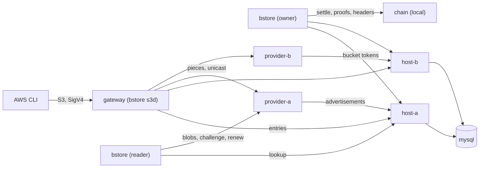

# Quickstart: a local development sandbox

No coin needed: a private regtest chain on your machine stands in for the
network. To use bstore on mainnet or testnet, start with
[docs/examples.md](docs/examples.md) instead; the last section here says
what changes.

In about fifteen minutes, on one machine: run two overlay hosts that carry
a bucket, two storage providers and an S3 gateway; make the bucket as its
owner; put a 20 MiB object through S3 with a bounty; judge the hold race,
in which both providers pass a challenge, and pay them by rank; anchor the
put; read it back through S3 and with a reader's verified `get`; buy a
challenge and a renewal as the reader; delete it and see `NoSuchKey`. No
coin is needed, because a local chain stands in for the network; the last
section says what changes on the real one.

You need [Docker](https://docs.docker.com/get-docker/) with Compose, the
[AWS CLI v2](https://docs.aws.amazon.com/cli/) for the S3 steps, and this
repository (or just its `deploy/quickstart/compose.yaml`).



Compose publishes these ports on loopback only: host-a's overlay API on
`127.0.0.1:8591`, host-b's on `127.0.0.1:8592`, host-a's terms route on
`127.0.0.1:8594`, and the S3 gateway on `127.0.0.1:9000` (`BSTORE_S3_PORT`).
The chain, the database and the providers are reachable only inside the
Compose network.

## 1. Start the local chain

```console
$ cd deploy/quickstart
$ docker compose up -d chain
$ docker compose run --rm certs
$ bs()   { who=$1; shift; docker compose run --rm -T -e BSTORE_HOME=/home/nonroot/.bstore/$who bstore "$@"; }
$ gw()   { docker compose run --rm -T gw "$@"; }
$ prov() { p=$1; shift; docker compose run --rm -T --no-deps $p "$@"; }
$ s3()   { AWS_ACCESS_KEY_ID=QUICKSTARTACCESSKEY AWS_SECRET_ACCESS_KEY=quickstart-secret-not-secret \
           AWS_DEFAULT_REGION=us-east-1 aws --endpoint-url http://127.0.0.1:9000 "$@"; }
```

`chain` is a stand-in for the network: it serves a node's API, mines every
transaction it is sent at once, and is the header source everything checks
proofs against. Nothing it mines is money. `certs` writes a throwaway CA
and a certificate for each provider: an advertised URL must be `https`.
`bs owner ...` runs the bstore command with the owner's home, `gw` runs it
on the gateway's own identity, `prov` runs a provider's command, and `s3`
the AWS CLI against the gateway.

The images are `ghcr.io/lightwebinc/bstore` (the command and the S3
gateway), `bstore-provider`, `bstore-host` and `bstore-devchain`, published
with each release for linux/amd64 and linux/arm64. To build them from a
checkout instead: `make docker-build` and `make docker-build-host
REFERENCE_HOST_IMAGE=<a reference overlay host image>`.

## 2. The owner and a reader

```console
$ INIT="-network regtest -node http://chain:8080 -settle rpc:http://chain:8080/rpc \
    -headers http://chain:8080 -hosts http://host-a:8080,http://host-b:8080 \
    -providers https://provider-a:8095,https://provider-b:8095 -ca /certs/ca.pem -fetch-private"
$ bs owner init $INIT
$ bs reader init $INIT
$ bs owner fund -blocks 101
```

Each home is one identity. `fund -blocks` is coinbase: only on a regtest
chain you run (development and tests). It mines to the home's fund
address; a coinbase spends after 100 more blocks, which is why the owner
mines 101. On a real network you pay the fund address from your own wallet
and import the payment with `fund -txid` instead.

## 3. The bucket, before any host carries it

```console
$ bs owner bucket new photos | tee bucket.txt
bucket photos_zzktyfefka
owner  03...
id     ba87...
served photos_zzktyfefka:03...:ba87...
topics tm_bstore_photos_zzktyfefka tm_bstoreblob_photos_zzktyfefka
bstore: anchor: incomplete: token 0 is mined and 2 target(s) have not taken it yet; ...
```

A host serves a chain only if it is told the bucket's id at start, and the
id exists only once the first token is minted. So the bucket comes first:
its first token is mined and kept (exit 3), and is delivered once the hosts
carry the topic. Put the lines the hosts, providers and gateway read into
`.env`:

```console
$ B=$(sed -n 's/^bucket *//p' bucket.txt) O=$(sed -n 's/^owner *//p' bucket.txt) I=$(sed -n 's/^id *//p' bucket.txt)
$ printf 'BSTORE_BUCKETS=%s\nBSTORE_SERVED=%s:%s:%s\nBSTORE_OWNER=%s\nBSTORE_ID=%s\n' "$B" "$B" "$O" "$I" "$O" "$I" > .env
$ echo "BSTORE_PAYEE_KEY=$(od -An -N32 -tx1 /dev/urandom | tr -d ' \n')" >> .env
$ S3B=$(printf %s "$B" | tr _ -)     # the S3 bucket name
```

## 4. Two providers and the gateway's identity

```console
$ for p in provider-a provider-b; do
    prov $p init -data /var/lib/bstore-provider
    prov $p fund -config /etc/bstore/provider.json -blocks 1
  done
$ docker compose run --rm -T --no-deps gateway s3d init -config /etc/bstore/gateway.json
identity gw 03...
$ docker compose run --rm -T --no-deps gateway s3d fund -config /etc/bstore/gateway.json -identity gw -blocks 2
$ bs reader fund -blocks 3            # several coins: a paid call holds one until mined
$ bs owner fund -blocks 100          # matures every coinbase above
$ GW=03...                           # the gateway identity's key
```

Each provider has its own identity and wallet: every advertisement it
makes is a mined transaction it pays for. Every `-blocks` here is
coinbase, on the sandbox's own chain. The gateway writes as the
identity `gw`, whose wallet lives in the gateway's data directory; its
configuration asks every put for a bounty of 3,000 satoshis, `t = 2`,
`K = 2`.

## 5. Start everything

```console
$ docker compose up -d
$ bs owner doctor            # both hosts and both providers answer
$ bs owner sync              # the first token, to both hosts
$ bs owner anchor -add-writer $GW
```

The owner's next token names the gateway's identity a writer: its entries
are anchored from now on.

## 6. A put through S3, with a bounty

```console
$ head -c 20971520 /dev/urandom > obj.bin
$ s3 s3api put-object --bucket $S3B --key photos/cat.bin --body obj.bin
```

The gateway builds the closure (5 blobs and a root), takes a hold output
minted ahead, sends the pieces to both providers' submit routes and the
entry to both hosts, and answers `200` once both hosts took the entry.
Each provider checks the closure and the bounty and advertises at once.

## 7. The hold race

The race is judged by the writer's own client. The gateway's identity is
used by one process at a time, so stop the gateway first:

```console
$ docker compose stop gateway
$ gw holds -watch 20s
race ...  key photos/cat.bin  open
  hold ....0  3000 satoshis  t 2  K 2  checkC 30  deadline ...
   1. 03...  first seen 10:02:11.412  passed  last: pass c=30
   2. 02...  first seen 10:02:11.412  passed  last: pass c=30
$ gw settle
    rank 1  03...  1758 satoshis  output 0  remitted
    rank 2  02...  1242 satoshis  output 1  remitted
$ docker compose start gateway
```

Each advertiser first seen in one look ties, broken by a key no provider
can grind before the entry exists; each is challenged free with 30 samples
at its own front. `settle` spends the hold output in one transaction to
each advertiser's derived key, by the square-root split, and sends each its
remittance.

## 8. Anchor

```console
$ bs owner anchor
minted 1 token(s): 1 change(s), 0 consumed
```

## 9. Read it back

```console
$ s3 s3api get-object --bucket $S3B --key photos/cat.bin got.bin && cmp obj.bin got.bin
$ bs reader -bucket $B bucket add $B -owner $O -id $I
$ bs reader -bucket $B get photos/cat.bin - -proof-root > got-reader.bin && cmp obj.bin got-reader.bin
```

Both reads prove the key against the owner's latest token and hold every
blob to its hash before using a byte of it; the reader's checks the proof
root too.

## 10. A challenge and a renewal, bought by the reader

```console
$ PA=$(prov provider-a address -config /etc/bstore/provider.json | sed -n 's/^identity //p')
$ bs reader -bucket $B challenge photos/cat.bin -provider $PA -c 30 -budget 1000
challenge of 03... at https://provider-a:8095/store/bstore/v1: pass (c = 30, paid 40)
  outcome record 9b...
$ bs reader sync
$ bs reader -bucket $B renew photos/cat.bin -provider $PA -days 7 -budget 2000
```

The challenge's outcome is published on the records topic, where anyone
reads it. The renewal is answered by a successor advertisement that spends
the old one, seven days later.

The local chain has no arcade, so a provider takes each payment and holds
it until it mines (a few seconds here): the challenge waits for that and
sends the same payment again (`-held-wait`, default 10m), and the renewal
answers `202 (paid ...)` and is made by the provider once the payment
mines.

## 11. Delete, anchor, NoSuchKey

```console
$ s3 s3api delete-object --bucket $S3B --key photos/cat.bin
$ bs owner anchor
$ s3 s3api get-object --bucket $S3B --key photos/cat.bin gone.bin   # NoSuchKey
$ bs reader -bucket $B get photos/cat.bin -                         # exit 1: proven absent
```

## 12. Nothing owed

```console
$ docker compose stop gateway && gw sync; gw due
nothing is due
```

## 13. Clean up

```console
$ docker compose --profile cli down -v
```

## What changes on a network

- The chain: no node is needed. Drop `node`, `settle` and `headers` and
  each configuration reads the chain from WhatsOnChain and broadcasts
  through GorillaPool's public arcade; set `-network main` or `test`
  (`mainnet: true` for a provider and a gateway on mainnet). Instead of
  `fund -blocks`, pay each fund address from your own wallet and import
  the payment with `fund -beef <file>` (the BEEF your wallet hands over)
  or `fund -txid <txid>` once it has a block. A node of your own
  (`chain asset:<url>`) is the better chain view, and a busy provider or
  gateway needs it or a WhatsOnChain API key (`woc_key`).
- Blocks every ten minutes: every step that waits for a block (a bucket
  token, a hold output, an advertisement, a settlement, an anchor) waits
  that long.
- Providers on public `https` URLs with real certificates, so no `ca` and
  no `fetch-private`.
- A host is a reference overlay host with the bstore module, carrying the
  bucket's records topic and naming its chain in `BSTORE_SERVED`
  ([docs/host.md](docs/host.md)).
- An incumbent UHRP host joins through `bstore-bridge` (its own
  repository).

[docs/user-guide.md](docs/user-guide.md) explains each role;
[docs/limits.md](docs/limits.md) what each step costs.
