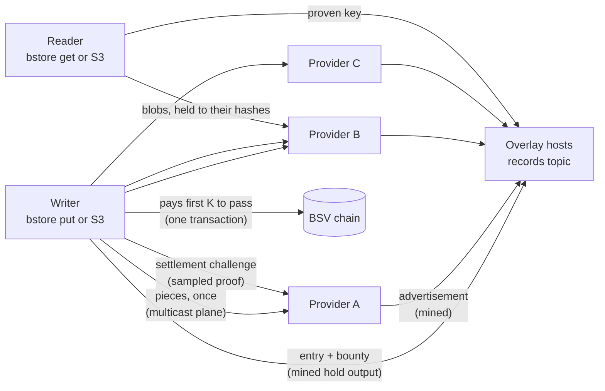
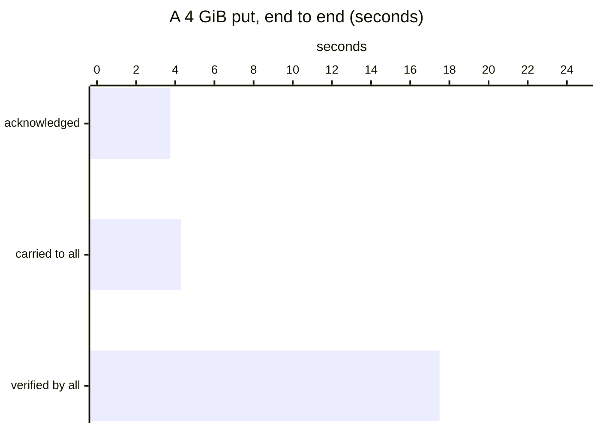

# bstore

**Storage as a market.** Object storage where the price is set by open
competition, every byte is proven before it is used, and no platform
stands between the people who write and the people who hold.

[](https://github.com/lightwebinc/bstore/actions/workflows/ci.yml)
[](https://github.com/lightwebinc/bstore/releases)
[](https://pkg.go.dev/github.com/lightwebinc/bstore)
[](go.mod)
[](LICENSE)

> [!WARNING]
> **Experimental software.** bstore is part of [bstack](https://github.com/lightwebinc/bstack),
> the applications and patterns built on [BSV Layered Multicast](https://github.com/lightwebinc/bsv-multicast).
> It is published to be built on and improved. Interfaces, formats and behavior may change
> rapidly between releases; pin an exact version.

A writer publishes an object once and names a bounty for holding it. Every
storage provider that holds the bytes advertises the fact on the BSV
blockchain and competes to settle the bounty by passing a settlement
challenge: a proof of retrievability, sampled and checked by the writer's
own client. The first `K` providers to pass are paid by the writer's own
transaction, by rank. Every record in the market is a mined, SPV-verifiable
transaction, so nobody trusts anybody, and there is no platform in the
middle to fail, to raise its price or to lock you in.

Writers and readers may speak S3. Providers run on commodity hardware and
set their own price per gigabyte per day. The bytes travel once, over a
multicast plane, to every provider of the bucket, however many there are.
bstore promises less and proves more.

> The TypeScript host module under `host/` is frozen: bug fixes only. New behavior goes to its Go twin under `module/`, written to bcommon's `module` contract and mounted by a Go overlay engine ([docs/host.md](docs/host.md#the-go-module)). The `bstore-host` image runs the TypeScript module.

## Why a market

| What you get | How bstore does it |
| --- | --- |
| No platform risk, no lock-in | Buckets, entries, holdings and payments are transactions on a public chain. Any compatible client reads them; any provider may serve them. |
| Verifiable durability | A challenge samples 4 KiB segments of an object and proves each into its proof root. You hold the proofs, not a dashboard's word. |
| Open competition sets the price | Providers publish their terms per GB per day. A writer's bounty goes to whoever holds and proves first; nobody negotiates. |
| Pay only for what is held and proven | A bounty is paid after a passed challenge, from the writer's own transaction, split by rank. Nothing is paid for a promise. |
| Your S3 tooling works unchanged | The gateway speaks S3 with SigV4. The AWS CLI, SDKs and most S3 clients need only an endpoint and keys. |
| Replicas by policy | `K` is the number of providers a writer pays and `t` the number it needs before it pays anyone. The writer chooses both per object. |
| Providers earn without a sales relationship | A provider subscribes to a bucket, holds what it chooses, advertises, and is paid by the chain. No contract, no account manager. |
| Everything auditable | Advertisements, settlements, renewals and published challenge outcomes are public records anyone can check against block headers. |
| Bytes delivered once | A put is carried over the multicast plane once; every subscribed provider receives the same bytes. Ten providers cost the writer one send. |

## How it works



1. **An object is a CHIRP closure** (BRC-167): 4 MiB blobs under a root
   node whose hash names the object everywhere. Pieces go to every provider
   of the bucket; a signed entry goes to the bucket's records topic.
2. **A bounty races the write.** The writer may lock a hold output. Each
   provider that checks the closure advertises it (a mined BRC-26
   advertisement). The writer's client ranks advertisers by first sight,
   challenges each, and pays the first `K` that pass with BRC-178's
   square-root split.
3. **Anyone can buy time or proof.** A renewal extends a holding; a
   challenge samples segments and proves each into the object's proof root.
   Outcomes may be published for everyone to read.
4. **The bucket proves its own listing.** The owner's chain of mined tokens
   commits to the whole key map, so a reader proves what a key names, that a
   key is absent, and that a listing page is complete.
5. **Two flows, one proof.** The bytes ride the data carrier and are never
   mined; what is mined is the proof. A 1 GiB put mines about 14 KB, and
   the link between the two is provable from block headers alone
   ([docs/limits.md](docs/limits.md#on-chain-and-off-chain)).
6. **Existing UHRP hosts join through a bridge**
   ([bstore-bridge](https://github.com/lightwebinc/bstore-bridge)) that
   speaks their HTTP routes. Current uhrp-server-basic releases need a
   one-line fix to commit CHIRP roots; the bridge checks before it pays.

**Honest about limits.** Availability is a market outcome, keys are not
copies, and enforcement is reputation in this version. The gateway's bounty
is flat per put, small objects under about 10 MB cost more than S3 by the
GB, and there are no public providers and no directory yet.
[docs/limits.md](docs/limits.md) has every bound and known limit;
[docs/architecture.md](docs/architecture.md) shows the pieces and how they fit.

## Measured

Measured on a lab fabric: one S3 gateway, one facade, a multicast plane and
two providers on commodity hosts. Details and method in
[docs/benchmarks.md](docs/benchmarks.md).



| Measure | Result |
| --- | --- |
| A 4 GiB put acknowledged by the S3 gateway | 3.75 s, about 1,145 MB/s |
| The same put carried over the multicast plane, lossless | 1,002 MB/s |
| Every provider verified the object | 15 to 18 s after the put |
| Small puts answered `200` by one gateway | 400 a second |
| Roots held and advertised by one provider | about 150 a second |

## Install

*Build the command line, the S3 gateway and a provider from the module.*

```bash
go install github.com/lightwebinc/bstore/cmd/bstore@latest
go install github.com/lightwebinc/bstore/cmd/bstore-provider@latest
```

Release tarballs for Linux and macOS (amd64, arm64), each with its
`SHA256SUMS` entry, are on the
[releases page](https://github.com/lightwebinc/bstore/releases). The
container images (`ghcr.io/lightwebinc/bstore`, `bstore-provider`,
`bstore-devchain`, `bstore-host`) are published with each release, built
from the [Dockerfile](Dockerfile) and [host/Dockerfile](host/Dockerfile); see
[docs/configuration.md](docs/configuration.md#container-images).

## On mainnet in five commands

No node is needed. By default the chain is read from WhatsOnChain (every
header held to its proof of work, every proof to those headers) and
transactions are broadcast through GorillaPool's public arcade. Your own
node (`-chain asset:URL`) is the better chain view, and every backend is a
setting ([docs/configuration.md](docs/configuration.md#networks-and-endpoints)).
You need only the overlay hosts that carry your bucket.

*Make an identity, print the address to fund it, and see the empty pool.*

```bash
bstore init -network main -hosts https://overlay-a.example.com,https://overlay-b.example.com
bstore fund
```

Send a small amount from your own wallet to the fund address (100,000
satoshis, 0.001 BSV, is ample to try every role but a bounty).

*Import the payment as the BEEF your wallet hands over, or by txid once it has a block.*

```bash
bstore fund -beef payment.beef
bstore fund -txid <txid of your payment>
```

*Make a bucket and put an object into it.*

```bash
bstore bucket new photos          # prints the "served" line your hosts add
bstore put photos/cat.jpg ./cat.jpg
```

*Read it back from any machine, every byte proven, with no coin at all.*

```bash
bstore bucket add photos_hmqzvtkwrx -owner 02... -id 5f...
bstore -bucket photos_hmqzvtkwrx get photos/cat.jpg ./cat.jpg -proof-root
```

Testnet is the same with `-network test`.
[docs/examples.md](docs/examples.md) walks each role on a real network,
with what each step costs.

## Documentation

| If you want to | Read |
| --- | --- |
| Do a task on mainnet or testnet: fund, make a bucket, put, read, challenge, renew | [docs/examples.md](docs/examples.md) |
| Learn the ideas and the day-to-day use, by role | [docs/user-guide.md](docs/user-guide.md) |
| See the numbers and how they were measured | [docs/benchmarks.md](docs/benchmarks.md) |
| See the components, the data flow and the code layout | [docs/architecture.md](docs/architecture.md) |
| Look up a flag, an environment variable, a config key or an image | [docs/configuration.md](docs/configuration.md) |
| Look up a command and what it does, step by step | [docs/usage.md](docs/usage.md) |
| Know the bounds, what each operation costs, and the known limits | [docs/limits.md](docs/limits.md) |
| Run a storage provider | [docs/provider.md](docs/provider.md) |
| Run the S3 gateway, and what S3 clients can do through it | [docs/s3.md](docs/s3.md) |
| Run an overlay host that carries buckets | [docs/host.md](docs/host.md) |
| Try everything on one machine: a local development sandbox (no coin needed, a private regtest chain) | [QUICKSTART.md](QUICKSTART.md) |
| Implement a compatible writer, provider, host or reader | [docs/spec.md](docs/spec.md) (the specification) |
| Know what cannot change once published | [docs/frozen.md](docs/frozen.md) |
| Use or check the codec and its golden vectors | [docs/codec.md](docs/codec.md) |

## Building

*Build everything from a checkout: binaries, the host module and the images.*

```bash
cd host && npm ci && cd ..
make verify NODE=/path/to/node24
make bstore bstore-provider       # bin/: the command line (and bstore s3d), the provider
make module NODE=/path/to/node24  # host/bundle/bstore-module.js
make docker-build                 # the images
```

Go 1.27.2 and Node 24. bstore pins go-sdk v1.7.1 and bcommon v0.33.14-0.20261110190038-8f3bc195c090
(exact tags in `go.mod`, asserted by `make verify`).

## License

Apache License 2.0. See [LICENSE](LICENSE), and [NOTICE](NOTICE) for the
third-party software and standards.
