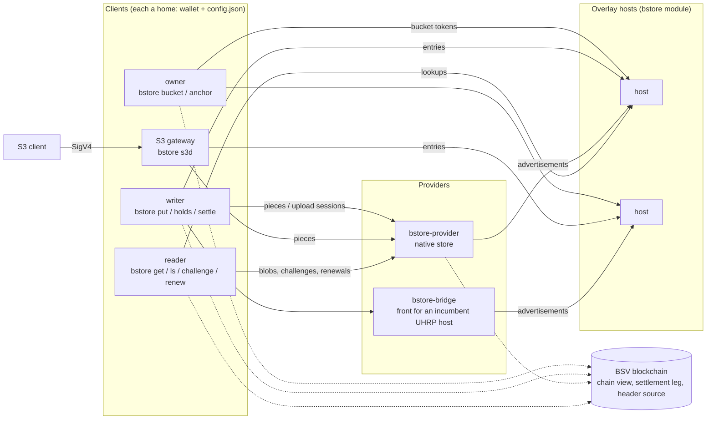

# Architecture

bstore is object storage as a market. This page names the parts, what each
holds and trusts, how an object moves through them, and where each lives in
the code. The contract (every byte format and rule a compatible
implementation must meet) is [spec.md](spec.md); this page is the map.

## The parts

| Part | Binary or artifact | Holds | Trusts |
| --- | --- | --- | --- |
| A home (owner, writer, reader) | `bstore` | one identity: its wallet, funding trees, outbox, hold races, the chains it owns, the closures it built | its own header source; everything else is checked |
| The S3 gateway | `bstore s3d` | one home per writer identity, a local store of its own writes, pending entries | as a home; S3 clients by their access keys |
| A provider | `bstore-provider` | the closures it chose to hold, its advertisements, its payment ledger | its header source and chain view; a writer's pieces only once checked |
| A bridge | `bstore-bridge` (its own repository) | segment hashes only; the incumbent keeps the bytes | the incumbent's answers, each checked against the closure |
| A host | an overlay host loading `host/bundle/bstore-module.js` (or the `bstore-host` image) | the bucket's records topic: tokens, entries, advertisements, outcomes, front statements | its header source |
| The chain | a chain view (WhatsOnChain by default, or a node's asset API), a settlement leg (GorillaPool's arcade by default), a header source (WhatsOnChain by default) | mined funding trees, hold outputs, bucket tokens, advertisements, settlements | |

Nobody is believed on their word. A host is a replica of records anyone
can check; a provider's bytes are held to their hashes; a reader proves a
key against the owner's latest token and its own headers.

## An object's life

1. **Bucket.** The owner's `bstore bucket new` mines a chain tree and the
   first token, naming the writers. A host serves the chain once its
   operator adds the `served` line.
2. **Put.** The writer's client streams the content into a CHIRP closure
   (4 MiB blobs under a root node) and a proof root over 4 KiB segments.
   Each piece rides an unmined carrier spending one mined funding output;
   the signed entry rides another. Pieces go to the providers (by the
   plane, as piece carriers to each provider's `/submit`, or by BRC-167
   upload session); the entry goes to the hosts. With a bounty, a hold
   output minted ahead is named in the entry.
3. **Hold.** Each provider checks the closure and the proof root, decides
   by its policy, and advertises (a mined BRC-26 advertisement).
4. **Race.** The writer's client ranks advertisers by first sight,
   challenges each at its front, and once `K` pass (or the window closes
   with `t`), settles: one transaction spends the hold output to each
   winner's derived key by BRC-178's square-root split, and each winner is
   sent its remittance.
5. **Anchor.** The owner's `bstore anchor` folds the writers' entries into
   the next token, which commits to the whole key map.
6. **Read.** A reader proves the key against the latest token, fetches
   every blob from the root's advertisers, holds each to its hash, and
   writes the file whole or not at all.
7. **Time and proof.** Anyone buys a challenge (samples proven into the
   proof root) or a renewal (a successor advertisement spending the old).

## Money

Every mined transaction is paid from the pool of the identity that makes
it. A pool is funded by paying the identity's fund address from the user's
own wallet and importing the payment with `fund -txid`
([examples.md](examples.md)). Carriers are never mined: a put costs its
funding outputs, the hold output's transaction and the bounty, not block
space for its bytes. [limits.md](limits.md) gives measured sizes and fees.

The `-blocks` and `-from` funding flags, the `devchain` binary and
`internal/testwriter` are coinbase: only on a regtest chain you run
(development and tests).

## The code

| Path | What |
| --- | --- |
| `cmd/bstore` | the command line: homes, owner tooling, writer, reader, and `bstore s3d` |
| `cmd/bstore-provider` | the provider's command |
| `cmd/devchain` | the local stand-in chain of the development sandbox (bcommon `testchain` over HTTP) |
| `cmd/vectors` | writes and checks the golden vectors under `testdata/vectors` |
| `storerec` | the byte-level contract: records, entries, pieces, outcomes, front statements, challenges, the key map, settlement, advertisements, a reader's checks |
| `provider` | the provider: receiving, checking, the hold policy, advertising, challenges, renewals, settlement, serving |
| `backend` | the hold-backend interface (frozen) and the native content-addressed store |
| `auth104` | the server side of BRC-103/104 mutual authentication, with its hardening |
| `internal/publish` | the publisher: staging, carriers, delivery, the outbox, the race, settlement, reclaim, paid calls |
| `internal/anchor` | the owner's tooling: chain creation and anchoring |
| `internal/reader` | the verified reader |
| `internal/s3d` | the S3 gateway |
| `internal/chaincfg` | the chain view, header source, settlement leg and fee policy every configuration names, and importing a payment (BEEF or txid) to a fund address into a pool |
| `internal/efleg` | attaching inputs' source transactions for Extended Format settlement legs |
| `internal/acceptcfg` | the payment acceptance settings shared by every configuration |
| `host/` | the TypeScript host module: topic managers, `ls_bstore`, the terms route, retention |
| `deploy/quickstart` | the development sandbox's Compose file |

bstore builds on [bcommon](https://github.com/lightwebinc/bcommon) (wallet,
carriers, minting, fee policy, headers, the chain views, payment acceptance) and
[go-sdk](https://github.com/bsv-blockchain/go-sdk). The Go codec in
`storerec` and the TypeScript twin in `host/src` read the same golden
vectors ([codec.md](codec.md)).
