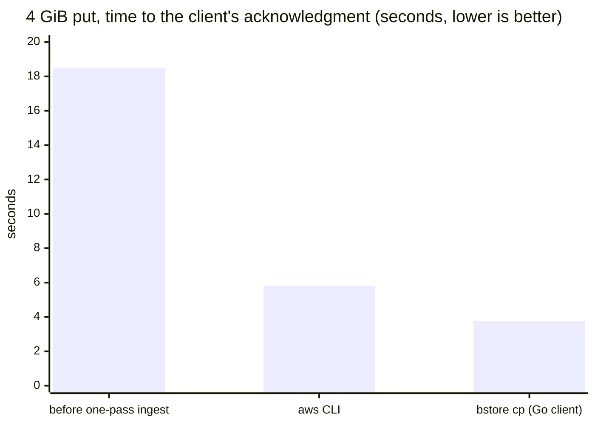
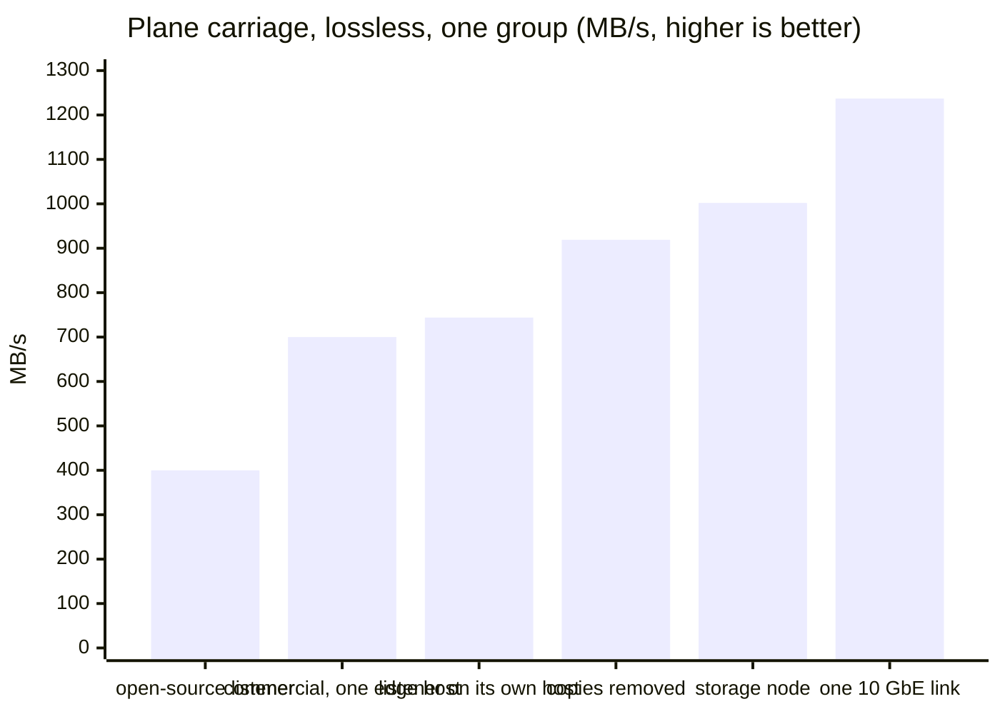
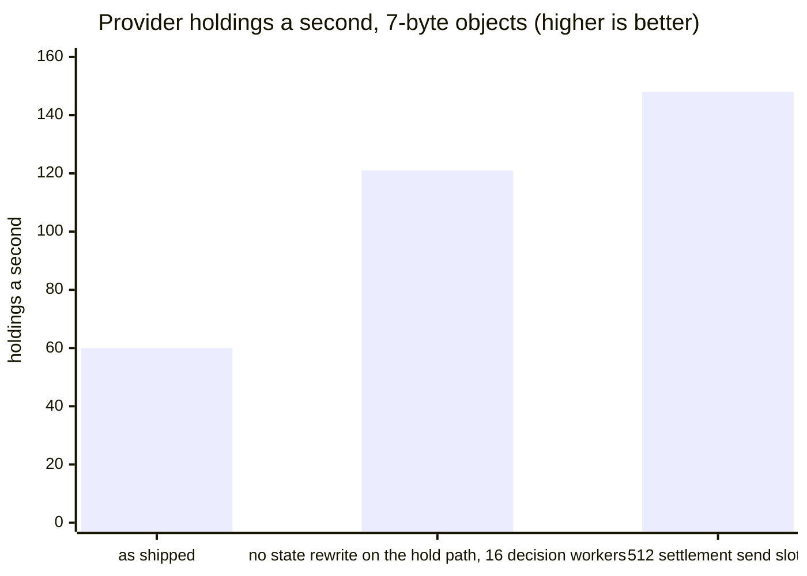

# Benchmarks

What bstore does with the bytes, measured end to end on a lab fabric. Every number here was
taken from a run, not a model, and each one says what bounds it. The point of the page is not
the figures themselves but their shape: a put is acknowledged at the speed of the network, the
providers hold and prove the object seconds later, and the chain's part of the work is a small
number of transactions, not a copy of the bytes.

## The rig

One gateway, one facade, one multicast edge, two providers. Each is a desktop-class host with a
16-thread CPU, dual 10 GbE ports bonded to one switch, an NVMe drive for the spool and, for the
provider stores, a tmpfs so that the drive's write rate is out of the picture (the drives' burst
write is 2 GB/s and their sustained rate far lower; a production provider sizes its disks for the
rate it sells).

```text
  client ──TLS/S3──▶ gateway ──TCP lane──▶ facade ──TCP lane──▶ commercial edge
                                                                    │ multicast, once
                                                        ┌───────────┴───────────┐
                                                     provider A              provider B
                                                     (verify, hold,          (verify, hold,
                                                      advertise)              advertise)
```

The gateway is an ordinary `bstore` S3 endpoint serving TLS. The facade is the host that puts the
gateway's records and pieces on BSV Layered Multicast. The edge is the commercial proxy and
listener of a 1BSV fabric; the open-source listener is what the numbers call "open-source". The
settlement leg is an Arcade instance in front of a Teranode, mining the lab's own chain.

## A 4 GiB put

```bash
# a 4 GiB body, 64 MiB parts, 16 in flight, over TLS
bstore cp -endpoint https://gateway.example:19002 -ca ca.pem -part 64MiB -conc 16 \
    body.bin s3://plane-bucket/obj/body.bin
```

_The Go client's put: the body moves on both bond members and the gateway answers once the object is staged and its carriers are in the synced outbox._



_The same object, acknowledged in 3.75 s (1,145 MB/s) once the gateway hashed the body in one pass, wrote its spool with two writers, answered from the outbox and minted the carriers afterward; the aws CLI spends most of its 5.8 s hashing the body in Python before the first byte moves._

| Phase | Measured | What bounds it |
| --- | --- | --- |
| Body into the gateway, Go client | 2.7 s, peak 2.0 GB/s in and 1.9 GB/s written | two bond members; the gateway's hashing and TLS at 56 to 73% of 16 threads |
| Body into the gateway, aws CLI, multipart x16 | 3 s of transfer after 7 s of client-side hashing | the CLI's own SHA-256 pass on one core |
| Put acknowledged, Go client | 3.75 s end to end, 1,145 MB/s | the body's transfer; the carriers are minted after the answer |
| Put acknowledged, aws CLI | 5.8 s | the CLI |
| Every provider holds the object verified | 15 s after the put | the plane's carriage rate below |
| Reading 4 GiB back, one stream | 894 MB/s | one TCP flow on one bond member |
| Ranged reads | 1.5 GB/s | both bond members |

## Carrying the pieces: the plane

A put's 1,024 pieces of 4 MiB leave the facade once, as multicast, and every provider that
subscribes to the bucket receives them. Adding a provider adds no upload.



_The open-source listener processes each datagram between reads and drops above about 400 MB/s; the commercial listener reads each socket in batches into a queue and carried every run without a drop at peaks of 700 MB/s on one edge host, 744 MB/s with the listener on a host of its own and the group forwarded to that host alone, and 919 MB/s once the copies on the way were removed (bstore v0.23.0: each piece read in place rather than copied out of the carrier; the lane read straight into its buffers; the retry cache given room), and 1,002 MB/s with the gateway as a storage node (bstore v0.25.0: its provider in process, each carrier minted with one copy of its piece, and the closure walk off the hand-off's path). The last bar is what one 10 GbE link moves (9.9 Gb/s, measured with iperf), the ceiling the lane is working toward._

At about 1 GB/s the lane's one TCP flow fills four fifths of a 10 GbE link, and more pieces in
flight at the gateway (16 workers rather than 12) move the wait to the edge without raising
the rate: the next step up is the link, not the software. A storage node (gateway and provider
in one process) costs about 11 cores per GB/s on the lab's hosts, most of it the three
SHA-256 passes a signed carrier needs over its 4 MiB.

Loss on the plane is repaired by the network: a listener that misses a datagram asks the retry
endpoint for it by number. A 4 GiB object is one chain of about 490,000 fragments, and a fleet
whose per-chain repair budget was sized for small objects could not repair it (five objects
expired unrepaired in one run); the perf fabric runs with that budget raised, and the fleet's
values are a matter of configuration.

## Small objects

Small objects stress a different path: every object is its own entry, hold output and, at each
provider, an advertisement on the chain. The question is how many a second the system takes.

```bash
# 400 seven-byte puts a second, 8 in flight, answered 200
bstore bench put s3://plane-bucket/small/ -n 24000 -size 7 -conc 8 \
    -endpoint https://gateway.example:19002 -ca ca.pem
```

_The gateway answers 400 a second with every put a 200 and a median of 240 ms on a clean state._



_Each bar is the same rig after one thing was taken off the provider's hold path: first the whole-state save it made under its mint lock (a 247 MB file rewritten every 16 advertisements, replaced by an append-only log with checkpoints), then the wait for a settlement send slot._

At 148 a second the rate was bounded by the settlement leg: one advertisement transaction per
root, and a node announces about 150 transactions a second however many are in flight. bstore
now mints one advertisement transaction for every root it holds within a short window, an output
per root (the specification admits up to 1,024 a transaction), and goes on once the leg has taken
it, with the Merkle proof as the evidence that it stands. The rate past that change is measured
next.

| Measure | Result |
| --- | --- |
| Gateway, seven-byte puts, 8 in flight | 400 a second, all 200, p50 240 ms |
| Provider holdings a second, one advertisement a root | 148, bounded by the leg's verdict rate (about 150 transactions a second) |
| Advertisements in one transaction, in the unit test | 12 roots held at once in 3 transactions |

## What the hardware does

The figures bstore is measured against, from the same hosts and switch.

| Limit | Measured |
| --- | --- |
| TCP, one stream | 9.9 Gb/s (one bond member) |
| TCP, one host pair, 8 to 16 streams | 18.4 to 19.8 Gb/s |
| UDP, 8,948-byte datagrams, one flow | 9.9 Gb/s, 139k packets a second, no loss |
| NVMe sequential write / read | 2.1 / 3.0 GB/s (burst; sustained writes far lower on these drives) |
| SHA-256, one core | 2.1 GB/s |

## Reading these numbers

- A put's cost to the writer is the transfer. Hashing, spooling, minting and publishing happen
  behind the acknowledgment or beside it, and the figures above say which.
- The plane's rate is a property of the edge host, not of the group: one group carried every run.
- The chain never carries the bytes. A 4 GiB put is a handful of transactions and a few thousand
  satoshis whatever the object's size; the plane carries the pieces.
- Every figure is from one lab fabric with its own chain and its own settlement node. A public
  network's numbers are its own, and a provider's price is its own too.
