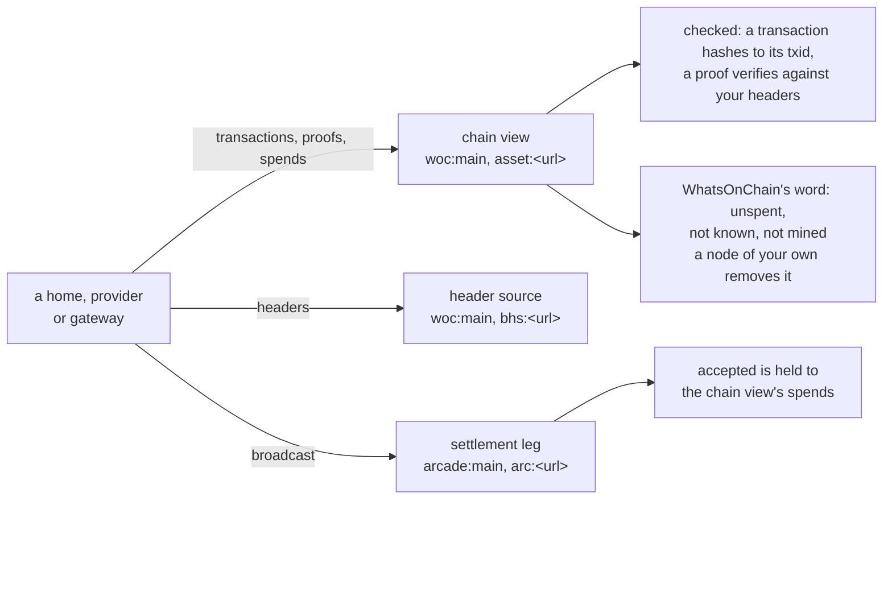

# Configuration

Every flag, environment variable and configuration key of the bstore
commands and images, from the code. The servers' longer tables live with
their guides and are linked here: the provider's in
[provider.md](provider.md#configure), the S3 gateway's in
[s3.md](s3.md#configure) and the host module's in
[host.md](host.md#configuration). [usage.md](usage.md) says what each
command does.

## Networks and endpoints

The same settings recur in every configuration: the network, the chain view
(where transactions, proofs and spends come from), the header source, the
settlement leg and the miner fee. **No node is needed on mainnet or
testnet**: with none of them set, the defaults are the zero-infrastructure
profile below. Every backend is a setting, and a node of your own is the
better chain view.

| Setting | Values |
| --- | --- |
| network | `main` (mainnet), `test` (testnet), `regtest` (a chain you run). For the provider and the gateway, `mainnet: true` or `false` selects the fund address form and the default services (`false` is testnet; a regtest chain sets every endpoint) |
| chain | the chain view: `woc:main` or `woc:test` (WhatsOnChain, the default for the network), `asset:<url>` (a Teranode asset API, yours or one you are given access to), or a comma-separated list, each item optionally serving one method (`tx=`, `proof=`, `spend=`, `known=`): `asset:<url>,woc:main` asks the node and then WhatsOnChain for what it lacks; `woc:test,spend=asset:<url>` takes spends from the node only. `woc_key` and `woc_rate` are a WhatsOnChain API key and its requests a second. The older key `node` (a node's asset API URL) still works and means `asset:<url>`; set one of them |
| settle | the settlement leg transactions are broadcast through: `arcade:main` or `arcade:test` (GorillaPool's public arcade, no key; the default for the network), `arcade:<url>` (any arcade, your own included), `arc:<url>` (an ARC installation, opt-in; TAAL's needs a key), `rpc:<url>` (a node's JSON-RPC, with `rpc_user`, `rpc_pass`) or `tcp:<host:port>` (a fabric ingress). `arcade_key` is the bearer token of an arcade or ARC leg. Payment acceptance before a block (`accept_threshold_sats`) needs arcade or ARC |
| headers | the header source proofs are checked against: `woc:main` or `woc:test` (the public WhatsOnChain API, the default for the network), `bhs:<url>` (a [block-headers-service](https://github.com/bsv-blockchain/block-headers-service); `headers_token` is its bearer token), `arcade:<url>` (the header server an arcade installation embeds), `chaintracks:<url>` (a chaintracks v2 service), or a bridge URL (an overlay bridge's native `/v1/root/<height>` and `/v1/tip`, which carries no proof of work to check). Every kind but a bridge serves the header fields, and every header is hashed and held to the proof of work its bits claim |
| fee | the miner fee policy, a block (below); the default is the network's rate, 100 satoshis per 1000 bytes, with a 100 satoshi floor, never more than 100 per 1000 bytes. The older keys `fee_sat_per_byte` and `fee_floor` still work, held to the same cap |

The zero-infrastructure profile, what an unset network gets:

| Role | mainnet | testnet |
| --- | --- | --- |
| chain view | `woc:main` | `woc:test` |
| headers | `woc:main` | `woc:test` |
| settle | `arcade:main` | `arcade:test` |

The three services every configuration names, and what is checked or
trusted from each:



What is trusted and what is checked: a transaction from the chain view
must hash to its txid and every proof must verify against your headers,
so a wrong answer is refused, never believed. "Unspent", "not known" and
"not mined" cannot be checked: they are WhatsOnChain's word (only its "known
and unspent" answer reads as unspent, never its "unknown"). A node of your
own (`asset:<url>`, or `spend=asset:<url>` for the spend view alone)
removes that trust. Arcade can answer "accepted" for a transaction whose
input was already spent, so its verdict is held to the chain view's spends.

WhatsOnChain's free tier allows 3 requests a second, and every chain view
paces itself to it. A home that publishes now and then stays well inside
it. **A busy provider or gateway exceeds it**: give it a WhatsOnChain API
key (`woc_key`, with `woc_rate` raised to the plan's rate) or a node
(`chain: asset:<url>`).

The `chain` grammar is bcommon's `nodeapi.ParseChain`; see
[chain views](https://github.com/lightwebinc/bcommon/blob/main/docs/configuration.md#chain-views-nodeapi-interfaces)
for how each backend is asked and checked.

A regtest chain you run has no public services: set `chain` (or `node`),
`settle` and `headers` (the [quickstart](../QUICKSTART.md)'s `devchain`
serves all three).

### The fee block

| Key | Default | Meaning |
| --- | --- | --- |
| `fee.rate` | `{"satoshis": 100, "bytes": 1000}` | satoshis per bytes of the signed transaction, as miners publish it |
| `fee.floor` | 100 | the least fee a transaction pays |
| `fee.dust` | 100 | the least change kept as an output; less goes to the fee |
| `fee.source` | `static` | `static`, or `arc`: the policy the broadcaster publishes (`GET /v1/policy`), refreshed every 5 minutes, held to `min_rate` and `max_rate`, falling back to the static rate. Opt-in |
| `fee.policy_urls` | the settlement leg's arcade or ARC | where `source: arc` reads the policy |
| `fee.min_rate`, `fee.max_rate` | `100/1000`, `100/1000` | the bounds a live policy is held to; `max_rate` also caps `rate` (and the older `fee_sat_per_byte`): a miner charging more is refused until `max_rate` is raised |
| `fee.max_tx` | none | the most one transaction may pay in fee (a funding tree, token, payment, sweep, hold outputs, payment coin split, settlement or reclaim); above it, it is refused rather than paid |
| `fee_sat_per_byte`, `fee_floor` | none | the older keys: `rate {fee_sat_per_byte, 1}` and `floor`. Either beside the `fee` key it aliases is refused |

```json
"fee": {"rate": {"bytes": 1000, "satoshis": 100}, "floor": 100, "source": "static"}
```

## bstore

### Global flags

| Flag | Default | Meaning |
| --- | --- | --- |
| `-home DIR` | `$BSTORE_HOME`, else `~/.bstore` | the identity's home |
| `-bucket B` | `config.json`'s `bucket`, else the only bucket listed | the bucket: its identifier, or its S3 name (`-` for `_`) |
| `-hosts URLS` | `config.json`'s `hosts` | overlay hosts, comma separated, for this run |
| `-v` | off | verbose: the log on standard error |
| `-version` | | print the version (also `bstore version`) |

`-v` and `-bucket` are accepted after a command's name too.

### Environment

| Variable | Meaning |
| --- | --- |
| `BSTORE_HOME` | the home when `-home` is not given |
| `BSTORE_COMMIT` | how synced writes reach the disk: `auto` (default) group-commits them on XFS (Linux), where that measured faster, and syncs each alone elsewhere; `group` group-commits them everywhere (one `syncfs` per group on Linux, an `fsync` per file and directory elsewhere); `direct` syncs each alone |

### Command flags

| Command | Flags |
| --- | --- |
| `init` | `-network` (`main`, `test`, `regtest`; default `main`), `-chain SPEC` (default `woc:<network>`), `-node URL` (the older `-chain asset:URL`), `-settle LEG` (default `arcade:<network>`), `-headers SPEC` (default `woc:<network>`), `-woc-key KEY`, `-woc-rate N`, `-fee-rate SATS/BYTES`, `-fee-source static\|arc`, `-fee-floor SATS`, `-fee-max-rate SATS/BYTES`, `-fee-max-tx SATS`, `-refuse-unmined`, `-hosts URLS`, `-facade URL`, `-providers URLS`, `-uploads URLS`, `-ca FILE`, `-fetch-private` |
| `fund` | none: print the fund address and pool. `-beef FILE` (or `-` for standard input; bytes or hex): import a payment you sent to the fund address from the BEEF your wallet handed over, with no lookup; a payment not mined yet is taken when every transaction it spends is proven, and its outputs wait until it mines, unless `-refuse-unmined` (or `refuse_unmined`). `-txid TXID`: import a mined payment by its txid (mainnet, testnet). `-blocks N`; `-from H` `[-to H]`: **coinbase: only on a regtest chain you run (development and tests)**. `-from` finds coinbase only, never an ordinary payment |
| `doctor`, `sync`, `fill`, `due` | none |
| `terms URL` | none |
| `bucket new NAME` | `-writers K1,K2` |
| `bucket add BUCKET` | `-owner KEY`, `-id HEX` |
| `bucket list` | none |
| `anchor` | `-add-writer KEY` (repeatable), `-remove-writer KEY` (repeatable), `-dry-run` |
| `put KEY [FILE\|-]` | `-type MIME`, `-meta k=v` (repeatable), `-max BYTES` (default 2^43), `-bounty SATS`, `-t N`, `-k N`, `-retention SECONDS`, `-deadline BLOCKS`, `-check-c N`, `-no-bounty` |
| `cp SRC DST` | `-to BUCKET`, and the bounty flags of `put` |
| `rm KEY` | none |
| `get KEY [OUT\|-]` | `-proof-root` |
| `ls [PREFIX]` | `-after KEY`, `-max N` |
| `holds` | `-entry TXID`, `-watch DURATION`, `-budget SATS` |
| `settle` | `-entry TXID`, `-close`, `-wait DURATION`, `-budget SATS` |
| `reclaim` | `-entry TXID`, `-unused` |
| `challenge KEY` | `-provider KEY`, `-c N` (default 30), `-budget SATS`, `-nonce HEX`, `-front URL`, `-answerer KEY`, `-no-publish` |
| `renew KEY` | `-provider KEY`, `-until UNIX` or `-days N`, `-budget SATS`, `-front URL` |
| `kill` | `-confirm KILL`, `-yes` |

### config.json

`bstore init` writes it in the home; an unknown key is refused.

| Key | Default | Meaning |
| --- | --- | --- |
| `network` | required | `main`, `test` or `regtest` |
| `chain` (`woc_key`, `woc_rate`), `settle` (`rpc_user`, `rpc_pass`, `arcade_key`), `headers` (`headers_token`) | `woc:<network>`, `arcade:<network>`, `woc:<network>`; a regtest chain has none | the chain view, the settlement leg, the header source (above). `node`, the older key, is `chain: asset:<url>` |
| `hosts` | required | the overlay hosts asked and written to |
| `facade` | none | the plane: pieces and records are submitted to it once |
| `providers` | none | providers' submit routes: without a facade, entries (and piece carriers) go to each |
| `uploads` | none | providers' public URLs: without a facade, a closure goes to each by BRC-167 upload session instead of as piece carriers, and the entry to the submit route at each URL's origin |
| `quorum` | 1 | hosts that must take an entry when there is no facade |
| `ca`, `fetch_private` | none, false | certificates trusted besides the system's; whether advertised URLs at loopback, private or link-local addresses are reached |
| `bounty` | none | what a put asks for unless told otherwise: `satoshis`, `t`, `k`, `retention_seconds`, `deadline_blocks`, `check_c` |
| `hold_ahead` | 16,384 | mined hold outputs of a bounty kept ready: the puts one block interval absorbs (27 a second on a ten-minute chain); each locks its bounty until its race ends, and a wallet too small fills what it can |
| `hold_tree` | 1,024 | hold outputs one transaction carries (a hold tree), at most 1,024, what hosts admit of a mined transaction |
| `race_window_seconds` | 3600 | the writer's race window |
| `publish_outcomes` | true | publish failed settlement challenges and every challenge's outcome as outcome records |
| `piece_tree`, `entry_tree` | 256, 1,023 | outputs of a new funding tree (outcome trees take `entry_tree`); trees are minted ahead, in the background, to keep `piece_ahead` and `entry_ahead` outputs ready, so a put of up to `piece_tree` pieces never waits for a block |
| `fee` | 100 satoshis per 1000 bytes, floor 100, cap 100/1000 | the miner fee policy ([the fee block](#the-fee-block)); `fee_sat_per_byte` and `fee_floor` are its older keys |
| `refuse_unmined` | false | `fund -beef` takes mined payments only |
| `accept_threshold_sats` | 25000000 | a settlement whose largest payout is at or below it is remitted once arcade says the network took it and the chain view shows its inputs spent by it alone, before it mines (race state `remitted`); above it, remitted once mined. Needs settle through arcade or ARC |
| `accept_payer_limit`, `accept_total_limit`, `accept_window_seconds`, `accept_watch_seconds` | one and ten thresholds, 3600, 0 | the rest of the acceptance rule, as for a provider ([provider.md](provider.md)) |
| `buckets`, `bucket` | none | the chains this home reads and writes (`{"bucket", "owner", "id"}`), and the one used unless `-bucket` names another |

A mainnet home with no node (WhatsOnChain and GorillaPool's arcade by
default):

```json
{
  "network": "main",
  "hosts": ["https://overlay-a.example.com", "https://overlay-b.example.com"],
  "providers": ["https://provider.example.com"],
  "buckets": [{"bucket": "photos_hmqzvtkwrx", "owner": "02...", "id": "5f..."}]
}
```

The same home with a node of its own as the chain view and its own
arcade:

```json
{
  "network": "main",
  "chain": "asset:https://node.example.com",
  "settle": "arcade:https://arcade.example.com",
  "headers": "woc:main",
  "hosts": ["https://overlay-a.example.com"]
}
```

### The home's files

| Path | Holds |
| --- | --- |
| `config.json` | the configuration |
| `wallet/` | the identity key and the pool; `wallet/paycoins.json` the small coins paid calls take |
| `store/` | the closures this home built |
| `outcomes.jsonl` | every challenge's outcome |
| the rest | funding trees, the outbox, hold races and the chains it owns |

Back the home up: the wallet is the identity. One process uses a home at a
time.

## bstore s3d

`bstore s3d <command> -config FILE`; the configuration file is in
[s3.md](s3.md#configure).

| Command | Flags |
| --- | --- |
| `init` | `-config FILE`: create every identity's wallet |
| `address` | `-config FILE -identity NAME` |
| `fund` | `-config FILE -identity NAME -beef FILE` (or `-`; `-refuse-unmined`): import a payment you sent to the identity's fund address from its BEEF. `-txid TXID`: import a mined payment by its txid (mainnet, testnet). `-blocks N`: **coinbase: only on a regtest chain you run (development and tests)** |
| `rescan` | `-config FILE -identity NAME -from H [-to H]`: **coinbase: only on a regtest chain you run (development and tests)** |
| `run` | `-config FILE` |

The configuration's keys: `data`, `listen`, `tls_cert`, `tls_key`,
`etag_md5`, `region`, `domain`, `chain`, `node`, `settle`, `rpc_user`, `rpc_pass`,
`arcade_key`, `headers`, `headers_token`, `woc_key`, `woc_rate`, `hosts`,
`facade`, `providers`, `quorum`, `ca`, `fetch_private`, `identities`,
`access_keys`, `buckets`, `bounty`, `hold_ahead`, `limits.*`,
`piece_tree`, `entry_tree`, `piece_ahead`, `entry_ahead`, `piece_workers`, `fee`,
`fee_sat_per_byte`, `fee_floor`, `mainnet`, `refuse_unmined`, the
`accept_` keys, `race.*`, `store_bytes`, `outbox_bytes` and
`metrics_listen`. `chain`, `settle` and `headers` default to the
zero-infrastructure profile for the network `mainnet` selects.

## bstore-provider

`bstore-provider <command> [flags]`; the configuration file is in
[provider.md](provider.md#configure).

| Command | Flags |
| --- | --- |
| `init` | `-data DIR` |
| `address` | `-config FILE` |
| `fund` | `-config FILE -beef FILE` (or `-`; `-refuse-unmined`): import a payment you sent to the fund address from its BEEF. `-txid TXID`: import a mined payment by its txid (mainnet, testnet). `-blocks N`: **coinbase: only on a regtest chain you run (development and tests)** |
| `rescan` | `-config FILE -from H [-to H]`: **coinbase: only on a regtest chain you run (development and tests)** |
| `run` | `-config FILE` |
| `doctor` | `-config FILE`, `-ca FILE` (a PEM file trusted for the front's certificate) |
| `version` | |

The configuration's keys: `data`, `listen`, `tls_cert`, `tls_key`,
`public_url`, `chain`, `node`, `settle`, `rpc_user`, `rpc_pass`,
`arcade_key`, `headers`, `headers_token`, `woc_key`, `woc_rate`, `hosts`,
`facade`, `uhrp_topic`, `buckets`, `backend`, `export`, `quota_bytes`,
`unclaimed_bytes`, `unclaimed_seconds`, `policy.*`, `terms.*`,
`limits.*`, `tree_count`, `tree_sats`, `fee`, `fee_sat_per_byte`,
`fee_floor`, `mainnet`, `refuse_unmined`, `trusted_proxies`, `feeders`,
`feed_listen`, `metrics_listen`, `pprof_listen` and the `accept_` keys. `chain`, `settle` and `headers`
default to the zero-infrastructure profile for the network `mainnet`
selects; a busy provider needs `woc_key` or a node.

## The host module

Environment variables of an overlay host loading the module, all
`BSTORE_`: `BUCKETS`, `STATE_DIR`, `HEADERS_URL`, `SERVED`, `KEEP_DAYS`,
`PENDING_DAYS`, `OTHER_HOURS`, `MAX_BEEF`, `MAX_SWEEP_INPUTS`, `LISTEN`,
`PRICES`, `PAYEE_KEY`, `SESSIONS`, `SESSION_TTL`, `HANDSHAKES_PER_SEC`,
`HANDSHAKE_BURST`, `HANDSHAKES_PER_ADDR_PER_SEC`, `HANDSHAKE_ADDR_BURST`,
`RESPONSES_PER_SEC`, `RESPONSE_BURST`, `ARCADE_URL`, `ASSET_URL` (or
`CHAIN`, `woc:main` or `woc:test`, with `WOC_KEY`, for a host with no
node), `ACCEPT_THRESHOLD_SATS`, `ACCEPT_PAYER_LIMIT`, `ACCEPT_TOTAL_LIMIT`,
`ACCEPT_WINDOW` and `ACCEPT_WATCH`, with the host's own `OVERLAY_*`
settings. Defaults and meanings: [host.md](host.md#configuration).

## devchain

The local stand-in chain of the development sandbox: **coinbase: only on a
regtest chain you run (development and tests)**. Nothing it mines is money.

| Flag | Default | Meaning |
| --- | --- | --- |
| `-listen ADDR` | `:8080` | where the RPC (`/rpc`), the asset API (`/api/v1/`), arcade (`/arcade/`) and the header source (`/v1/`) are served |
| `-height N` | 700 | the tip before anything is mined |
| `-journal FILE` | none | append every accepted RPC call and replay it at start |
| `-version` | | print the version |

`devchain certs -dir DIR -names a,b` writes a throwaway CA and a server
certificate for each name.

## Container images

Built from the [Dockerfile](../Dockerfile); static binaries on a distroless
nonroot base (uid 65532). No `ENV` defaults are baked in: every endpoint is
an address of somebody's deployment.

| Image | Build | Entrypoint | Port | State to mount |
| --- | --- | --- | --- | --- |
| `ghcr.io/lightwebinc/bstore` | `docker build .` | `bstore` | 9000 (`s3d run`) | `/home/nonroot/.bstore` (a home), `/var/lib/bstore-s3d` |
| `ghcr.io/lightwebinc/bstore-provider` | `--target provider` | `bstore-provider` | 8095 | `/var/lib/bstore-provider` |
| `ghcr.io/lightwebinc/bstore-devchain` | `--target devchain` | `devchain -journal /var/lib/devchain/journal` | 8080 | `/var/lib/devchain`, `/certs` |
| `ghcr.io/lightwebinc/bstore-host` | `-f host/Dockerfile --build-arg REFERENCE_HOST_IMAGE=...` | the reference host with the module | the host's | `BSTORE_STATE_DIR` |

Each image carries the licenses under `/usr/share/doc/bstore/` (`LICENSE`,
`NOTICE`, `LICENSE-THIRD-PARTY`). A named volume mounted on a state
directory starts owned by nonroot; a bind mount keeps the host directory's
owner, so make it writable by uid 65532 or run with `--user`.

```console
$ docker build -t bstore .
$ docker run --rm -v bstore-home:/home/nonroot/.bstore bstore init -network main \
    -hosts https://overlay.example.com
$ docker run --rm -v bstore-home:/home/nonroot/.bstore bstore fund
$ docker run --rm -i -v bstore-home:/home/nonroot/.bstore bstore fund -beef - < payment.beef
$ docker run --rm -v bstore-home:/home/nonroot/.bstore bstore fund -txid <txid>
```

`ghcr.io/lightwebinc/bstore` is published by a manual workflow
(`.github/workflows/image-publish.yml`) once a release is tagged; build the
provider, devchain and host images from a checkout (`make docker-build`,
`make docker-build-host REFERENCE_HOST_IMAGE=...`).
