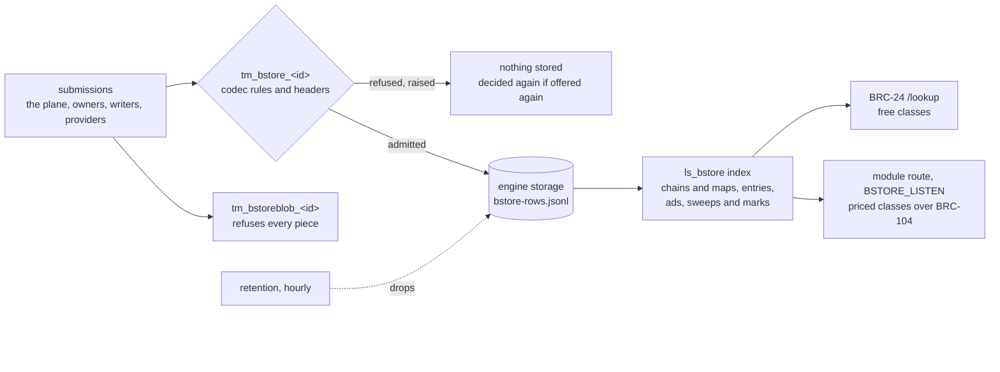

# Running a bstore host

A bstore host is an ordinary overlay host that loads the bstore module: one
file, `host/bundle/bstore-module.js`, which mounts the topic manager
`tm_bstore_<bucket>` for each bucket it carries, `tm_bstoreblob_<bucket>`
where the host's topics name one, and the lookup service `ls_bstore` for
all of them ([spec.md](spec.md) sections 11 and 12). The module imports
nothing but `@bsv/sdk` (the host's own copy) and Node's built-ins; bcommon
is inlined. The terms route, its BRC-104 hardening, the payee ledger and
payment acceptance are bcommon's shared host module
(`@lightwebinc/bcommon/host`), bound to bstore's service, classes, settle
protocol and `bstore` metric names, with the `payee` ledger layout and a
session's response budget taken before the request's signature is
verified. It holds no bytes of any object, fetches nothing a record
names, and broadcasts nothing.

What happens to a submission, from admission to the answer:



This page is in two parts: what the module does, and an operator's guide.

## Build and deploy

```console
$ (cd host && npm ci)   # once
$ make module NODE=/path/to/node24   # writes host/bundle/bstore-module.js
```

Copy the file into a directory beside the host's `node_modules` (for
example `<host>/modules/bstore/bstore-module.js`) and name it by absolute
path:

```sh
OVERLAY_TOPICS=tm_bstore_example_photos_hmqzvtkwrx
OVERLAY_MODULES=/srv/overlay/modules/bstore/bstore-module.js
BSTORE_BUCKETS=example_photos_hmqzvtkwrx
BSTORE_STATE_DIR=/var/lib/bstore
BSTORE_HEADERS_URL=https://headers.example.com
BSTORE_SERVED=example_photos_hmqzvtkwrx:<owner key>:<bucket id>
```

The host must run with no broadcaster, and must not synchronize `tm_bstore_`
topics as unspent outputs (spec sections 12.1 and 12.6). The module refuses
to start on a host whose `OVERLAY_SYNC_PEERS` names one. A bucket is joined
by replay (below).

## Configuration

| Variable | Default | Meaning |
| --- | --- | --- |
| `BSTORE_BUCKETS` | required | the bucket identifiers this host carries, a comma list. Every `tm_bstore_` and `tm_bstoreblob_` topic in `OVERLAY_TOPICS` must be one of theirs, or the module refuses to start: a bstore topic left to the host's default manager would admit anything |
| `BSTORE_STATE_DIR` | required | an absolute directory kept for the host's life: the rows journal and the payment ledger (below) |
| `BSTORE_HEADERS_URL` | `OVERLAY_CHAIN_TRACKER_URL` when it is an `http` or `https` URL | the header source admission checks proofs against, in the reference host's native shape (`/v1/root/<height>`, `/v1/tip`) |
| `BSTORE_SERVED` | none | the chains this host serves, a comma list of `<bucket>:<owner>:<id>` (the bucket identifier, the owner's key in 66 hex digits, the 64-hex bucket id). The map classes answer for these alone, and retention favors them (below) |
| `BSTORE_KEEP_DAYS` | 31 | the long floor: a replaced entry after the token that replaced it, an advertisement of a served root, a hold output a served entry names, an outcome or front statement of a served party, a sweep's outpoints, a stranger's retraction mark. At least 31 |
| `BSTORE_PENDING_DAYS` | 7 | the floor of an entry no token names, of a served chain's owner or writers. At least 7 |
| `BSTORE_OTHER_HOURS` | 24 | the floor of everything else. At least 24 |
| `BSTORE_MAX_BEEF` | 262144 | the host's BEEF bound in bytes. At least 262144; the per-object ceilings of spec section 12.1 apply whatever it is |
| `BSTORE_MAX_SWEEP_INPUTS` | 1024 | the most inputs of a sweep the host accepts. At least 1024 |
| `BSTORE_LISTEN` | none | `host:port` of the module's own route (below) |
| `BSTORE_PRICES` | none | the classes this host prices, for example `history=5,chain=10,export=20,outcome-history=3,outcome-history-of=4`. Only the five priceable classes, each by its own name; 0 charges nothing |
| `BSTORE_PAYEE_KEY` | none | the payee's private key, 64 lowercase hex characters: the route's BRC-104 identity and the key payments are derived from |
| `BSTORE_SESSIONS` | 10000 | the most BRC-104 sessions the route keeps; past it the least recently used is forgotten |
| `BSTORE_SESSION_TTL` | 600 | seconds a BRC-104 session is kept once idle |
| `BSTORE_HANDSHAKES_PER_SEC` | 4 | BRC-104 handshakes a second the route answers; decimals allowed |
| `BSTORE_HANDSHAKE_BURST` | 8 | the most handshakes the route answers at once |
| `BSTORE_HANDSHAKES_PER_ADDR_PER_SEC` | 1 | handshakes a second one remote address is answered |
| `BSTORE_HANDSHAKE_ADDR_BURST` | 4 | the most handshakes one remote address is answered at once |
| `BSTORE_RESPONSES_PER_SEC` | 5 | signed responses a second one BRC-104 session is given |
| `BSTORE_RESPONSE_BURST` | 20 | the most signed responses one session is given at once |
| `BSTORE_ARCADE_URL` | none | arcade, which the host broadcasts each payment through before it answers (`POST /tx`, `GET /tx/<txid>`) |
| `BSTORE_ASSET_URL` | none | a node's asset service as the node view: the spend view of a payment's inputs and the proof of a held or watched payment |
| `BSTORE_CHAIN` | none | `woc:main` or `woc:test`: WhatsOnChain as the node view, for a host with no node (its "unspent" is taken on its word; every proof is checked against the host's headers). Not with `BSTORE_ASSET_URL`. Without an arcade and a node view every payment is held until it mines |
| `BSTORE_WOC_KEY` | none | a WhatsOnChain API key, with `BSTORE_CHAIN`: the free tier allows 3 requests a second |
| `BSTORE_ACCEPT_THRESHOLD_SATS` | 25000000 | the largest payment answered on the network's acceptance; above it a payment is held until it mines |
| `BSTORE_ACCEPT_PAYER_LIMIT` | the threshold | satoshis one payer may have answered fast and not yet mined; past it, held |
| `BSTORE_ACCEPT_TOTAL_LIMIT` | ten thresholds | the same across every payer |
| `BSTORE_ACCEPT_WINDOW` | `1h` | how long a fast payment counts against the limits unless it mines first (`ms`, `s`, `m`, `h`) |
| `BSTORE_ACCEPT_WATCH` | `0s` | how long the host keeps watching for a conflict after arcade's acceptance before it answers |

Any `BSTORE_PRICES` entry needs `BSTORE_LISTEN`, and a price above 0 also
needs `BSTORE_PAYEE_KEY`. Any mistake stops the host before its port opens.

## Admission

`tm_bstore_<bucket>` runs the codec's transaction rules (spec section 12.1)
on the submission's bytes and the host's headers, and on nothing else:
never another topic, another record, or anything the topic holds. It
admits entry, outcome and front carriers, bucket tokens, advertisements and
hold outputs (mined, at most 1,024 a transaction) and output 0 of sweeps. A
piece is refused (`piece`), and so is a transaction that only spends held
outputs (`not-bstore`). Every refusal is raised, so the engine stores
nothing for it and the same txid offered again is decided again: a copy in
a worse BEEF cannot suppress the genuine object, and a token refused while
the host's headers lagged is admitted once they catch up. Every input that
spends an output the topic holds is retained.

`tm_bstoreblob_<bucket>` is mounted only where `OVERLAY_TOPICS` names it,
and refuses every submission (`piece`): a host holds no bytes, and the blob
topic is for providers. A directory host does not subscribe to it; one
that does is delivered, and billed for, every piece of the bucket.

The engine checks a transaction's own proof but not its parent's, and the
reference host hands a module no chain tracker, so the module reads headers
itself and reuses a confirmed root for ten minutes. A source that does not
answer refuses a token or mined object `unmined`, raised.

`bstore_admitted_total{kind}` counts admitted transactions (`entry`,
`outcome`, `front`, `bucket-token`, `mined`, `sweep`);
`bstore_refused_total{reason}` every refusal by its label.

## The index

`ls_bstore` keeps its index in memory and rebuilds it on start from the
engine's storage and the state directory, whatever order storage returns
rows in.

### Tokens and maps

A chain is `(owner, id)`; a token of one owner never takes a place of
another's. A token is **rooted** when the host holds every token from it
back to its chain's first by spends, `pending` until then. At most 8 tokens
are kept at one `seq` of a chain, rooted ones first, then the lowest txids;
one turned away while it was pending is read back from storage once its
predecessor is rooted.

For a chain the host serves, each rooted token is folded onto its branch's
map (spec section 3.4): `consistent`, or `map-mismatch` (sticky: every later
token of the branch has it too). The map of the latest consistent token is
kept with its tree, so an `object` or `list` answer costs one path per
output. A chain the host does not serve is rooted but never folded: its
`bucket` answers its highest rooted tokens, and the map classes refuse it.

The **latest** tokens are those of the branch on the current chain (frozen.md
row C8, signed): walking down from the highest
`seq` that holds a candidate, the candidates at the first `seq` where any
token's proof verifies in the host's headers, kept for a minute; an answer
that needs one token takes the lowest txid among them. A longer branch a
reorganization orphaned is not latest, and retention follows the branch on
the chain. With no answer from the header source, the highest `seq`.

**What a fold costs.** Each token costs its changes and one tree over the
whole map (about two hashes a key). Folding a chain whole costs that for
every token: a restore does it, giving the event loop a turn after every
token, before the host answers anything; and a reorganization does it once,
synchronously, for the second branch of a fork (the first takes the map),
as does a `seq` turned over its cap of 8 tokens. A token that only extends a
branch never refolds anything.

### One carrier per funding outpoint keeps a floor

The first carrier the host admits on a funding outpoint is recorded. A later
carrier on the same outpoint (a re-signed copy has another txid) has no
floor: it is dropped at once, unless a token of a served chain names it,
when it is held as the first is.

### Retraction

An admitted sweep's input outpoints are kept once per host, whatever bucket
admitted it, for `BSTORE_KEEP_DAYS`. Every carrier the host holds on one of
them is retracted at once, and so is a carrier that arrives later on one:
the outpoint gets a **retraction mark**, kept for the host's life when the
carrier's owner is a served chain's owner or one of its latest token's
writers, otherwise for `BSTORE_KEEP_DAYS` after the sweep's first sight. A
carrier on a marked outpoint is retracted whenever it is offered. The
sweep's own transaction is kept only where an input matched a carrier the
host held in that bucket, as long as its outpoints; `sweep` answers those.
A sweep retracts carriers in every bucket the host carries, and is kept in
a bucket only where it matched one of that bucket's carriers (or the mark one
left), whichever bucket it reached first.

The replay of a retracted carrier is admitted by the topic manager, which
reads nothing the topic holds, and dropped by the index at once: it is never
answered and leaves storage again.

### Advertisements

An advertisement is answered by `ads` and `ad` while it is unspent as far as
the host knows (an admitted transaction, a renewal above all, spends it)
and its expiry is after the host's clock. An advertisement of the anyone key
is admitted, as the SDK validates it, and never answered or counted.

## The lookup classes

All on the host's BRC-24 `/lookup` and on the module's own route. A class
marked served answers only for a chain `BSTORE_SERVED` names and is refused
with an error for any other.

| Class | Answer | Order | Cap | Price |
| --- | --- | --- | --- | --- |
| `bucket` | the latest tokens: rooted and consistent (served), or rooted (any other chain), of the branch on the current chain (above) | txid | 8 | free |
| `bucket-seq` | the tokens held at the `seq`, rooted or not | rooted first, then txid | 8 | free |
| `object` (served) | the latest token, with the token context (empty, or the leaves that prove the key absent, or its role 2 leaf); then the entry with its context | | 2 outputs | free |
| `list` (served) | the latest token with its context, then the entries whose keys start with the prefix and sort after the cursor, each with its context; stops at the first entry the host cannot produce, as a role 2 leaf | key bytes | 256 | free |
| `pending` (served) | entries for the key no token of the chain names, by the owner or the latest token's writers, never dated after the host's time | newest `created` first | 8 | free |
| `unanchored` (served) | the writer's entries for the chain no token names, admitted within 7 days, after the txid cursor | txid | 64 | free |
| `entry` | the entry carrier with the txid | | 1 | free |
| `ads` | live advertisements of the root after the txid cursor; a page never splits a transaction | txid, then output | 64 | free |
| `ad` | the same, by one advertiser | txid, then output | 8 | free |
| `fronts` | front statements naming the advertiser after the txid cursor | txid | 8 | free |
| `front` | the statements by one front naming the advertiser, never dated after the host's time | newest first | 8 | free |
| `hold` | the transaction holding the hold output | | 1 | free |
| `outcomes`, `outcomes-of`, `outcomes-by`, `outcomes-of-by` | outcome records naming the answerer (or provider; and buyer), admitted within 31 days, never dated after the host's time | newest `created` first | 64 | free |
| `sweep` | the held sweeps that spend the outpoint | height, position, txid | 8 | free |
| `history` (served) | the rooted tokens below the `seq` whose changes set or remove the key, each followed by the entry its change names when held | newest first; a page never splits a `seq` | 64 tokens | priceable |
| `chain` | the chain's rooted tokens above the `seq`; a page never splits a `seq` | `seq`, then txid | 64 | priceable |
| `export` (served) | as `list` with no prefix | key bytes | 512 | priceable |
| `outcome-history`, `outcome-history-of` | outcome records naming the answerer (or provider) strictly before the time cursor, no window, never dated after the host's time | newest first | 64 | priceable |

A question carrying the members of no class, a value that breaks its rule
(spec section 11.2), a bucket the host does not carry, or a chain it does
not serve for a served class is refused with an error, never answered
empty. Every answer starts with a binary search and walks at most its page,
plus anything that left a window (`ads`, `ad`, `unanchored`, the free
`outcomes` classes) since the last retention pass, which the answer that
meets it takes out of the index, so it is walked once: an index a stranger
fills costs that stranger, not the next question. `chain` and the latest
tokens search only the `seq`s that hold a rooted token, so a stranger's
unrooted tokens are never walked; `history` finds its `seq` by binary search
and never ends a page inside a `seq`.

## Retention

Floors (spec section 12.3), each configurable upward:

| What | Kept |
| --- | --- |
| a token of a served chain, rooted or pending | for the host's life |
| any other token | `BSTORE_OTHER_HOURS` after first sight |
| an entry a served chain's current map names | as long as it names it |
| an entry a consistent token of a served chain named that the map no longer holds | `BSTORE_KEEP_DAYS` after the token that replaced or removed it |
| an entry no token names, of a served chain's owner or latest writers; one named only by tokens that are not rooted or off the latest branch | `BSTORE_PENDING_DAYS` after first sight |
| an advertisement of a root a served map names | until the earlier of its expiry and `BSTORE_KEEP_DAYS` after first sight, plus `BSTORE_OTHER_HOURS` |
| a hold output an anchored or pending entry of a served chain names | `BSTORE_KEEP_DAYS` after first sight |
| an outcome whose buyer is a served party, naming a root a served map names | `BSTORE_KEEP_DAYS` after first sight |
| the first 16 front statements by first sight naming an advertiser of a root a served map names (the same 16 for each such root) | `BSTORE_KEEP_DAYS` after first sight |
| a sweep's input outpoints, and its transaction where kept | `BSTORE_KEEP_DAYS` after first sight |
| a retraction mark | for the host's life when the carrier's owner is a served party; otherwise `BSTORE_KEEP_DAYS` after the sweep's first sight |
| a later carrier on a funding outpoint | no floor, unless a served chain names it |
| anything else | `BSTORE_OTHER_HOURS` after first sight |
| a retracted carrier | dropped at once, never answered |

Retention runs once the index is restored and hourly after, and never while
a restore is in flight; it also ages the windows `unanchored`, `outcomes`
and `ads` answer from, so no free question walks what aged out of them.

To **drop** an object is to delete its output from the topic and to evict
the engine's record that its transaction was applied, so the same object
offered again (by a replayer, after a token came to anchor it) is decided
afresh. The engine records an admission only after it has told the lookup
services, so a drop decided during an admission waits until the record
exists (at most a minute), and drops still waiting are tried every two
seconds; an output offered again and held again before its drop runs is
left alone. A mined transaction's record is evicted only once none of its
outputs is held. The Go module takes a pass's drops 64 at a time and
releases the lookup service's lock between two chunks: under a put load
nearly every admission leaves a drop (the entry it supersedes), and one
pass holding the lock for all of them stalled every admission behind it for
tens of milliseconds every two seconds. While an admission waits for the
lock (the host holding that topic's lock meanwhile), a pass gives it up
after every drop instead.

The reference host gives a module no handle on the engine, so the module
cannot call the engine's `evictAppliedTransaction`. It does what that call
does through the storage object the host hands a restore, which is the
engine's own store: `deleteOutput` and `deleteAppliedTransaction`. On a
store without them the module says so once in the log; what it dropped then
stays in storage, unanswered, and is a duplicate when offered again.

## The state directory

- `bstore-rows.jsonl`: the first carrier of each funding outpoint, the
  input outpoints of admitted sweeps, the retraction marks, the first sight
  of every carrier, token and mined output, and which held outputs a later
  transaction spent (storage hands a restore its unspent outputs only).
  Each line is in the file before the admission it records completes. The
  TypeScript module flushes it to disk then too; the Go module flushes the
  lines of each `BSTORE_JOURNAL_SYNC_MS` window together (below), so a
  process that dies loses none and a power loss at most that window.
  Retention rewrites the file as the state it holds (a new file, flushed,
  then renamed over the old one). It names outpoints, txids, commitments
  and keys, never a record's contents. A last line cut short by a crash is
  dropped; any other line that does not parse stops the host, because a
  mark or a sweep's outpoint skipped could let a retracted carrier be
  answered again.
- `payments.jsonl` and `unsettleable.jsonl`: the payment ledger and the
  lost-payment flags of the shared host module (below).

## The route

The reference host lets a module add no route, so with `BSTORE_LISTEN` set
the module serves its own beside the host:

| Route | Answer |
| --- | --- |
| `GET /ls_bstore/terms` | `{"service": "ls_bstore", "terms": 1, "classes": [...]}`; 404 when the host prices nothing |
| `POST /.well-known/auth` | the BRC-104 handshake |
| `POST /lookup` | the same BRC-24 questions as the host's `/lookup` |

Its base URL is what the host publishes as `ls_bstore`'s base, an origin
with no path. A free question is answered with or without BRC-104. A class
the host prices (`history`, `chain`, `export`, `outcome-history`,
`outcome-history-of`) must be asked here, over BRC-104; the host's own
`/lookup` refuses it with an error that says so. One payment buys one
question, one page. The provider routes of spec section 10.1 (`challenge`,
`renew`, `settle`, a provider's `terms`) are a provider's, not a host's,
and are not served here.

The terms route, its statuses (402 for a price, 202 `ERR_PAYMENT_HELD` for
a held payment, 409 for a replay or conflict), the session bound, the
handshake and response budgets, replay refusal and the payee ledger
(`payments.jsonl`, bcommon `payee` version 2) are bcommon's shared host
module: see [the host module](https://github.com/lightwebinc/bcommon/blob/main/docs/host-module.md).
bstore's settings for them are the `BSTORE_SESSIONS`,
`BSTORE_SESSION_TTL`, `BSTORE_HANDSHAKE*` and `BSTORE_RESPONSE*`
variables above. bstore adds: 400 for a question that names a bucket the
host does not carry, and 503 until the index is restored.
`testdata/host/payments-v2.jsonl` is a golden ledger line the TypeScript
ledger writes byte for byte and bcommon's `payee` reads and writes back
byte for byte.

## Payment acceptance

A paid question is answered only after bcommon's acceptance rule
([the host module](https://github.com/lightwebinc/bcommon/blob/main/docs/host-module.md#payment-acceptance)):
a held payment is answered 202 `ERR_PAYMENT_HELD`, recorded with
`"decision":"hold"`, and answered when sent again once mined; a lost fast
payment is written to `unsettleable.jsonl` and its payer held from then on.
bstore's settings are the `BSTORE_ARCADE_URL`, `BSTORE_ASSET_URL` (or
`BSTORE_CHAIN` with `BSTORE_WOC_KEY`, WhatsOnChain as the node view for a
host with no node) and `BSTORE_ACCEPT_*` variables above. Without an
arcade and a node view every payment is held until it mines.

## The Go module

The same module exists in Go, `module/` in this repository, written to
bcommon's engine-neutral contract (`github.com/lightwebinc/bcommon/module`)
for a Go overlay host that carries the adapter: `tm_bstore_<bucket>` for
each bucket, `tm_bstoreblob_<bucket>` where the host's topics name one (it
refuses everything, as above), `ls_bstore` for all of them with every class
and the same answers, the journal `bstore-rows.jsonl` with the same lines,
byte for byte, and the same retention floors and restore, and the terms
route (bcommon's `termsroute`, the Go twin of the shared host module) with
the same routes, codes, prices, metrics and ledger lines (`payments.jsonl`,
the payee layout). It reads the same `BSTORE_` variables as the table above
and refuses the same mistakes; on a Go host the terms route takes port 8294
(`BSTORE_LISTEN`), beside the TypeScript host's 8094. It reads one more:

| Variable | Default | Meaning |
| --- | --- | --- |
| `BSTORE_JOURNAL_SYNC_MS` | 100 | the journal's group commit window, 0 to 60000 milliseconds. Each line is written to `bstore-rows.jsonl` before the admission completes and the lines of a window are flushed to disk together by a timer, off the lookup service's lock; closing the module and a rewrite flush too. A process that dies loses nothing (the lines are in the page cache); a power loss loses at most the window, the bound the engine's own store keeps (`OVERLAY_STORE_WAL_SYNC_MS`). 0 flushes each line before the admission completes, as the TypeScript module does, and costs one fsync of every admission that writes a line, under the lock |

Its admission rules are `storerec.Admit`, its folds and map answers
storerec's, and its tests drive it with the transaction vectors and the
TypeScript module's own cases. A host hands the topic manager the submission's bytes exactly as
they arrived (`module.WithSubmission`): the rules decide on the wire form.
No rule reads what the topic holds, so the manager also decides a
submission before the host takes the topic's lock (`Precheck`, which
a Go host calls where a manager has it; `storerec.Prepare`) and only
finishes the verdict with the previous coins under the lock: the field
signature and the key derivation leave the lock's hold. Keys that held the
key rule and locking keys derived are remembered by their bytes (4096 of
each), since a bucket's writers sign many records.
To drop an object the module deletes its output and asks the host to forget
the applied transaction (`DeleteOutput`, `DeleteAppliedTransaction` on the
storage a restore is handed), so the same object offered again is decided
afresh; a storage that cannot forget leaves it a duplicate.

### Ordered replay on a Go host

The Go module repairs its own host from a sibling host by replay (spec
section 12.6), never by an unordered synchronization of unspent outputs: its
lookup service is a bcommon `module.Replayer`, which a Go host that carries
the hook asks on its catch-up schedule, once
a round for each `tm_bstore_` topic and each peer. A walk asks the peer's
`ls_bstore` only free classes and answers the objects to submit, which the
host admits through its ordinary path, in five phases:

1. tokens: for every chain of the bucket the host holds a token of or
   serves, `bucket`, then `bucket-seq` at each seq up to the peer's latest
   at which the host holds no token; each token goes in the BEEF of the
   token and its parent (minimal paths, held to `storerec.Admit` first),
   after its parent, never without it. A chain's first token takes its
   parent, the chain tree, from the node view (`BSTORE_ASSET_URL`, else
   `BSTORE_CHAIN`); without one, or once the node no longer serves a fully
   spent tree, the chain is counted as a gap and waits for the owner's
   `fill`;
2. named: `entry` for every entry a served chain's current map holds, or a
   token this host first saw inside the keep floor less a day names, that
   the host does not hold (an entry only older tokens name has left every
   host by its floor);
3. unanchored: `unanchored` page by page for each served chain's owner and
   latest writers;
4. mined: `ads` for each root a held entry names, `hold` for each hold
   output a held entry names and the host lacks;
5. attached: `fronts` and `outcomes-of` for each advertiser the host holds
   an advertisement of, and `sweep` for each held carrier's funding
   outpoint.

Replay never lengthens a floor: an entry no token names is replayed only
while dated within the pending floor less a day, an outcome or a statement
within the 24-hour floor less an hour, an advertisement or a hold output
within 4032 blocks of the tip, and nothing on a funding outpoint the host
retracted or gave to another carrier. What no free class leads to is not
replayed: a sweep of a carrier the host never held (it retracts nothing
here), an entry of a chain the host does not serve, a chain the host holds
nothing of and does not serve.

## Metrics

Counters: `bstore_admitted_total{kind}`, `bstore_admitted_repeats_total{kind}`,
`bstore_refused_total{reason}`, `bstore_token_status_total{status}`,
`bstore_retractions_total`, `bstore_dropped_total{why}` (`retracted`,
`retention`, `second-carrier`, `unmatched-sweep`),
`bstore_lookups_total{class}`, `bstore_handshakes_total{result}`,
`bstore_requests_total{result}`, `bstore_payments_total{decision,reason}`
(paid questions by what the host did: `requested`, `fast`, `hold` or
`refuse`, with the reason; [Payment acceptance](#payment-acceptance)),
`bstore_payment_events_total{kind}` (`confirmed`, `double-spent`, `refused`,
`unmined`), `bstore_sessions_evicted_total{why}`, and from the Go module
alone the journal's: `bstore_journal_lines_total`,
`bstore_journal_wait_seconds_total` (the time the lookup service spent
writing lines under its lock, the fsync included when
`BSTORE_JOURNAL_SYNC_MS` is 0), `bstore_journal_syncs_total{result}` (`ok`,
`error`) and `bstore_journal_sync_seconds_total` (the timed fsyncs, off the
lock). Gauges:
`bstore_payments_unmined`, `bstore_buckets`,
`bstore_tokens`, `bstore_tokens_pending`, `bstore_entries`,
`bstore_outcomes`, `bstore_fronts`, `bstore_advertisements`,
`bstore_hold_outputs`, `bstore_sweeps`, `bstore_sweep_outpoints`,
`bstore_retraction_marks`, `bstore_outpoint_rows`, `bstore_pending_drops`,
`bstore_sessions`, and as the last retention pass counted them:
`bstore_maps_complete`, `bstore_maps_incomplete`, `bstore_chains_broken`,
`bstore_anchored_entries`. A token that is `map-mismatch` is logged with its
bucket, owner, id, `seq`, txid and reason; a served map that is incomplete
(the host lacks an entry it names) is logged with how many it lacks.

## Operator's guide

### Setting up a host for a bucket

1. Learn the bucket identifier (`<name>_<suffix>`), and, for a bucket you
   serve, the owner's key and the bucket id from its first token.
2. Add `tm_bstore_<bucket>` to `OVERLAY_TOPICS`, the bundle to
   `OVERLAY_MODULES`, and set `BSTORE_BUCKETS`, `BSTORE_STATE_DIR` and the
   header source. Add the chain to `BSTORE_SERVED` if this host keeps its
   map. Leave `tm_bstoreblob_<bucket>` out unless you mean to be billed for
   pieces you refuse.
3. To sell the bulk walks, set `BSTORE_LISTEN`, `BSTORE_PAYEE_KEY` and
   `BSTORE_PRICES`, put the route behind a proxy that keeps the path, and
   publish its origin as `ls_bstore`'s base.
4. Start the host and check the log line `bstore module mounted`: the
   topics, the blob topics (`none`), the served count, the floors, the
   route and the prices.
5. Fill the bucket by replay: tokens (each with its parent, from
   `bucket-seq` of a sibling host, the first with the chain tree from the
   owner), entries, advertisements, hold outputs, outcomes, statements and
   sweeps, in any order. A Go host with peers does this itself (above),
   but for a chain's first token where no node view gives its chain tree.

### Day to day

- Watch `bstore_refused_total`, `overlay_host_topic_failures_total`, and
  the logged token statuses: a `map-mismatch` on a served chain is the
  owner's to fix with a new chain.
- `bstore_maps_incomplete` above 0 means the host lacks entries a served map
  names: replay them from a sibling host or the writer.
- `bstore_pending_drops` should return to 0 within seconds; a value that
  stays up means the store cannot delete or evict.
- `bstore_sweep_outpoints` grows with sweeps for `BSTORE_KEEP_DAYS`; it is
  36 bytes an outpoint and a stranger pays a mined input for each.
- Rate-limit `/submit` per submitter in front of the host (the connection
  or remote address, never a record's writer, whose carriers anyone can
  replay). The module cannot: it never sees the request.

### Backups and restore

Back up `BSTORE_STATE_DIR` with the database, daily, and keep several days.
The files are written by append or by rename, so a copy taken while the
host runs is usable. To restore, stop the host, restore the database and the
state directory from the same backup, and start it. Never restore the
state directory alone: marks and sweep outpoints written after the copy
would be lost, and a retracted carrier replayed could be answered.

### Settling payments

Settle `payments.jsonl` promptly with `bstore payee settle
<payments.jsonl>...` from the home whose identity is `BSTORE_PAYEE_KEY`
(`bstore payee key -out FILE` writes that line); it records each payment
settled in the home's `payee.json`. See [the host module](https://github.com/lightwebinc/bcommon/blob/main/docs/host-module.md#settling).

## What the module does not do

- It does not keep a token or mined object refused `unmined` to decide it
  again when the headers move (a SHOULD of spec section 12.1): the
  reference host gives a module no way to submit to the engine. A publisher
  offers the object again.
- It does not learn of a hold output's settlement or an advertisement's
  cancellation except through an admitted transaction that spends it;
  readers and providers check a spend source.
- It applies no allow-list of writers.
- It cannot rate-limit submissions: it never sees the request (above).

## What a host cannot tell

A host admits what the contract lets a writer, buyer, front, provider or
owner sign. Whether an entry's writer may write, whether a hold output
exists and is unspent, whether an advertisement's root belongs to any entry,
whether a front answers for anyone, and whether a pass happened are a
reader's or a provider's checks (spec section 15); the host neither checks
nor filters them.

## Tests

`make module-test` (and `make test`) runs the module's tests on the
compiled tree and on the bundle: every transaction vector through the topic
manager and the engine, every lookup class with every map answer held to a
reader's checks, the fold against the codec's on a thousand chains, every
retention floor, restore in any order, the races, and the route with a
paying client and the attacks the hardening answers. `make e2e
REFERENCE_HOST=/path/to/host` runs the bundle on a local reference overlay
host over MySQL (Docker), as above. `make go-test` runs the Go module's
tests beside the codec's: the same cases on a stand-in for the Go engine's
storage and admission path, the journal's bytes, restore in any order, and
the terms route with a paying client.
