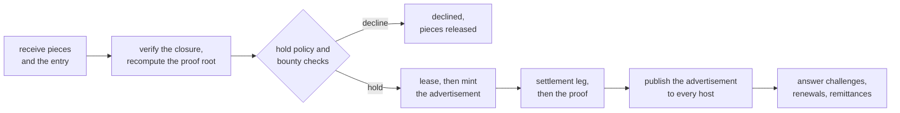
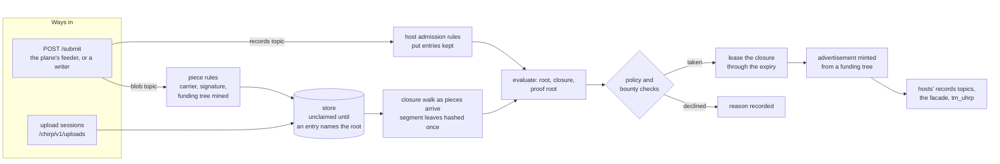

# Running a bstore provider

`bstore-provider` is a storage provider: the market front of
[spec.md](spec.md) section 17 over a hold backend. It receives the pieces of
a bucket's objects, checks each closure, decides by its own policy whether
to hold it, races for the bounty by advertising at once, answers
challenges, renewals and settlement remittances on its front, and serves
the bytes on BRC-167's object routes.

A provider earns in three ways: the bounties it wins by holding an object
and passing the writer's settlement challenge, the renewals anyone buys to
keep an object held, and the challenges anyone pays for. It pays for its
disk, for the bytes delivered to it, and for one mined advertisement per
hold. Nothing it holds is taken on trust: every piece is held to its hash
and every closure is checked before an advertisement is minted.

This page is in two parts: what the provider does, and an operator's guide.



## What it does

How an object moves through a provider, from the ways in to the
advertisement (each step is a section below):



### Receiving

A provider subscribes to both topics of each bucket it serves (spec section
3.1): the blob topic carries pieces, the records topic carries entries.
There are two ways in, and the provider is the same behind both.

- **The plane, or a writer that submits directly.** `POST /submit`, the
  overlay engine's own submit shape: the BEEF as the body, `x-topics` naming
  the topic (one name, or a JSON array of up to four).

  On `tm_bstoreblob_<bucket>` a piece carrier is held to a carrier's rules:
  shape, its BEEF and the funding tree's minimal path within 4,259,840
  bytes, the piece record, the bucket, not mineable, one signature push,
  the PushDrop under `derive(writer, "piece")`, its field signature, the
  writer's funding output and its value. Its funding tree must be mined in
  the provider's headers. What the provider keeps is a writer's signed
  piece, paid for with a mined output, never anyone's junk. One funding
  output pays for one carrier (spec section 13.2): a second, different
  carrier on an outpoint already seen, piece or entry, is refused, so a
  mined output buys one piece or one entry.

  On `tm_bstore_<bucket>` the provider runs the host's admission rules
  (spec section 12.1) and takes put entries; everything else a records
  topic carries is a host's business and is passed over.

  The answer is the engine's, per topic, with a `refused` reason when
  nothing was taken. A piece is held to its rules first, on any blob topic,
  served or not, before this provider's own policy:

  | Answer | When |
  | --- | --- |
  | `400` `{"error": "piece: <rule>"}` | the carrier breaks a rule; nothing is taken on any topic of the submission |
  | `503` with `Retry-After` | the funding tree is not yet in the provider's headers |
  | `200`, with a `refused` reason when it keeps nothing | a valid piece, whether or not this provider keeps it (a bucket it does not serve, a writer it does not take, a full store) |

  So an overlay bridge whose facade routes a blob topic here publishes
  exactly the valid pieces, and a bridge that feeds the provider from the
  plane retries a header lag and never a refusal. A feeder's submission (on
  `feed_listen`, or from a `feeders` address) is answered as soon as every
  piece has passed its check, and stored right after, at most eight takes
  at a time, each holding its body's slot of the 64 until it is done. A
  writer that submits directly is answered after its take, since it reads
  the `refused` reason. A crash between a feeder's answer and the store
  loses the piece, as it loses one the next background pass (every 5 s)
  had not yet recorded.
- **Unicast upload sessions** (spec section 14, BRC-167's baseline
  profile), over BRC-104: `POST <public>/chirp/v1/uploads` opens a
  session bound to the caller's identity; `PUT` (and `HEAD`)
  `<public>/chirp/v1/uploads/<id>/objects/<object>` stages one object, its
  body hashed and refused on a mismatch; `POST .../<id>/commit` with
  `{"rootIdentifier"}` checks the closure as a complete host does, bounded:
  the root must be staged in this session, its logical length within
  `policy.max_object` before anything is walked, every object staged in
  the session or held already, and the walk runs one at a time, apart from
  the closures the provider checks for entries, with a deadline, and at
  most six a minute from one identity; a root committed once, or held
  already, is not walked again. A
  provider advertises only for an entry (spec section 9.3), so the commit
  answers `202` with the closure staged until an entry for the root reaches
  the provider and it takes it, and `201` with `hostedFileLocation` and
  `expiryTime` after (frozen.md section 14, row C9). A writer that
  unicasts submits its entry to the provider's `/submit` as it does to a
  host. `bstore put` uses upload sessions when its configuration names the
  provider's public URL under `uploads` ([usage.md](usage.md)).

Pieces may come before or after their entry, in any order. A piece no held
closure names is **unclaimed**: it has a share of the store of its own and
a time of its own (below), and a provider looks at a root again only when
an entry names it and every object its closure names is in the store, which
it learns from the root and branch nodes without reading a blob.

### Checking a closure

Once a closure is complete, for the first entry that names the root with
the root's own size and content hash:

1. the root node, as rows C1 and C2 of frozen.md section 14 have it: CHIRP
   version 1.0, chunking profile 1, no extension, `logicalLength` and
   `contentHash` the entry's;
2. the closure, by bcommon `chirp.Verify` with the 2^43-byte bound, in its
   refusal order (rows C3 and C4), and profile 1's canonical construction;
3. the proof root (spec section 6): every 4 KiB segment hashed, the
   subtree root of each blob kept, and the proof root over them compared
   with the entry's.

**Work as the pieces arrive.** Each piece is hashed by the request that
brings it (its SHA-256, its segment leaves and subtree root, from one pass
over its bytes, on whatever core serves it) and handed to the root's
closure walk (bcommon `chirp.Incremental`). The walk checks the closure as
`chirp.Verify` does, as far as the pieces on hand allow, the content hash
advancing over the blobs in order. When the entry is evaluated, the walk is
finished from where it stopped and the proof files are written from the
leaves already hashed. Closures with branch nodes (over 1 GiB) are walked
the same way.

A walk starts when its root's piece arrives. A root whose walk is not kept,
after a restart for instance, has its walk started by the evaluation, which
reads back the pieces already held, once each, and continues as more
arrive. A piece the store already held is read from the store, not taken
from the request that sent it again. Leaves are kept for at most 4,096
pieces (16 GiB of content waiting for its entries) and walks for 64 roots
(the least recently used dropped first). The pieces stored last,
`limits.closure_cache_mb` of them across all walks (128 MiB by default),
are kept until their walk comes to wait for each and handed to it then
with the hash the provider computed, so a piece taken out of order is
neither read back nor hashed again; one dropped from that budget is read
back from the store when the walk reaches it and hashed once, by the
check of the walk's fetch. A piece lost on the way holds every later
piece of its object until it is sent again, so a provider fed a few large
objects at once keeps more.

**A storage node's own closures.** A provider that runs in its gateway's
process (`local_provider` with `verify` false, [s3.md](s3.md)) takes each
piece on the gateway's account, and checks a closure that gateway staged
(a put's own, not a copy whose content hash is another entry's) on that
account instead of walking it. The root and every branch node are
read, hashed and checked as above (encodings, lengths, child sums,
depth, cycles, references, the canonical construction); a blob this
provider stored from the gateway's bytes is taken at its stored length
without being read; any other blob (one the store already held, say) is
read and hashed; the proof root is recomputed from the segment leaves the
gateway hands over with each blob, from the pass that hashed it as it was
staged (hashed here for a piece without them: a blob the stage found
already held, or one past the gateway's 128 MiB of kept leaves). The content hash is the
gateway's, computed over the bytes it staged. What this trusts: the node's
own gateway hashed the content and the leaves correctly, and nothing
between that hashing and the store changed the bytes; the bytes on disk are
checked by later challenges and reads. The entry and every other record
are checked whole, a provider in another process or on another host walks
every closure, and `bstore_provider_closure_checks_total` counts the
checks by `mode` (`carried` or `walked`).

**Deciding.** A closure that fails is the writer's fault: every entry it
fails is declined, and the reason recorded. One that is not complete yet is
waited for. Up to `limits.verify_workers` roots (default 4) are seen
through at once, each taken in the order it was queued and verified and
then decided (the hold policy, the bounty's checks, the hold and the
advertisement) by the one worker that took it. A root's entries are decided
oldest first, and no root waits for a root queued before it. The chain
reads, the signature and the journal sync of each hold run side by side
across the workers, so small entries are held at a rate that grows with the
workers (with a chain view 2 ms away: about 50 a second with one worker,
200 with 4, 550 with 16) and does not fall with the number waiting.

**Bounded memory throughout.** One blob at a time for each closure being
verified. For each held root the provider keeps, under `roots/<root>/`, the
leaf hash of every segment (32 bytes per 4 KiB, 1/128 of the data), each
blob position's subtree root and object hash, and the closure's objects in
order and sorted.

### The hold policy and the bounty

An entry is taken when the provider's policy allows it (`policy` below:
size, retention, and whether it holds without a bounty). An entry dated
more than ten minutes ahead of the provider's clock is declined, and the
advertisement it asks for must end within `max_retention_seconds` of now.

For a bounty, the provider's own checks of spec section 9.3 must pass with
its own chain view and headers. The hold output:

- exists and is mined (its proof verifies in the provider's headers);
- is locked to `derive(writer, "hold")` and holds exactly `satoshis`;
- is unspent by positive evidence from the chain view (one that does not
  answer is not evidence);
- is worth at least `min_bounty` and pays this provider's price: an even
  share among the hold's `K` ranks covers `renew_per_gib_day` for the
  object's size and the hold's retention, since a provider cannot know its
  rank;
- backs an entry whose `deadline` is at least `min_deadline_blocks` ahead
  of the tip.

One hold output settles one entry (spec section 9.2): a second entry naming
a hold output that backs an entry the provider took is declined. An entry
whose bounty fails is declined, or held without racing when
`hold_unbountied` is on. A check the chain view or the header source could
not answer decides nothing (a hold transaction the node does not know or
has not mined yet included), and the entry is looked at again for
`unclaimed_seconds`, then declined.

An entry the provider took is checked against the closure it holds: another
size, content hash or proof root is declined. A closure is checked once for
all the entries waiting on it, and the proof root decides every one of them
in the same pass. An entry whose closure has not arrived within
`unclaimed_seconds` is declined, and one of whose root not even the root
node came within five minutes. A writer a bucket's `writers` names is never
shut out by the total of waiting entries strangers fill.

### Advertising, and the race

The writer ranks advertisements by when its own client first sees them
(spec section 9.4), so the provider advertises the instant a closure is
checked. The lease runs through the expiry it will advertise, then the
advertisement is minted exactly as the SDK makes it (BRC-26, `[2, "uhrp
advertisement"]` key id `1`, the CHIRP URL of the root, `fileSize` the root
node's length). Its expiry is the entry's `floor(created / 1000) +
retention`, and never less than an hour from now.

Roots checked close together share one transaction: the minter collects
the roots asked for within `limits.ad_batch_ms` behind the first, up to
`limits.ad_batch`, and signs one transaction with an advertisement output
per root, its fee paid from as many of the provider's funding outputs as it
needs. A renewal is minted one a transaction, since it spends the
advertisement it renews.

The transaction goes to the settlement leg at once. Once it mines it is
submitted, with its own minimal proof, to the records topic of every
bucket each root is held for at every configured host, to the plane's
facade when one is set, and to `tm_uhrp` when `uhrp_topic` is on. A host it
cannot reach is tried again, each time later.

An advertisement that already exists for the root serves a later entry
when it lasts long enough; when it does not, it is renewed to.

**Funding trees.** Advertisements and renewals are paid from funding trees
of `tree_count` outputs of `tree_sats` each, locked to the wallet's fund
key; the next tree is minted before the current one runs out. A lone
advertisement pays all of its output in fee and keeps no change, so
`tree_sats` is the most one costs; a batch spends several.

A tree is recorded with its fee coin before it reaches the settlement leg
(bcommon `producer`'s `Prepare`), as a row of the state log, so a provider
that stops between the leg and the adoption finds the record on its next
start and settles it (`Recover`): the tree adopted when it is on the chain,
held behind the current tree; its coin taken out of the pool when another
transaction spent it; or its coin returned when the chain view does not
know the tree, the record then kept for one more start and dropped on the
second. A tree the library already holds is never recovered twice.

An advertisement is persisted as its own transaction (its funding tree
and, for a renewal, the advertisement it renews are kept already), with
its funding outputs marked used and the lease extended, before it reaches
the leg. A start finds it and records it once mined, sends the same bytes
again when the chain view never saw it, or advertises afresh when a
funding output went to another transaction.

### Renewals

`POST <front>/renew` with `{"root": <64 hex>, "until": <Unix seconds>}`
(spec sections 10.1 and 10.3), over BRC-104. It is always priced (BRC-105;
`renew_minimum` at least the fee floor, so a renewal pays its own fee):
`renew_per_gib_day`
for each GiB a day from the later of now and the current expiry to
`until`, rounded up, never below `renew_minimum`. Once paid, the live
advertisement is spent into its **successor**: the same key and root, the
later expiry, in the transaction that spends it, so the writer's ranking
keeps the original's first sight (spec section 9.3). The answer is the
successor's BEEF (`advertisement`), with its proof when it mined at once
and unmined otherwise, a promise until it mines. `until` must be later than
the current expiry and at most `max_renew_seconds` ahead; one root is
renewed at most `renewals_per_root_per_hour`, a budget spent only by a
payment the ledger has not seen; a root whose advertisement is not mined
yet is answered `409` before any payment, and a payment spending a coin a
taken payment spent is refused before the root's budget is spent. The
provider broadcasts the payment and holds it to
[payment acceptance](#payment-acceptance) before it is recorded, and the
renewal is recorded as owed before it is made: when it cannot be made at
once the answer is `202` and the provider makes it as soon as it can. A
renewal paid above the threshold, or without the network's clear word,
answers `202` with `"held": true` and is made once the payment mines (and
not at all if the payment is double-spent first).

### Challenges

`POST <front>/challenge` with `{"request": <base64>, "entry": <txid>}`
(spec sections 7 and 10.1), in this order:

1. the buyer's budget (`challenges_per_buyer_per_min`, by identity key, or
   by address for a request without BRC-104), before any work;
2. `422 {"error": "request"}` for bytes that are not a request, or a request
   that names another provider or answerer (row C11); `422 seed` unless the
   provider's header source holds `seedHash` at `seedHeight` and `tip - 6 <=
   seedHeight <= tip`; `422 unknown-root` unless the root is held verified
   and `proofRoot` and `size` are the provider's own computation;
3. the **free settlement challenge**, exactly as frozen (spec section 9.4):
   owed only to the entry's writer, authenticated by BRC-103, naming in
   `entry` an entry with hold terms for this root that the provider took,
   while the provider advertises the root with an advertisement eligible for
   that entry (unexpired, and lasting the entry's retention), before the
   entry's
   `deadline`, when the provider's bounty checks pass at that moment (the
   hold output exists, is mined, is the writer's, holds `satoshis`, is
   unspent by positive evidence, and is worth at least `min_bounty`), with
   `c` at most `min(checkC, free_c)`, the hold output at least `min_age`
   blocks deep (`tip - h + 1`), and at most two per hold outpoint, whatever
   entries name it, counted when a signed response is given (row C10). A
   writer is also held to `free_per_writer_per_min`. Every other challenge
   is priced: `challenge_base + challenge_per_sample * c`, BRC-105 over
   BRC-104 (`401` without it, `402` without a payment);
4. the answer is built: each sample's segment read through the backend and
   held to the kept leaf hash, its path (inside the blob's subtree, then
   among the blob roots) held to reproduce the proof root. A segment
   missing or read back wrong marks the root **damaged** and the answer is
   `422 unknown-root`, with no payment taken: from then on the root is not
   served, answered for or renewed, and its advertisement lapses. A read
   the system could not make now (a file it could not open) is `503` and
   marks nothing;
5. the payment is taken into the ledger, or the free answer counted;
6. `200 application/cbor`, the signed response `[body, signature]`, its
   signature over `SHA-256(request) || SHA-256(body)` under
   `derive(provider, "challenge")`, checked as a buyer checks it before it
   leaves.

A refusal of a request that came with a payment the provider did not take
(any answer but `200`, `402` and `409`) carries a signed
**payment-not-taken note** as `"notTaken"` (spec section 10.4, row C30):
the payment's txid, the
SHA-256 of the request, the refusal's reason and the time, under
`derive(provider, "challenge")`. The buyer gives its coin back at once on
it. Only a payment that passed the payment check (this provider's own
derivation prefix, paying it at least the price, new to the ledger) is
noted, never on a `429`, and at most 200 a day for one caller. The txid is
appended to `nottaken.jsonl`, synced, before the note is signed and read
back at every start: the payment is refused for good (`409
ERR_PAYMENT_REFUSED`), so a note never names a payment the provider takes.

Samples are inline by default (spec section 7.5: a native provider SHOULD).
With `answer_inline` off every sample is by reference and the buyer fetches
it from the advertised URL with `Range`: that proves what a reader of the
URL gets. A buyer whose fetched segment fails rechecks it from the whole
blob, so a URL whose `Range` handling is wrong is never the answerer's
fault (spec section 7.4).

**What a challenge proves.** A pass shows the provider could produce the
sampled segments at that moment. A provider may fetch them from elsewhere
to answer (outsourcing is allowed, spec section 20, item 5): what the
market buys is that the bytes are retrievable. Several provider keys over
one disk pass alike (spec section 9.7).

### Serving

`GET` and `HEAD <public>/chirp/v1/<root>/objects/<object>` (BRC-167's
complete-host route), for a root held verified and not damaged and an
object its closure names, with HTTP `Range`, `ETag` and cross-origin `GET`.
Each object is read whole and hashed before a byte is sent, so bytes that
went bad on disk are never served; such a root is marked damaged. Nodes are
`application/vnd.bsv.chirp-node`, blobs `application/octet-stream`.

### Settlement

`POST <front>/settle` with a BRC-29 remittance (spec sections 9.5 and
10.1), unicast, never on the plane. It is taken only when everything in it
follows from an entry the provider holds for: the prefix is base64 of the
entry's commitment, the suffix base64 of the two-byte rank (1 to the
entry's `K`), the sender is the entry's writer, the transaction spends the
entry's hold output, and the named output pays the key BRC-29 derives for
this provider, verifying against the provider's headers, and it passes
[payment acceptance](#payment-acceptance) on this provider's own output.
It answers `200` once the payment is in the ledger (the same payment again
is `200` and recorded once), `202` with `"held": true` when the output is
above the threshold and the settlement is not mined yet (the payout scan
takes it once it mines), and `400` otherwise; one address sends at most one a second
(burst 16). A provider that never got its
remittance finds its payout from public data: for each entry it holds
with a bounty, it asks the chain view who spent the hold output, derives its key
for ranks 1 to `K`, and takes the output that pays it, looking at each
entry at most once a minute. A remittance whose transaction the network
refuses for good (a settlement never broadcast, beaten by the one that
spent the hold output) frees the coins it claimed, and the payout is looked
for again.

### Payment acceptance

Every payment the provider is offered (a paid challenge, a renewal, a
remittance) is held to bcommon's acceptance rule (package `acceptance`):
checked (its output pays this provider's derived key, it is final, its
outputs do not exceed its inputs, SPV against the provider's headers),
**broadcast by the provider**, and decided on value:

- at or below `accept_threshold_sats`, within the payer's and the total
  limits, and with arcade's word that the network took it (no
  `DOUBLE_SPEND_ATTEMPTED`, no competing transaction) and the chain view's
  spends showing each input unspent or spent by it: **fast**, taken and
  answered at once, and watched until it mines;
- above the threshold, over a limit, from a flagged payer, or without that
  word within 10 s: **held**, taken once its proof verifies against the
  provider's headers;
- refused by the network, or spending an input another transaction spent:
  **refused**.

A paid challenge held is taken (the payment is broadcast and the payee
collects it) and answered `202` `ERR_PAYMENT_HELD` (as a held renewal is), not
`402`: a BRC-105 client treats every 402 as a price to pay, so a 402 would
never reach its caller or would be paid again; the same payment sent again once mined buys
its answer. The payment is not bound to its first request: the seed is
checked against the tip when it is sent again, as for any answer, so a
buyer that waited longer than the seed window sends it with a request on a
fresh seed (a `422 seed` refusal of a held payment says so and names it).
Waiting is never a reason to refuse a payment already taken. A challenge refused on the fast path is answered `400`
`ERR_PAYMENT_REFUSED` with a payment-not-taken note (row C30). Without an
arcade or ARC settlement leg nothing is fast. Each fast
payment is watched on the background tick until it mines; one that is
double-spent or refused is recorded unsettleable and logged, and its payer
is held for confirmation from then on, across restarts (the payers of the
book's unsettleable payments are held again when the provider starts).
Nothing is clawed back.

A writer's remittance taken fast and then lost (its settlement never
mined) holds that writer's later remittances: each answers `202` and is
taken once its settlement mines. The writer, for its part, remits the
settlement it builds in place of an abandoned one only once it mines. When
the payout scan then finds the entry's hold output spent by a mined
settlement paying this provider at least what the lost remittance said,
the loss is made good: it is recorded (`madeGood` in the state) and the
writer is no longer held on its account, at once and across restarts. A
loss nobody makes good keeps the writer held; the operator unflags it by
removing the payment from the book's unsettleable list.

Every payment the provider takes (settlements, paid challenges, renewals)
goes to `payments.jsonl` in the data directory, the shared payee ledger's
format (bcommon `payee`), synced before the request is answered; a txid is
taken once, and so is every coin a payment spends. A background run
broadcasts each and takes it into the wallet's pool once it mines.

### Terms

`GET <front>/terms` (spec section 10.1):

```json
{"service": "bstore", "terms": 1,
 "challenge": {"base": 10, "perSample": 1, "freeC": 30, "minBounty": 1000, "minAge": 2},
 "renew": {"perGiBDay": 250, "minimum": 500}}
```

The `402` is authoritative.

## The backend

The hold-backend interface (spec section 17) is `backend`:

| Call | The native backend |
| --- | --- |
| `Put(hash, bytes)` | refuses bytes that do not hash to `hash` or are over 4 MiB; writes `store/objects/<2 hex>/<64 hex>` to a temporary file, syncs it and renames it into place; idempotent |
| `Has(hash)` | the file is there |
| `Get(hash, offset, length)` | a range of the file; the front checks what it reads |
| `ServeURL(root)` | `<public_url>/chirp/v1/<root>/objects/<root>` |
| `Advertise(root, until)` | the front leases the closure and mints the advertisement (above) |

Every path in the store is made from a hash's hex digits alone, so nothing
a request carries names a file.

**As a front for another advertiser.** With `backend` set to `bridge`, the
provider is run by a bridge (its own repository, `bstore-bridge`), which
supplies the bridge backend and the advertiser's identity key
(`provider.Options.Front`). Receiving, the closure checks, the hold
policy, the bounty checks, the terms and the route hardening are the same.
What differs:

- for a closure it takes, every object is handed to the backend (`Put`),
  the backend makes the closure held through its `Advertise` (the
  advertiser commits or renews through its own routes) and returns the
  advertiser's advertisement mined; the front adopts it only when it names
  the advertiser's key, the root, the backend's `ServeURL`, the expiry
  asked for and the root node's length, and its proof verifies in the
  front's headers, then publishes it to the records topic of every bucket
  the root is held for and drops its own copy of the bytes, keeping the
  segment hashes;
- it answers challenges whose `provider` is the advertiser and whose
  `answerer` is itself, every sample by reference (`policy.answer_inline`
  true is refused), each sampled segment read through the backend from the
  advertiser's URL and held to the kept leaf hash before anything is
  signed; a ranged read that does not match is read again from the whole
  blob, held to its object hash, before it decides anything; a segment the
  advertiser no longer serves marks the root damaged;
- it serves no object routes and takes no uploads; `/settle` answers `400`
  (a bounty pays the advertiser's key), and every spend of a held entry's
  hold output, once mined, is passed to the bridge to forward;
- renewals are priced and paid as here, then made through the backend's
  `Advertise`.

**A read-only export.** With `export` set, the provider keeps
`<export>/<root hex>/<index>` for each held closure, index 0 the root node
and the rest in the closure's order, each a hard link to the object's file
(so the export must be on the store's file system), the directories mode
0555 and the files 0444. The provider is its only writer; it adds a root's
directory once the closure is checked and removes it when the root is
evicted. Export the directory read-only with the system's NFS server, for
example `/srv/bstore-export 192.0.2.0/24(ro,no_subtree_check)` in
`/etc/exports`. It is an operator's convenience for local pipelines, not
how readers reach the bytes.

## Limits

| What | Bound |
| --- | --- |
| The store | `quota_bytes` across held closures and unclaimed pieces |
| Unclaimed pieces | `unclaimed_bytes` in all, a quarter of that from one writer, and always one whole object of `policy.max_object` with its nodes and half of it from uploads, each piece counted at least 4 KiB and at most 200,000 pieces, each kept `unclaimed_seconds`; past a share a piece is refused, never makes room by pushing out another's |
| Entries waiting for their closures | 256 from one writer, 10,000 in all |
| Eviction | a holding goes only when no advertisement of it is pending, its advertisement has expired and its lease has run out, or when it was never advertised and no entry for it is undecided; an object another held closure names stays |
| A delete | a delete entry from one of the bucket's writers ends every put of that key made no later than it; a holding no held or undecided entry names any more is dropped at once (its objects leave the store unless another held closure names them, with its export and the renewals owed for it), whatever its lease: the advertisement on chain runs out on its own and nothing answers for it meanwhile. The newest delete per key is remembered (100,000 keys), so a put it ends that arrives after it (the plane does not order entries) is ended on arrival and its pieces released |
| A declined entry | the pieces that waited for its root leave with the decision (not after `unclaimed_seconds`), unless another undecided entry wants the root or a held closure names them |
| An object | `policy.max_object` |
| A submission | 262,144 bytes on a records topic, 4,259,840 on a blob topic |
| Request bodies | a handshake 16 KiB, a challenge 2 KiB, a renewal 1 KiB, a remittance 1 MiB, an uploaded object 4 MiB, a commit 1 KiB; headers 256 KiB (a payment rides in one) |
| Timeouts | headers 10 s, a request 2 min (a submission's or an upload's body 1 min), an answer 5 min, idle 2 min |
| Handshakes | `handshakes_per_sec`, `handshake_burst` for the route and `handshakes_per_addr_per_sec`, `handshake_addr_burst` for one address (an IPv6 address by its /64; behind a proxy named in `trusted_proxies`, the client's address), before any signature work; `429` with `Retry-After` |
| Sessions | `sessions` kept, `session_ttl_seconds` idle; every request identifier a session was answered for is remembered while the session is, so a signed request sent again is refused (`401`); past the bound on remembered requests the least recently used session is forgotten whole, which makes its requests unverifiable too |
| Signed answers | `responses_per_sec`, `response_burst` per session, taken before a request is verified |
| Challenges | `challenges_per_buyer_per_min` with `challenge_burst` per buyer, `free_per_writer_per_min` free ones per writer, `challenge_workers` answered at once |
| Roots verified and decided | `verify_workers` at once (1 to 64), each reading one 4 MiB blob at a time while verifying, and each holding and advertising for the root it verified |
| Pieces kept for their closure walks | `closure_cache_mb` (4 to 65,536 MiB) of the pieces stored last, across all walks; one past it is read back from the store when its walk reaches it |
| Advertisements on the leg | `ad_sends` (1 to 1024) on their way to the settlement leg at once, behind the workers; an unmined input (the funding tree) is put on the leg ahead of its first spender and again at most every two minutes |
| Advertisements a transaction | `ad_batch` (1 to 1,024) roots in one advertisement transaction, an output each, collected for `ad_batch_ms` behind the first root asked for; renewals are minted one a transaction. The fee is the floor plus a few satoshis an output, paid from as many funding outputs as it needs; the leg sees one transaction for the batch; each root's row is finished when the one proof arrives, and the records topic receives the transaction once per root with that proof |
| The leg's verdict | `ad_verdict`: `proof` (the default) sends an advertisement and goes on once arcade has taken it, the Merkle proof the background watches for being the evidence that it stands, a refusal showing when the transaction is sent again; `network` waits for the network's verdict before the send slot is released, which bounds the rate at what one node announces (about 150 transactions a second) |
| Renewals | `renewals_per_root_per_hour` per root |
| Submissions | `submits_per_addr_per_sec`, `submit_burst` per address; `in_flight_per_addr` in flight from one address, uploads included, one past it waiting up to 2 s for a slot before a `429` (a connection from one of the `feeders` skips both); 64 bodies read or held at once, a feeder's held until its take is done; 16 processed at once, a slot taken only once the body is read; 8 of a feeder's takes at once, after their answers; `undecided_per_writer` put entries from one writer kept waiting for their closures, one past it refused for room (a feeder reads no refusal: a writer bursting while this host's closures pause loses what arrives over it, so size it for the burst a pause can hold back) |
| Funding outpoints remembered | 200,000, each for seven days, recorded only for a carrier taken |
| Reads | `object_readers` objects read at once, the slot released before the answer is written; `object_reads_per_addr_per_sec`, `object_read_burst` per address |
| Upload sessions | `upload_sessions` open, 4 per identity and 8 per address, 60 opened an hour from one address, `upload_session_seconds` each, 65,536 objects each |
| Remittances | one a second from one address, burst 16 |
| Payments | a payment's BEEF at most 192 KiB; one the ledger holds is refused before its proof is checked |

A command-line writer ([usage.md](usage.md)) is a process per command: each
opens a BRC-103 session with each provider it calls, so the handshake bounds
per address are how many of its commands one address runs a second (it
waits out a `429` twice, up to 10 s each), and each put by upload session
opens one session here, so the 60 sessions an hour from one address are 60
such puts an hour.

## Operating

### Build and initialize

*Build the binary and create the provider's identity; the key printed is
what advertisements, challenge responses and payouts are bound to.*

```console
$ make verify
$ go build -o bstore-provider ./cmd/bstore-provider
$ ./bstore-provider init -data /var/lib/bstore-provider
identity 02...
```

`init` creates the provider's identity and its wallet under
`<data>/wallet`. The identity key is what advertisements, challenge
responses and payouts are bound to: back the directory up.

### The state on disk

The state is a checkpoint and a log. `state.json` is the whole state,
written whole, synced and renamed; `state.log.<gen>` is one JSON row a
line, each a change appended as it is made: an entry taken or decided, a
piece kept or claimed, a holding verified, held, advertised or dropped, an
advertisement pending or finished, a funding tree signed or an output of
it spent, a payment held, a settlement found. A change a writer is
answered for (an entry, a delete, an upload, a payment) waits for the sync
that covers its row; the rows share each sync, and the rest are synced
with the next pass. A start loads the checkpoint and applies every log
whose generation is the checkpoint's or later, in order; a line a crash
cut short is passed over. The background writes a checkpoint every five
minutes when something changed, or sooner once the log passes 256 MB, and
on a stop: it turns the log over and copies the state in one critical
section (tens of milliseconds for 25,000 holdings) and encodes and writes
the copy outside it, then removes the logs the checkpoint covers. Nothing
on the hold path or the feed writes the state whole: a large state written
whole on every change queued everything behind the write. A data directory
from before the log loads as it is: the checkpoint, then the rows under
`ads/`, which the first checkpoint drops.

### Configure

A JSON file; an unknown key is refused. The required keys, and `mainnet` on
mainnet. No node is needed: with no `chain`, `settle` or `headers` the
provider reads the chain from WhatsOnChain, checks every header's proof of
work and every proof against those headers, and broadcasts through
GorillaPool's public arcade.

```json
{
  "data": "/var/lib/bstore-provider",
  "listen": "127.0.0.1:8095",
  "public_url": "https://provider.example.com/store",
  "mainnet": true,
  "hosts": ["https://overlay.example.com"],
  "buckets": [{"bucket": "example_photos_hmqzvtkwrx"}]
}
```

| Key | Default | Meaning |
| --- | --- | --- |
| `data` | required | the data directory, absolute: `wallet/`, `state.json` and `state.log.<gen>` (below), `fundings.log`, `ads/` (journal rows of versions before the log, read once), `store/`, `roots/`, `payments.jsonl` |
| `listen` | `127.0.0.1:8095` | the address the routes are served on |
| `tls_cert`, `tls_key` | none | serve TLS directly; otherwise a TLS proxy in front terminates it |
| `public_url` | required | the `https` URL the routes are reached at: objects under `<public_url>/chirp/v1/`, the front at `<public_url>/bstore/v1`; no trailing slash, query, fragment or user |
| `chain` | `woc:main`, or `woc:test` when `mainnet` is false | the chain view (proofs, spends, transactions): `woc:main`, `woc:test`, `asset:<url>` (a Teranode asset API, the better choice), or a list ([configuration.md](configuration.md#networks-and-endpoints)) |
| `node` | none | the older key: a node's asset API URL, read as `chain: asset:<url>`; set one of them |
| `woc_key`, `woc_rate` | none, 3 | a WhatsOnChain API key and its requests a second. **A busy provider needs one, or a node**: every entry, bounty check, challenge seed and payment it takes asks the chain view or the headers, and the free tier allows 3 requests a second |
| `settle` | `arcade:main`, or `arcade:test` | the settlement leg: `arcade:main`, `arcade:test` or `arcade:<url>` (GorillaPool's or any arcade), `arc:<url>`, `rpc:<url>` (with `rpc_user`, `rpc_pass`) or `tcp:<host:port>`; `arcade_key` for an arcade or ARC that needs one |
| `headers`, `headers_token` | `woc:main`, or `woc:test`; none | a header source, as bcommon `headers` reads it: `woc:main`, `woc:test`, `bhs:<url>` (with its bearer token), `arcade:<url>`, `chaintracks:<url>`, or a bridge URL |
| `hosts` | none | overlay hosts advertisements are submitted to, each directly |
| `facade` | none | a plane facade advertisements are also submitted to |
| `uhrp_topic` | false | also submit each advertisement to `tm_uhrp` |
| `buckets` | required | `{"bucket": <identifier>, "writers": [<66 hex>, ...]}`; with `writers`, only those writers' pieces and entries are taken |
| `backend` | `native` | the hold backend: `native`, or `bridge` when a bridge runs the provider as a front (see The backend) |
| `export` | none | the read-only export directory |
| `quota_bytes` | 128 GiB | the store's bound |
| `unclaimed_bytes` | an eighth of the quota | unclaimed pieces' share |
| `unclaimed_seconds` | 3600 | how long an unclaimed piece is kept |
| `policy.max_object` | 4 GiB | the largest object taken |
| `policy.min_deadline_blocks` | 6 | how far ahead a deadline must be to race |
| `policy.max_retention_seconds` | 31 days | the longest retention taken |
| `policy.hold_unbountied`, `policy.unbountied_seconds` | off, 1 day | hold without a bounty, for this long |
| `policy.answer_inline` | true | samples inline; off, by reference |
| `terms.challenge_base`, `terms.challenge_per_sample` | 10, 1 | a challenge's price |
| `terms.free_c` | 30 | 30 to 1024 |
| `terms.min_bounty` | 1000 | the least bounty raced for and owed a free challenge; at least the fee floor |
| `terms.min_age` | 0 | 0 to 1008 blocks |
| `terms.renew_per_gib_day`, `terms.renew_minimum` | 250, 500 | this provider's price, for a renewal and for what an even share of a bounty must cover; a renewal's minimum, at least the fee floor |
| `terms.max_renew_seconds` | 366 days | the furthest a renewal runs |
| `limits.*` | as the table above | `handshakes_per_sec` 32, `handshake_burst` 64, `handshakes_per_addr_per_sec` 1, `handshake_addr_burst` 4, `responses_per_sec` 5, `response_burst` 20, `sessions` 10000, `session_ttl_seconds` 600, `challenges_per_buyer_per_min` 6, `challenge_burst` 6, `free_per_writer_per_min` 12, `challenge_workers` 4, `verify_workers` 4, `closure_cache_mb` 128, `ad_sends` 64, `ad_batch` 64, `ad_batch_ms` 20, `ad_verdict` `proof`, `undecided_per_writer` 4096, `renewals_per_root_per_hour` 4, `submits_per_addr_per_sec` 1024, `submit_burst` 4096, `in_flight_per_addr` 32, `object_readers` 32, `object_reads_per_addr_per_sec` 50, `object_read_burst` 200, `upload_sessions` 64, `upload_session_seconds` 3600 |
| `tree_count`, `tree_sats` | 1023, 200 | the funding trees; `tree_sats` at least twice the fee floor, and past that only what an advertisement overpays |
| `fee` | 100 satoshis per 1000 bytes, floor 100, cap 100/1000 | the miner fee policy ([the fee block](configuration.md#the-fee-block)); `source: arc` follows the broadcaster's published rate |
| `fee_sat_per_byte`, `fee_floor` | none | the older fee keys, still read as `fee.rate {n, 1}` and `fee.floor`, the rate capped at `fee.max_rate` |
| `mainnet` | false | mainnet addresses, and the mainnet services by default |
| `refuse_unmined` | false | `fund -beef` takes mined payments only |
| `trusted_proxies` | none | CIDRs of proxies whose `X-Forwarded-For` names the client, for every per-address budget |
| `feeders` | none | CIDRs of the plane's local feeders: the overlay bridge that hands this provider what the plane delivers. A submission whose connection comes from one skips the per-address submission budgets; the bounds on bodies held and processed still apply |
| `feed_listen` | none | a loopback address where the local bridge submits: `POST /submit` and `/healthz` only, plain HTTP, no per-address budgets, the way a bridge reaches its engine. Every other route stays on `listen`. A non-loopback address is refused |
| `metrics_listen` | none | where `/metrics` is served; it is served nowhere else |
| `pprof_listen` | none | where Go's `net/http/pprof` is served; a loopback address, since the profiles are the process's internals |
| `accept_threshold_sats` | 25000000 | the largest payment taken on the network's acceptance; above it, held until mined; 0 holds every payment |
| `accept_payer_limit`, `accept_total_limit` | one and ten thresholds | satoshis taken fast and not yet mined, per payer and in all |
| `accept_window_seconds` | 3600 | how long a fast payment counts against the limits unless it mines first |
| `accept_watch_seconds` | 0 | how long to watch for a conflict after the network's acceptance |

### Fund

*Print the fund address and the pool, then import a payment you made to
it, from the BEEF your wallet handed over or by its txid once mined.*

```console
$ ./bstore-provider address -config provider.json
identity 02...
fund address 1...
pool 0 output(s), 0 satoshis
$ ./bstore-provider fund -config provider.json -beef payment.beef
$ ./bstore-provider fund -config provider.json -txid <txid>
```

Pay the fund address from your own wallet, then import the payment: as the
BEEF your wallet handed over (`-beef FILE`, or `-` for standard input; no
lookup, and a payment not mined yet is held in the pool until it mines
unless `-refuse-unmined`), or by its txid once it has a block (`-txid`,
fetched from the chain view). Every output of it paying the fund address
that the pool does not hold and the chain view does not show spent goes
into the pool, its proof checked against the header source. Set `mainnet: true` on mainnet; with `false`
the fund address is in the testnet form. Every advertisement and renewal
is a mined transaction the provider pays for: 300,000 satoshis covers a
funding tree (`tree_count` 1023 outputs of `tree_sats` 200, 204,600
satoshis, about a thousand advertisements) and its fees with room to spare. One coin pays for each tree, so the pool needs a coin of
`tree_count` x `tree_sats` plus the tree's fee.

`rescan -from H` and `fund -blocks N` are **coinbase: only on a regtest
chain you run (development and tests)**, with `chain asset:<url>`:
`-blocks` mines to the fund address through the node's RPC and pools the coinbase; `rescan` takes the
coinbase outputs paying the fund address in blocks `H` to the tip, and
finds no ordinary payment.

### Run

*Start the provider, and check from the outside that its chain view,
header source, settlement leg, hosts and front answer; `doctor` changes
nothing.*

```console
$ ./bstore-provider run -config provider.json
$ ./bstore-provider doctor -config provider.json   # reads only
```

*Read the provider's own numbers (with `metrics_listen` set to
`127.0.0.1:9095`): holdings, store bytes, advertisements and where an
advertisement's time goes.*

```console
$ curl -s http://127.0.0.1:9095/metrics | grep -E '^bstore_provider_(holdings|store_bytes|advertisements_total|advertise_seconds)'
```

`doctor` prints the identity, the pool, what the store holds, the fee
policy in force, and whether the chain view, the header source, the
settlement leg, the hosts, the facade and the provider's own front answer (`-ca FILE` trusts a private CA for the front). It changes
nothing and may run beside the provider.

Behind a TLS proxy, route to the provider:

- `<public_url>/chirp/v1/` and `<public_url>/bstore/v1/`;
- `/.well-known/auth` at the origin, where the SDK's clients send the
  BRC-104 handshake whatever the path of the route they call;
- `/submit`, for the plane's listener or writers that submit directly.

**On the plane.** A provider subscribes through an overlay bridge (one
consumer subscription per site): the bridge routes the bucket's blob topic
to the provider's `/submit`, and hands the records topic to the provider as
an `also` target beside the site's engine, if it runs one.

*The bridge's routes: pieces to the provider, records to the engine and
the provider both.*

```text
overlay-bridge ... \
  -topics tm_bstore_<bucket>,tm_bstoreblob_<bucket> \
  -engine-route 'tm_bstoreblob_*=http://127.0.0.1:8096' \
  -engine-route 'tm_bstore_*=http://127.0.0.1:8280,also=http://127.0.0.1:8096'
```

with `feed_listen: 127.0.0.1:8096` in the provider's configuration (or the
bridge's address in `feeders`, when it reaches `listen`). A bridge whose facade a writer
publishes through routes the blob topic to this provider too, so the
provider's check is what the facade publishes on: the writer's one publish
reaches every provider subscribed to the blob topic, and the provider beside
the facade takes it from the facade, as the plane does not deliver a site's
own publications back to it.

Behind a proxy, name it in `trusted_proxies`: otherwise every client is
the proxy's address to every per-address budget. `/healthz` answers `ok`.
`/metrics` (Prometheus text) is served on `metrics_listen` only: `bstore_provider_handshake_total`,
`bstore_provider_request_total`, `bstore_provider_session_evicted_total`,
`bstore_provider_state_saves_total`, `bstore_provider_state_save_seconds`,
`bstore_provider_state_save_seconds_total`, `bstore_provider_state_copy_seconds_total`
(of the saves, the copy taken under the state's lock), `bstore_provider_state_log_bytes`,
`bstore_provider_mint_lock_total`, `bstore_provider_mint_lock_seconds_total`,
`bstore_provider_submits_total`, `bstore_provider_challenges_total`,
`bstore_provider_payments_total{decision,reason}` (`requested`, `fast`,
`hold` or `refuse`, with the acceptance reason),
`bstore_provider_payment_events_total{kind}` (`confirmed`, `double-spent`,
`refused`, `unmined`), `bstore_provider_advertisements_total`,
`bstore_provider_advertise_seconds{stage}` (histograms: `mint` the signature, `journal`
the row's sync, `slot` the wait for a send slot, `ancestors` unmined inputs put on the
leg, `submit` the leg's answer), `bstore_provider_publish_seconds{host}` (each engine
publish),
`bstore_provider_renewals_total`, `bstore_provider_payouts_total`,
`bstore_provider_objects_served_total`, `bstore_provider_damaged_total`,
`bstore_provider_evicted_total`, `bstore_provider_refused_total`, and the
gauges `bstore_provider_holdings`, `bstore_provider_store_bytes`,
`bstore_provider_sessions`, `bstore_provider_pool_satoshis`.

A stop (`SIGINT`, `SIGTERM`) waits for a feeder's takes and saves the
state; a crash loses nothing that was answered but a feeder's pieces not
yet stored, and the next start finishes what was in flight. Pieces are
recorded with the next background pass: an object in the store that no held
closure names and no record keeps is removed at the start, and its writer
sends it again.

### Test it end to end

*Run two providers, a writer and a host on a local test chain, end to end.*

```console
$ make provider-e2e REFERENCE_HOST=/path/to/reference-host NODE=/path/to/node24
```

Two provider processes and a test-only writer (`internal/testwriter`) on a
reference overlay host loading the bstore module, over MySQL (Docker), on
a local test chain: a 100 MiB object put with a bounty of `t = 2`,
`K = 2`; both providers receive, check and advertise it; the second is
killed the instant its funding tree reaches the settlement leg and
restarted, and recovers the tree and advertises; the race is ranked by
first sight at the host; both pass a free settlement challenge, the second
answering by reference behind a server whose `Range` answers are wrong and
is not blamed; a third free challenge is priced; a renewal is bought and
its successor spends the advertisement; the bounty is settled to both by
rank, one by remittance and one found from the hold output's spend; and a
blob dropped from the first provider's store is caught by a paid challenge
of `c = 113` (about 99 % of nonces catch one blob of 25; the run picks one
that does), after which the root is no longer served.
