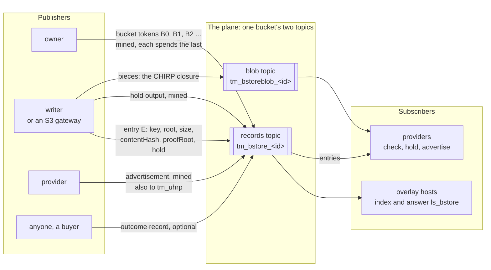
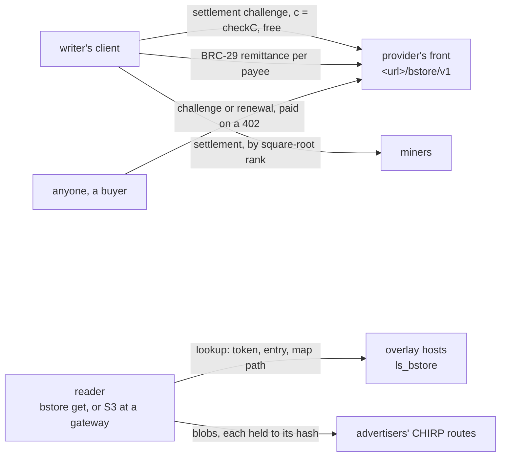
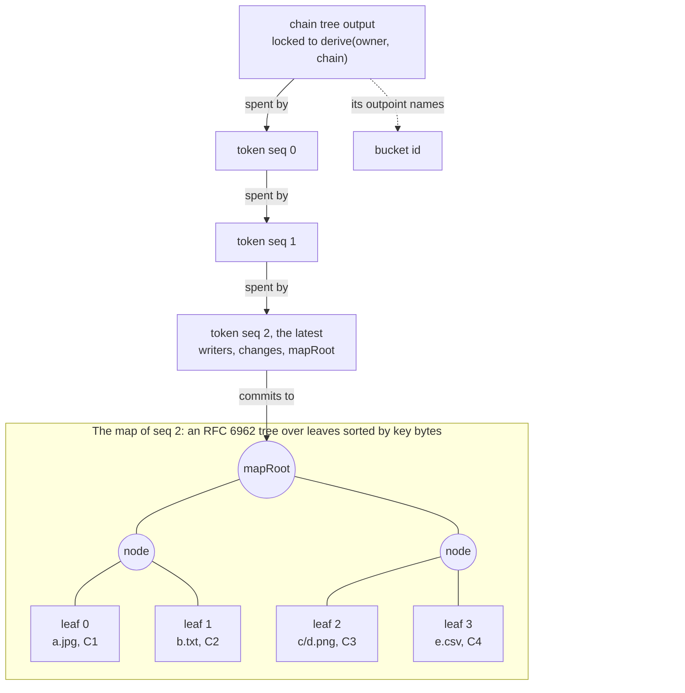
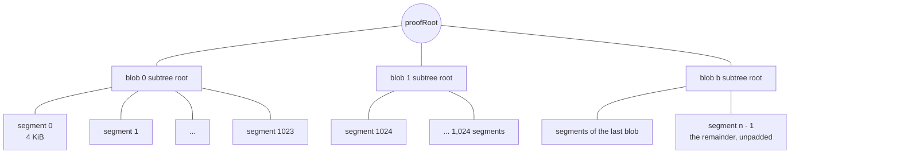
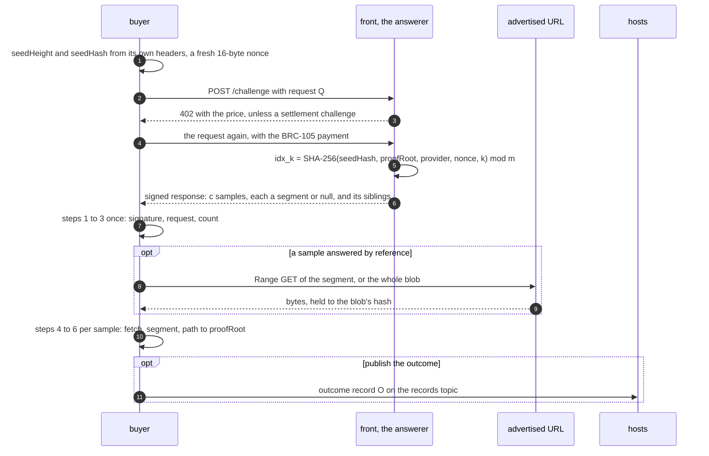
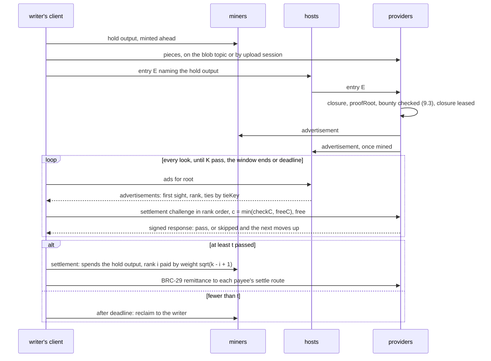
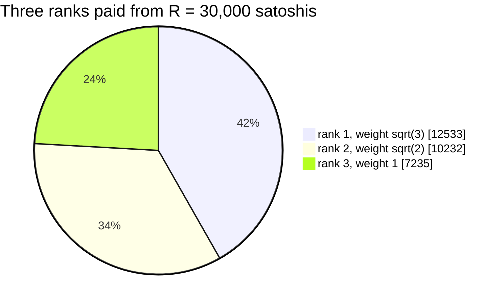
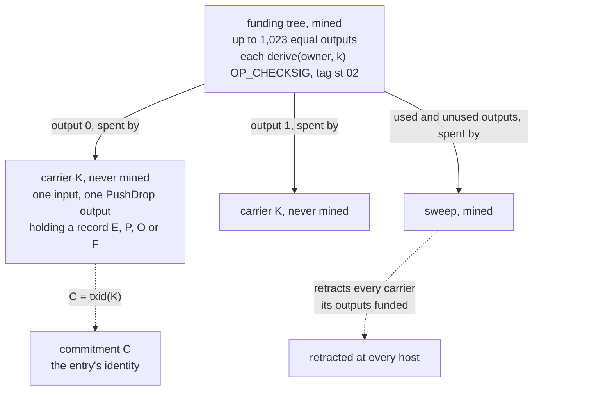
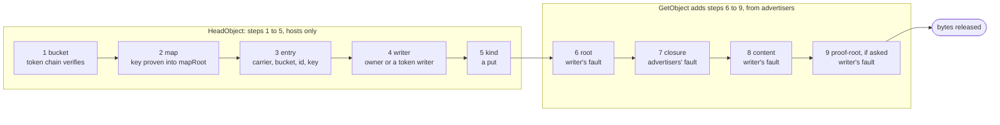
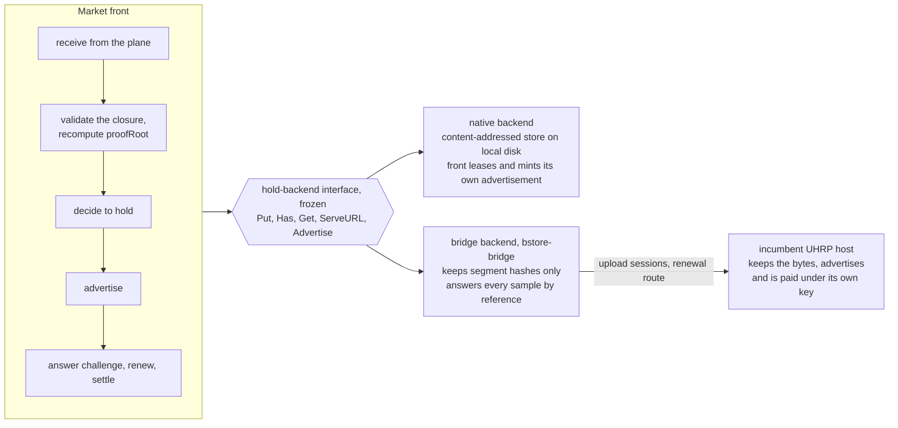

# bstore: the storage market contract

**How to read this document.** This is the contract: every byte format,
rule and bound a compatible implementation must meet, in RFC 2119
language. Sections 1 and 2 name the objects and the conventions; 3 to 8
define the records (buckets, entries, pieces, the proof tree, challenges,
outcomes and front statements); 9 and 10 the market (holding, the race,
settlement, the provider's routes and who pays whom); 11 and 12 the host
(lookups and admission); 13 to 17 carriers, delivery, reading, the S3
mapping and the backend seam; 18 to 22 patterns followed, bounds, what the
contract does not do, the registry and the vectors. What cannot change
once published is listed in [frozen.md](frozen.md). The diagrams in this
document are illustrative; the text is normative.

bstore is object storage as a market on the BEEF object plane. A **bucket**
belongs to an owner (an identity key) and has two topics: a records topic,
`tm_bstore_<name>_<suffix>`, that overlay hosts carry, and a blob topic,
`tm_bstoreblob_<name>_<suffix>`, that storage providers subscribe to. A
publisher puts an object on the plane once: its CHIRP (BRC-167) closure as
**pieces** on the blob topic, and an **object entry** on the records topic.
Every provider subscribed to the bucket receives the same bytes and decides
whether to hold them. Holding is advertised the way UHRP (BRC-26) advertises
it, as an expiring mined token, and the publisher may attach a **hold
bounty** that it pays, by rank, to the first providers to advertise and pass
a challenge. Anyone may buy more time from a provider (a renewal) or a proof
that a provider still holds an object (a **challenge**): a sample of 4 KiB
segments chosen by a seed made of a recent block's hash, the buyer's nonce
and the provider's key, which the provider does not control (signed
clarification, frozen.md section 14, row C12), each proven into
the object's **proof root**, which the object entry commits to. The bucket's
owner orders the bucket by a chain of mined **bucket tokens**; each token
commits to the bucket's whole key map, so that a reader proves what a key
names, what a listing holds and that a key is absent against a token it
verified itself. Readers see S3 through a gateway.

This document is normative. MUST, MUST NOT, SHOULD and MAY are used as in
RFC 2119. Every byte-level and name-level choice that cannot change once a
record is on a public host is listed in [frozen.md](frozen.md). The golden
vectors (section 22) are part of the contract.

bstore adopts BRC-26 advertisements and BRC-167 CHIRP Profile 1 unchanged:
"advertisement", "root", "branch", "blob", "closure", "complete host" and
"object identifier" mean what they mean there. It builds on bcommon (the
shared library of records, carriers, chain tokens and funding trees) and
copies none of it (section 18.1).

## 1. Objects

| Object | On chain | On the plane | What it is |
| --- | --- | --- | --- |
| **Bucket record** `B` | inside a mined token | the token's transaction, records topic | canonical CBOR: one transition of the bucket: its writers, the key changes of one interval, and the root of the whole key map after them (section 3) |
| **Bucket token** | mined | a BEEF object, records topic | a PushDrop of a tag and a `B`; each spends the one before it (section 13.3) |
| **Object entry** `E` | never | inside a carrier, records topic | canonical CBOR: one put or delete of one key by one writer: the CHIRP root, size, content hash, proof root, metadata and hold terms (section 4) |
| **Piece** `P` | never | inside a carrier, blob topic | canonical CBOR: one CHIRP object (a blob, a branch node or the root node) of one closure (section 5) |
| **Hold output** | mined | its transaction, records topic | a tagged output holding a bounty a writer committed to an entry (section 9.2) |
| **Advertisement** | mined | its transaction, records topic and `tm_uhrp` | a BRC-26 advertisement, exactly as the SDK validates it (section 9.1) |
| **Challenge request** `Q`, **response** `R` | never | never (HTTP) | canonical CBOR: a sampled possession challenge and the provider's signed answer (section 7) |
| **Outcome record** `O` | never | inside a carrier, records topic | canonical CBOR: the result of one challenge, published at the buyer's option (section 8.1) |
| **Front statement** `F` | never | inside a carrier, records topic | canonical CBOR: a key that answers challenges and renewals for an advertiser at a URL (section 8.2) |
| **Carrier** `K` | never mined | a BEEF object | one unmined transaction whose one output holds an `E`, `P`, `O` or `F` (section 13.2) |
| **Commitment** `C` | no | no | `C = txid(K)`, 32 bytes, hash byte order: an entry's identity |
| **Funding tree** | mined | inside each carrier's BEEF | one transaction of tagged outputs; each carrier spends one (section 13.4) |
| **Sweep** | mined | a BEEF object, records topic | a mined spend of funding outputs; it retracts the carriers they funded (section 12.4) |
| **Proof tree** | never | never | an RFC 6962 tree over an object's 4 KiB segments; only its root is published (section 6) |

Mine the state, not the data: entries, pieces, outcomes and statements are
never mined. A bucket pays one mined transaction per token; a writer pays one
funding output per carrier and one mined transaction per funding tree, and
one hold output per bounty; a provider pays one mined advertisement per hold
and per renewal.

On the plane, every publisher submits once and every subscriber of a topic
receives the same bytes. Providers are both: they take pieces and entries,
and publish their advertisements.



Off the plane, everything is unicast HTTP or a mined payment: the race and
its settlement, paid challenges and renewals, and reads.



## 2. Conventions

- **CBOR.** Every record is one CBOR map in the core deterministic encoding
  of RFC 8949 section 4.2.1, written and read by bcommon's `cbor` package,
  which enforces it on encode and on decode. The subset is unsigned and negative integers, byte strings, UTF-8 text strings, arrays, maps, `false`, `true` and `null`; tags, floats, indefinite lengths and nesting deeper than 16 are refused. A negative integer where this document defines an unsigned one fails at `type`. A text string that is not valid UTF-8,
  at any depth, is refused at the `cbor` step. One value has exactly one
  encoding a reader accepts.
- **Record keys.** A record's top-level keys are unsigned integers, at most
  64 of them. Key 0 is the record's magic. A key this version defines is
  checked as its table says. A key above the last defined one is unknown: a
  reader MUST preserve it verbatim when it re-encodes and MUST otherwise
  ignore it, except in a challenge request and response (section 7), where
  an unknown key is refused, because it would change what a signature
  binds.
- **Hashes.** SHA-256 unless stated. A txid or commitment inside a record is
  in hash byte order (the order SHA-256d produces); in JSON (a lookup
  question, an outpoint) it is in display order, the byte-reversed hex. A CHIRP object hash, a content hash, a proof root, a map root and a bucket id are SHA-256 digests in their natural order, never reversed, in records and in
  JSON alike. All hex is lowercase. **Two identities for one object:** the
  plane names an object by `SHA-256d` of the whole BEEF object; CHIRP and
  UHRP name bytes by single SHA-256. bstore never compares one with the
  other.
- **Keys.** An identity key is a compressed secp256k1 point: 33 bytes,
  prefix `0x02` or `0x03`, an x-coordinate below the field prime, and a
  point on the curve (bcommon `guard.ParsePubKey`). A reader MUST refuse any
  other byte string, including an x-coordinate at or above the prime that
  some parsers reduce and accept, because that gives one party two names. In
  JSON a key is its 66 lowercase hex digits. The **anyone key** (BRC-43's
  anyone counterparty, the generator point, whose private key is 1) is never
  an owner, writer, buyer, provider, answerer, front or advertiser: a record
  that names it in one of those keys is refused (`identity`).
- **Lists** in a record are strictly ascending by their bytes (an entry of
  a list by its first element), so one set has one encoding.
- **One line.** A text value that is one line holds no control character
  (U+0000 to U+001F, U+007F to U+009F) and neither U+2028 nor U+2029.
- **Object keys.** An S3 object key in a record is a text string of 1 to
  1024 bytes that is one line. Keys compare and sort by their UTF-8 bytes.
- **Signatures** a host or a reader checks are strict DER with a low S
  value: the bytes MUST equal the one canonical serialization of `(r, s)`.
  A signature "over" data is ECDSA over `SHA-256(data)`, as BRC-100's `createSignature` computes it. The one exception is a BRC-26 advertisement's own signature, which is checked exactly as the SDK checks it: canonical DER, any S (section 9.1).
- **Time.** Times in records are Unix milliseconds (UTC) on the writer's
  clock, from 1 to 253402300799999; they are claims. A BRC-26 advertisement's
  expiry is Unix seconds, as BRC-26 has it. A host never admits or refuses by
  a time. The only times anyone proves are block heights.
- **Sizes.** `KiB`, `MiB`, `GiB`, `TiB` are powers of 1024; `KB`, `MB`,
  `GB`, `TB` powers of 1000. A blob is 4 MiB (4,194,304 bytes) and a
  segment 4 KiB (4,096 bytes).

## 3. Buckets

### 3.1 Bucket identifiers and topics

A bucket's **identifier** is `<name>_<suffix>`:

- `<name>` is 1 to 25 bytes of lowercase ASCII letters and single
  underscores, starting and ending with a letter;
- `<suffix>` is exactly 10 lowercase ASCII letters, each drawn uniformly at
  random from `a` to `z` by whoever creates the bucket, once, and never
  changed.

The identifier is 12 to 36 bytes and splits at its last underscore. A bucket
has two topics:

| Topic | Name | Carries | Who subscribes |
| --- | --- | --- | --- |
| records | `tm_bstore_<identifier>` (22 to 46 characters) | bucket tokens, object entries, hold outputs, advertisements, outcome records, front statements, sweeps | overlay hosts (`ls_bstore`), providers, gateways |
| blob | `tm_bstoreblob_<identifier>` (26 to 50 characters) | pieces only | providers |

Both are BRC-87 names of at most 50 characters; the 25-byte bound on
`<name>` is what fits the blob topic. The `tm_bstore_` and `tm_bstoreblob_`
namespaces belong to bstore. The identifier, never the readable part, is
what every record's `bucket`, every question and every topic carries.

The blob topic exists so that a host that answers questions about a bucket
is not delivered, and billed for, every byte of every object in it. A
directory host subscribes to the records topic only; a provider subscribes to
both. A random suffix makes an accidental collision of two buckets
negligible (about 2^-47 for any one pair). It is not a secret and not an
access control: anyone who knows a topic can publish to it.

A topic may hold more than one bucket chain, by more than one owner: a chain is named by the pair of its **owner** and its **bucket id** (section 3.3), and every question about a chain names both.

### 3.2 The bucket record (magic `stb` `0x01`)

| Key | Name | Type | Rule |
| --- | --- | --- | --- |
| 0 | `magic` | bytes | exactly `73 74 62 01` |
| 1 | `bucket` | text | the bucket identifier (section 3.1) |
| 2 | `owner` | bytes(33) | the owner's identity key; not the anyone key |
| 3 | `id` | bytes(32) | the bucket id (section 3.3) |
| 4 | `seq` | uint | 0 to 2^53 - 1; the token's position in the chain |
| 5 | `prev` | bytes(32) | 32 zero bytes at `seq` 0; otherwise the txid of the token at `seq - 1`, hash byte order |
| 6 | `writers` | array | 0 to 16 identity keys, ascending, none the owner or the anyone key: the keys besides the owner whose entries the owner intends to anchor |
| 7 | `changes` | array | 0 to 1024 entries, ascending by `key`, no key twice: a put `[key, C]`, `C` the commitment of the put entry the key names from this token on; or a removal `[key, Z, D]`, `Z` 32 zero bytes and `D` the commitment of the delete entry that removes the key; `key` an object key, `C` and `D` 32 bytes, neither zero |
| 8 | `count` | uint | 0 to 1,048,576: the number of keys in the map after this token's changes |
| 9 | `mapRoot` | bytes(32) | the root of the map after this token's changes (section 3.4) |
| 10 | `created` | uint | Unix milliseconds |
| 11 | `consumed` | array | 0 to 1024 commitments (32 bytes each), ascending, none equal to a `C` or `D` in this token's `changes`: the entries the owner applied in this interval without naming them in `changes` (a put superseded by a later put of the same key in the same batch, a delete of a key the map does not hold, a put of a key whose value it would not change) |

All keys 0 to 11 are required; 12 and above are unknown. The record is at
most 65,536 bytes encoded, and that bound governs over the list bounds: an
owner whose changes do not fit splits them over several tokens.

**The refusal order.** A record is refused for the first rule it breaks:
`too-large` (over 65,536 bytes, before decoding), `cbor`, `key-type`,
`magic`, then per key in key order `missing`, `type` and the key's own rule (`bucket`, `identity` for `owner` and for any key in `writers`, `seq`, `writers` for order, count and the owner, `changes`, `count`, `created`, `consumed`),
then `first`: at `seq` 0, `prev` is not 32 zero bytes, or `changes` or `consumed` is not empty, or `count` is not 0, or `mapRoot` is not `SHA-256` of the empty
string; at `seq > 0`, `prev` is 32 zero bytes.

A host checks these on the record's bytes. It cannot check, at admission,
that `count` and `mapRoot` agree with the chain before the token: that is
the fold of section 12.2.

### 3.3 The bucket id

```text
id = SHA-256("bstore bucket id v1" || txid || uint32be(vout))
```

where `txid || vout` (hash byte order, then 4 bytes big-endian) is the
outpoint the bucket's first token spends from the owner's chain tree (an
output locked to `derive(owner, "chain")`, section 13.4). Checked at admission (`bucket-id`) for a first token. The id is unique to one first token because an outpoint is spent once, but a later token's `id` is only copied from its predecessor, and a stranger can mint tokens of its own that copy another chain's `id`. So a chain is always named by `(owner, id)`: a token whose `owner` differs is another chain, whatever its `id`, and a question, a host's served configuration and a reader's memory all hold the pair. A stranger's tokens can never be the owner's, because only the owner's key makes a token locked to `derive(owner, "bucket")`.

### 3.4 The key map and its root

The **map** of a token is the set of `(key, C)` pairs after its changes,
applied to the map of its predecessor in `changes` order: a put `[key, C]` sets the key, a removal `[key, Z, D]` removes it. Every change MUST change the map: a removal of an absent key, or a `C` the key already names, is a fold error (`map-mismatch`, section 12.2), which breaks the chain for good. The map at `seq` 0 is empty.

A token **names** an entry when the entry's commitment appears in the
token's `changes` (as a put's `C` or a removal's `D`) or in its `consumed`.
Every entry the owner's tooling applies is named exactly once, by the token
that applies it, and the tooling never applies an entry that any token of
the chain has named: it keeps the set of commitments its chain has named, rebuilt from the chain itself (the rooted tokens it verified, by `chain` or `bucket-seq`), never from a local cache, so that a second instance of the tooling or a reorganization cannot rename an entry, and skips every entry in it, whatever the entry says and whenever it is
seen again. Within one batch, when several entries for one key are to be
applied, the tooling orders them by `created`, then by commitment, and the
last one decides the key's change; the others go to `consumed`. Before it
mints, the tooling folds the batch against the current map and moves to
`consumed` every entry whose change would not change the map (a delete of a
key the map does not hold, a put of the value the key already names), so
no change it writes can be a fold error. Because naming is by commitment,
not by time, an entry applied once is never applied again: a delete that
removed a key is not found again as unapplied after a later put sets it,
and a put superseded within a batch does not come back over its successor.

A **delete** entry anchors as a removal, `[key, Z, D]`, whose `D` is its own commitment. A key is deleted when the map does not hold it; there is no "current entry is a delete", and the removal records which delete entry removed it.

```text
leaf(key, C) = uint16be(len(key)) || key || C
mapRoot      = RFC 6962 Merkle Tree Hash over leaf(key, C) for every pair, ascending by key bytes
```

RFC 6962 section 2.1: a leaf hashes as `SHA-256(0x00 || leaf)`, an interior
node as `SHA-256(0x01 || left || right)`, and the root of no leaves is
`SHA-256` of the empty string. Because the leaves are sorted, a path for the
leaf at index `i` together with paths for its neighbors proves both what a
key names and that a key is absent (section 11.3).

A bucket is a chain of spends rooted in one chain tree output, and each
token commits to the whole map. Leaves sort by key bytes, so the paths of
two adjacent leaves (`b.txt` and `c/d.png` below) also prove that a key
between them, `b.zip`, is absent.



### 3.5 Writers

The owner writes entries and anchors them. It may name up to 16 further
**writers** (for example, one key per S3 access key a gateway serves).
Writers matter in two places only: a reader refuses an anchored entry whose writer is neither the owner nor a writer of the token the answer is proven against, the chain's latest (`writer`), and a reader that asks for unanchored entries (section 4.4) considers only the owner's and the latest token's writers'. Because the check is against the latest token, the owner's tooling MUST NOT remove a writer from `writers` while the map names an entry of that writer's; it replaces or removes those keys first, or keeps the writer.
Who may write is the owner's decision at anchoring: a host admits an entry by any key (section 12.1), and the owner's tooling finds its writers' unanchored entries with `unanchored` (section 11.1).

### 3.6 More than one instance of the owner's tooling

The bucket chain is a chain of spends, so two instances of the owner's
tooling that mint a token at the same `seq` make a double spend: one mines,
the other is never admitted (`unmined` forever). Tooling asks `bucket` for
the latest token before it mints, and an instance whose token lost rebuilds
its changes on the winner. Entries carry no sequence, so writers on several
devices never fork anything.

## 4. The object entry (magic `ste` `0x01`)

### 4.1 Keys

| Key | Name | Type | Kinds | Rule |
| --- | --- | --- | --- | --- |
| 0 | `magic` | bytes | all | exactly `73 74 65 01` |
| 1 | `bucket` | text | all | the bucket identifier |
| 2 | `id` | bytes(32) | all | the bucket id the entry is written for |
| 3 | `writer` | bytes(33) | all | the writer's identity key; not the anyone key |
| 4 | `key` | text | all | an object key |
| 5 | `kind` | uint | all | 1 put, 2 delete; 3 to 255 unknown |
| 6 | `created` | uint | all | Unix milliseconds |
| 7 | `size` | uint | put | the object's logical length, 0 to 2^43 (8 TiB) |
| 8 | `root` | bytes(32) | put | the CHIRP root hash (the SHA-256 of the root node's bytes) |
| 9 | `contentHash` | bytes(32) | put | the root node's `contentHash`: SHA-256 of the whole content |
| 10 | `proofRoot` | bytes(32) | put | the proof root (section 6) |
| 11 | `proofProfile` | uint | put | 1 |
| 12 | `contentType` | text | put | 3 to 127 bytes of lowercase printable ASCII (`0x21` to `0x7e`, no `A` to `Z`), one `/`, no parameters |
| 13 | `etag` | text | put, optional | 1 to 64 bytes of printable ASCII without `"`: the S3 ETag the writer's gateway computed (section 16.3); informative |
| 14 | `meta` | map | put, optional | 1 to 32 pairs of text keys (1 to 128 bytes of `a-z`, `0-9` and `-`) and one-line text values (0 to 1024 bytes); at most 2048 bytes encoded; the S3 user metadata |
| 15 | `hold` | array | put, optional | the hold terms (section 4.3) |

Keys 16 and above are unknown. A put carries keys 0 to 12 and may carry 13
to 15; a delete carries keys 0 to 6 only. A kind from 3 to 255 is checked for
keys 0 to 6 and admitted as unknown; a reader treats it as unsupported. The
record is at most 8,192 bytes encoded.

**An empty object.** A put of `size` 0 has `root` equal to the CHIRP
Profile 1 root of empty content
(`0403640d635fd27b6c719d2b81db853483ff8d0fb46f7b90ce9f9d7e9a2729ee`,
BRC-167's vector), `contentHash` and `proofRoot` equal to `SHA-256` of the
empty string, and no `hold`.

### 4.2 The refusal order

`too-large`, `cbor`, `key-type`, `magic`, then per key in key order `missing`, `type` and the key's own rule (`bucket`, `identity`, `objkey`, `kind` for 0 or above 255, `created`, `size`, `profile`, `content-type`, `etag`, `meta`, `hold`); then
`kind` (a key present that the kind does not carry, or one missing that it
does), then `empty` (the rule above, both ways: a `size` 0 put that breaks
it, or a put of `size` above 0 whose `root` is the empty root).

### 4.3 Hold terms

`hold` is the array `[txid, vout, satoshis, t, K, retention, deadline,
checkC]`:

| Element | Type | Rule |
| --- | --- | --- |
| `txid`, `vout` | bytes(32), uint | the hold output's outpoint, txid in hash byte order, `vout` 0 to 2^32 - 1 |
| `satoshis` | uint | 1 to 2,100,000,000,000,000: the hold output's value, the whole bounty |
| `t` | uint | 1 to 16: distinct advertisers that must pass before anything is paid |
| `K` | uint | `t` to 16: the most advertisers paid |
| `retention` | uint | 1 to 2^32 - 1 seconds: an eligible advertisement expires no earlier than `floor(created / 1000) + retention` |
| `deadline` | uint | 1 to 2^32 - 1: the block height by which the writer settles or the bounty lapses |
| `checkC` | uint | 1 to 1024: the samples of the settlement challenge each candidate answers free (section 9.4); 30 recommended |

A host checks these bounds only (`hold`). Whether the outpoint exists, is a
hold output of the writer and holds `satoshis` is a provider's and a
reader's check (section 9.3).

### 4.4 Anchored and pending

An entry is **applied** when a token of the bucket's chain names it (section 3.4), and **anchored** while the latest token's map holds its `C` for its key. An entry no token names yet is **pending**. A put through a gateway
is acknowledged when the facade accepts its entry, before any token anchors
it: that gateway serves its own pending entries at once (read your writes),
and every other reader sees the change once a token anchors it. A reader that asks for pending entries (`pending`, section 11.1) receives the unanchored entries of the owner and the latest token's writers for a key that no token of the chain names, newest claim first, and treats them as claims: nothing orders two writers' pending entries but the owner's next token. Entries a token superseded or dropped are named in its `consumed`, and a delete already applied is named by its removal, so none of them is pending; no clock decides it. A reader of pending entries SHOULD check each entry's funding outpoint unspent by positive evidence from a spend source, as the anchoring tooling must. The owner's anchoring tooling walks each writer's unnamed entries with `unanchored`, which pages by txid and always completes, and checks that every entry an answer returns has the `writer`, `bucket` and `id` it asked for before it applies it, so that a host cannot slip in a stranger's entry or another chain's; it walks again from the start each time it anchors, so an entry admitted behind its cursor is picked up on the next pass. Before it applies an entry the tooling MUST check the entry carrier's funding outpoint unspent by positive evidence from a spend source: a carrier is never mined, so a spent funding outpoint means the writer swept it, and a host that never saw the sweep (it joined later, or the sweep's outpoints aged out) may still answer the carrier.

## 5. Pieces (magic `stp` `0x01`)

A piece carries one CHIRP object of one closure on the blob topic.

| Key | Name | Type | Rule |
| --- | --- | --- | --- |
| 0 | `magic` | bytes | exactly `73 74 70 01` |
| 1 | `bucket` | text | the bucket identifier |
| 2 | `writer` | bytes(33) | the writer's identity key |
| 3 | `root` | bytes(32) | the CHIRP root hash of the closure the piece belongs to |
| 4 | `piece` | bytes | 1 to 4,194,304 bytes: a blob, a branch node or the root node, exactly as stored |

Keys 5 and above are unknown; the record is at most 4,194,560 bytes encoded.
A piece's identity is `SHA-256(piece)`; whether it is a blob or a node is
decided by the closure that references it, never by the piece (BRC-167).
Overlay hosts never admit pieces (section 12.1). A provider reads pieces as
the plane delivers them and applies section 9.3.

A publisher publishes every object of the closure once, in any order: each
distinct blob, each branch node and the root node. A blob shared by two
positions, or by two closures, is published once per closure that needs it.
Profile 1's rules (exactly 4 MiB non-final blobs, fanout 256, the canonical grouping) are the closure's; a provider validates them before it holds. A bstore root node carries **no extension**: no `mediaType`, whose value the entry's `contentType` already carries, so that equal content has one root whoever writes it, and copying, deduplication and bridging never meet two roots for one content. A provider refuses to hold a root with an extension.

How a closure is checked (signed clarifications, frozen.md section 14, rows C1 to C4; C6 and C7 there clarify sections 7.1 and 8.2):

- **C1.** A root node of CHIRP version 1 with a minor version above 0 is refused (`root`): bstore reads version 1.0 alone, as bcommon's decoder does, and never reads a later minor version as 1.0.
- **C2.** bstore checks that a root carries no extension itself: a root with any extension (`len(Root.Extensions) != 0`), advisory or not, is refused (`root`), because bcommon's decoder keeps an advisory extension rather than refusing it.
- **C3.** The depth bound of a closure (16, bcommon `chirp.MaxDepth`) counts the objects on the path from the root to an object, both included: a blob under fourteen branches is sixteen objects deep and within the bound; under fifteen it is seventeen and refused (`root`).
- **C4.** A closure is checked by bcommon `chirp.Verify` with `Limits{MaxLength: 1<<43}` (the entry's size bound) and the default bound on references, in its refusal order: missing, hash, the node checks and the length bound for the root; then, walking the children depth first in child order, the references bound, depth, cycle and missing for each reference, a branch's hash, node checks and length, a blob's length then hash; then content-hash; then canonical (profile 1's construction). A fetch takes only bytes that hash to the object asked for. An object not served, or served only as other bytes, the root included, is `closure` (section 15.2 step 6's root bytes that do not hash to `root` are read as step 7's object no advertiser served); content-hash is `content`; every other refusal, and every rule of the root above, is `root`.

## 6. The proof tree

Proof profile 1. An object of `size` bytes has `n = ceil(size / 4096)`
**segments**: segment `i` is the content bytes from offset `4096 * i`, 4,096
bytes long except the last, which holds what remains and is hashed as it is,
with no padding. Every non-final CHIRP Profile 1 blob is exactly 4 MiB, so
blob `b` holds segments `1024 * b` to `1024 * b + 1023` and no segment
straddles two blobs.

```text
segment leaf = SHA-256(0x00 || segment)
node         = SHA-256(0x01 || left || right)
proofRoot    = RFC 6962 Merkle Tree Hash over the n segments, in order
```

Built per blob, this is a subtree over the blob's segments in order (1,024
leaves for a full blob), at any level an odd node carried up unchanged, and `proofRoot` the same construction over the blob subtree roots in blob order, the subtree roots taken as nodes and never hashed again as leaves;
carrying the odd node up is exactly RFC 6962's split at the largest power of
two below the count, so the two descriptions are one tree. Single SHA-256
throughout, as CHIRP; the prefixes keep a leaf from ever passing as a node.
An object of 0 bytes has no segments and its `proofRoot` is `SHA-256` of the
empty string.

Segments group into one subtree per 4 MiB blob, and the proof root is the
same construction over the blob subtree roots:



A provider recomputes `proofRoot` over the closure it validated before it
advertises the root. A mismatch with the writer's signed entry is a reason
to refuse to hold, and is attributable to the writer: anyone holding the
bytes recomputes it. What a provider keeps to answer challenges is its own
choice: a native provider keeps at least one 32-byte subtree root per blob
and rebuilds a blob's subtree on demand (one 4 MiB read and 2,047 hashes per
sampled blob), or keeps every segment hash (32 bytes per segment, 1/128 of
the data) and answers each sample from one 4 KiB read; a bridge front keeps
every segment hash (section 17).

| Object | Segments `n` | Path depth, at most | One sample, bytes, at most |
| --- | --- | --- | --- |
| 4 KiB | 1 | 0 | 4,096 |
| 100 MiB (25 blobs) | 25,600 | 15 | 4,576 |
| 1 GiB (256 blobs) | 262,144 | 18 | 4,672 |
| 1 TiB (262,144 blobs) | 268,435,456 | 28 | 4,992 |
| 8 TiB, the bound | 2,147,483,648 | 31 | 5,088 |

A sample is the segment and one 32-byte sibling per level. The **path** of
segment `i` among `n` is RFC 6962's audit path (RFC 6962 section 2.1.1),
leaf to root; its length and every direction follow from `i` and `n`
(RFC 9162 section 2.1.3.2 gives the verification), so neither is sent.

## 7. Challenges

A challenge from the buyer's side, with the steps of section 7.4:



### 7.1 The request (magic `stq` `0x01`)

| Key | Name | Type | Rule |
| --- | --- | --- | --- |
| 0 | `magic` | bytes | exactly `73 74 71 01` |
| 1 | `root` | bytes(32) | the CHIRP root hash |
| 2 | `proofRoot` | bytes(32) | the proof root the entry names |
| 3 | `size` | uint | 1 to 2^43: the entry's `size` |
| 4 | `provider` | bytes(33) | the advertiser's identity key (the key of the advertisement being tested) |
| 5 | `answerer` | bytes(33) | the key that signs the response: the provider itself, or a front (section 8.2) |
| 6 | `seedHeight` | uint | a block height |
| 7 | `seedHash` | bytes(32) | the hash of the block at `seedHeight`, hash byte order |
| 8 | `nonce` | bytes(16) | drawn at random by the buyer |
| 9 | `c` | uint | 1 to 1024: samples |
| 10 | `range` | array, optional | `[first, last]`, blob indices, `first <= last < ceil(size / 4194304)` |

No other key: a request with a key above 10 is refused. At most 512 bytes
encoded. The request's hash is `SHA-256` of its encoding.

### 7.2 Indices

```text
idx_k = SHA-256(seedHash || proofRoot || provider || nonce || uint32le(k)) mod m      for k = 0 .. c - 1
```

the 32-byte digest read as an unsigned **little-endian** integer (byte 0 least significant), which is how a script reads it after appending `0x00` and `OP_BIN2NUM`. Without `range`, `m = n`
(all segments) and the sample is segment `idx_k`; with `range`, `m` is the
number of segments in blobs `first` to `last` and the sample is segment
`1024 * first + idx_k`. Samples are drawn with replacement: an index may
repeat, and a repeated sample is answered again. The concatenation is exact
bytes, with `uint32le(k)` four bytes little-endian.

The seed is the block at `seedHeight`. A provider answers a request only if its own headers hold a block at `seedHeight` whose hash is `seedHash` and `seedHeight` is within **6 blocks** of its tip (`tip - 6 <= seedHeight <= tip`), else it answers 422 `seed`. The buyer checks the window against its own tip when it sends the request; when it verifies, which may be later, it checks only that the block at `seedHeight` is `seedHash`.

An answerer MUST answer 422 `unknown-root` unless `root` is a root it holds (or fronts) and `proofRoot` and `size` equal its own computation for that root: a buyer cannot obtain a signed response to a request about a proof root the content does not have, and so cannot manufacture an apparently provable failure.
Neither party picks the seed alone: the miners make the block, the buyer
draws the nonce after it, and `provider` gives two advertisers of one root
different samples, so that one cannot answer from another's response. What the buyer's choice of nonce lets it do, and what a later on-chain use
must keep from the prover, is clarification C12 (signed,
frozen.md section 14).

`range` lets a later partial-hosting profile challenge only the blobs a
host claims. A complete host answers a request with `range` like any other.

### 7.3 The response (magic `str` `0x01`) and its signature

The response body:

| Key | Name | Type | Rule |
| --- | --- | --- | --- |
| 0 | `magic` | bytes | exactly `73 74 72 01` |
| 1 | `request` | bytes(32) | `SHA-256` of the request's encoding |
| 2 | `samples` | array | exactly `c` entries, in `k` order: `[segment, siblings]`, `segment` the segment's bytes or `null` (by reference, section 7.5), `siblings` the path, an array of 32-byte strings; when `answerer` is not `provider`, every `segment` is `null` |
| 3 | `answerer` | bytes(33) | the request's `answerer` |

No other key. The **signed response** on the wire is the CBOR array
`[body, signature]`: `body` the response body's encoding as a byte string,
`signature` a strict low-S DER signature over
`SHA-256(request encoding) || SHA-256(body)` (64 bytes) under
`derive(answerer, "challenge")` (section 13.1). At most 8,388,608 bytes. The
**response hash** is `SHA-256(body)`.

This is the compact inclusion-proof serialization BRC-167 leaves to a later
document, defined over the proof tree rather than over CHIRP nodes. It is
deliberately what a script can check (section 7.7).

### 7.4 Verifying a response

A buyer checks steps 1 to 3 once, then steps 4 to 6 for each sample in `k`
order (sample-major), and stops at the first that fails:

| Step | Label | Fails when |
| --- | --- | --- |
| 1 | `signature` | the response is not `[body, signature]`, or the signature is not strict low-S DER or does not verify under `derive(answerer, "challenge")` |
| 2 | `request` | the body does not decode under section 7.3, or `request` is not this request's hash, or `answerer` differs, or `answerer` is not `provider` and a `segment` is not `null` |
| 3 | `count` | `samples` does not hold exactly `c` entries, or a `siblings` array's length is not the audit path's length for `(idx_k, n)` |
| 4 | `fetch` | a by-reference segment could not be fetched from the tested URL (section 7.5) |
| 5 | `segment` | the segment's length, inline or fetched, is not that segment's length (4,096, or the remainder for segment `n - 1`) |
| 6 | `path` | the leaf and its siblings do not reproduce `proofRoot` |

A response that fails step 1 is attributable to nobody: it is a
**no-answer**. One that fails step 2 or 3, or step 5 or 6 for an inline
segment, is **invalid**: signed by its answerer, and checkable again by
anyone who holds the request and the response. A by-reference sample that
fails step 4, 5 or 6 needs one more look before it is anyone's: the buyer
fetches the whole blob from the tested URL and checks it against its CHIRP
object hash.

- If the blob verifies, the buyer takes the segment from it and checks
  steps 5 and 6 again. If they still fail, the answerer's path is wrong:
  **invalid**, the answerer's. If they pass, the sample passes: the
  advertised bytes are right and only the URL's `Range` handling was wrong,
  which the buyer MAY note as its own record of that URL, never as a
  failure of the challenge or of the answerer.
- If the blob does not verify, or cannot be fetched, the sample is
  **unretrievable**: the tested URL did not serve the bytes when the buyer
  asked, which is the buyer's statement, because a later fetch may succeed.

One whose every sample passes is a **pass**. Each outcome is the
**answerer's**; it is also the advertiser's only when the answerer is the
advertiser, and an unretrievable outcome is about the advertiser's URL
whoever answered. The buyer's deadline for an answer, and what it pays, are
its own. A later reorganization that orphans the seed block changes
nothing: the indices come from the request's bytes, the window was checked
when the request was sent, and at verification, or when a third party
checks an outcome, the buyer accepts `seedHash` if its headers hold it at
`seedHeight` on any branch it has seen.

### 7.5 By-reference samples

A sample whose `segment` is `null` is fetched by the buyer itself, before it checks the path, from the **tested URL**: the `url` of the provider's live advertisement for `root` with the latest `expiryTime` (ties to the lower txid) that the buyer knows of when it sends the request. A request names the provider's key, not one advertisement, so a provider with two live advertisements for one root is tested at that one. The fetch uses the blob object route derived from the
tested URL (BRC-167, "Complete-Host HTTP Retrieval Profile") and an HTTP `Range` request for that segment's bytes within its blob. The buyer
hashes what it receives as the leaf and checks the path. If the host does not honor `Range`, the buyer fetches the whole blob, checks the blob's object hash, and takes the segment from it; against such a host a challenge costs the buyer up to `c` whole blobs (`c` x 4 MiB) of fetches. A by-reference sample proves
that the bytes were retrievable at the advertised URL when the buyer asked,
whoever answered: it is how a front answers for an incumbent host that never
learned of bstore (section 17). A native provider SHOULD answer inline. A front that is not the advertiser MUST answer every sample by reference (section 7.4 step 2): an inline segment from a front would prove only that the front has a copy, and would credit the advertiser with it.

### 7.6 Detection

A provider that lacks a fraction `f` of an object's segments passes one
challenge of `c` samples with probability `(1 - f)^c`; it does not choose
which samples it is asked. Percent of challenges that catch it:

| `c` | 50 % lost | 25 % | 10 % | 5 % | 1 % | 0.1 % |
| --- | --- | --- | --- | --- | --- | --- |
| 1 | 50.0 | 25.0 | 10.0 | 5.0 | 1.0 | 0.1 |
| 8 | 99.6 | 90.0 | 57.0 | 33.7 | 7.7 | 0.8 |
| 16 | >99.9 | 99.0 | 81.5 | 56.0 | 14.9 | 1.6 |
| 30 | >99.9 | >99.9 | 95.8 | 78.5 | 26.0 | 3.0 |
| 60 | >99.9 | >99.9 | 99.8 | 95.4 | 45.3 | 5.8 |
| 100 | >99.9 | >99.9 | >99.9 | 99.4 | 63.4 | 9.5 |
| 230 | >99.9 | >99.9 | >99.9 | >99.9 | 90.1 | 20.6 |
| 459 | >99.9 | >99.9 | >99.9 | >99.9 | 99.0 | 36.8 |
| 1000 | >99.9 | >99.9 | >99.9 | >99.9 | >99.9 | 63.2 |

Samples one challenge needs for a stated confidence:

| Lost | 90 % | 99 % | 99.9 % |
| --- | --- | --- | --- |
| 50 % | 4 | 7 | 10 |
| 25 % | 9 | 17 | 25 |
| 10 % | 22 | 44 | 66 |
| 5 % | 45 | 90 | 135 |
| 1 % | 230 | 459 | 688 |
| 0.1 % | 2,302 | 4,603 | 6,905 |

A dropped blob is `f = 1 / blobs`. One of the 25 blobs of a 100 MiB object
(4 %) is caught by a `c = 30` challenge 70.6 % of the time and by
`c = 113` 99 % of the time; one of the 256 blobs of a 1 GiB object
(0.39 %) 11.1 % of the time at `c = 30`. A buyer who wants to find a dropped
blob raises `c`, or challenges again with a fresh nonce: confidence is
bought per challenge, and two challenges of `c` catch what one of `2c`
catches. At the bound `c = 1024`, one challenge reaches 99 % only for a loss of at least about 1/223 of the segments; one dropped blob of a 1 GiB object is caught 98.2 % of the time at the bound, and two challenges reach 99.97 %.

### 7.7 Script-checkable by construction

A sample's path is checkable by a locking script: the domain bytes `0x00`
and `0x01` are single pushes, the leaf and every node are `OP_SHA256` over
an `OP_CAT`, and `derive(answerer, "challenge")` is an ordinary key an
`OP_CHECKSIG` binds. The index is not a constant a funder can write in
advance, because it depends on a block and a nonce that do not exist when an
output is funded: a later on-chain use derives `idx_k` in script from a
header the unlocking script supplies and the script checks as pinned to a
height (its proof of work against an embedded floor and its height by a
Merkle path to its coinbase), reads the digest as a little-endian number
(section 7.2), and computes each direction from the index or checks the
directions supplied against it. This version defines no on-chain use. The
formats of sections 6 and 7 are frozen so that a later version can add an
output that pays on proof without a new proof format; tag type `st` `0x04`
is reserved for it (section 21).

## 8. Outcome records and front statements

### 8.1 The outcome record (magic `sto` `0x01`)

A buyer MAY publish the result of a challenge on the bucket's records topic,
so that anyone can compute an answerer's record from public data. The shape
is fixed; publishing is optional.

| Key | Name | Type | Rule |
| --- | --- | --- | --- |
| 0 | `magic` | bytes | exactly `73 74 6f 01` |
| 1 | `bucket` | text | the bucket identifier |
| 2 | `buyer` | bytes(33) | the buyer's identity key; not the anyone key |
| 3 | `created` | uint | Unix milliseconds |
| 4 | `request` | bytes | the request's exact encoding, which must decode under section 7.1 |
| 5 | `outcome` | uint | 1 pass, 2 invalid, 3 no-answer, 4 unretrievable |
| 6 | `response` | bytes(32) | outcomes 1 and 2: the response hash |
| 7 | `signature` | bytes | outcomes 1 and 2: the answerer's signature from the signed response |

Keys 8 and above are unknown; at most 4,096 bytes encoded. Refused in the
order `too-large`, `cbor`, `key-type`, `magic`, per key `missing`, `type`
and its own rule (`bucket`, `identity`, `created`, `request`, `outcome`),
then `kind` (keys 6 and 7 present exactly for outcomes 1 and 2), then
`response-signature`: for outcomes 1 and 2, `signature` is not strict low-S
DER or does not verify over `SHA-256(request) || response` under
`derive(answerer, "challenge")`, `answerer` read from the request.

What each outcome proves:

- **pass**: the answerer signed a response to this request with this hash.
  That the response verified is the buyer's statement. A buyer and a
  provider acting together can publish passes for a challenge never made,
  so a reader weighs a pass by who the buyer is (its own challenges, buyers
  it trusts), never by the count.
- **invalid**: the answerer signed a response that, by the buyer's
  statement, failed section 7.4 at an inline segment, or at a fetched segment whose blob the advertised URL served intact. Anyone who holds the
  request and the response (its hash is `response`) checks it again, so an
  invalid outcome is provable to whoever obtains the response, and a false
  one provably false; how the buyer makes the response available (its own
  URL, a bstore object of its own, or on request) is its own, and an
  invalid outcome whose response nobody can obtain weighs no more than a
  statement. Because an answerer refuses a request whose `proofRoot` or
  `size` is not the root's (section 7.2), a reader also checks that the
  request's `proofRoot` and `size` are those of an entry for `root` before
  it counts an invalid outcome.
- **no-answer**: the buyer's statement alone. Non-response cannot be proven
  off chain.
- **unretrievable**: the buyer's statement that the advertised URL did not
  serve a by-reference sample when asked. It is about the advertiser's URL,
  not the answerer's signature, and a later fetch may succeed.

An outcome is attributed to the request's `answerer`, and to its `provider` only where the answerer is the provider, except that an unretrievable outcome is about the provider's advertised URL. Hosts index outcomes by answerer and by provider (section 11.1). An outcome names its root through the request's `root`; nothing ties it to a bucket's entries but the reader's lookup.

### 8.2 The front statement (magic `stf` `0x01`)

| Key | Name | Type | Rule |
| --- | --- | --- | --- |
| 0 | `magic` | bytes | exactly `73 74 66 01` |
| 1 | `bucket` | text | the bucket identifier |
| 2 | `front` | bytes(33) | the front's identity key |
| 3 | `advertiser` | bytes(33) | the advertiser the front answers for |
| 4 | `url` | text | the front's base URL: `https://`, no user information, query or fragment, 12 to 512 bytes of `0x21` to `0x7e`, not ending in `/`; and it parses under the WHATWG URL parser as the advertisement check parses an advertisement's url (section 9.1): scheme `https:`, a non-empty host, no username, password or fragment; its host, percent-decoded, is ASCII and has no label beginning `xn--` (any case), so that no internationalized name is mapped (UTS #46) and every implementation decides alike (`https://:1/x` and `https://1.2.3.256/x` are refused) |
| 5 | `created` | uint | Unix milliseconds |

Keys 6 and above are unknown; at most 2,048 bytes encoded. Refused in the
order `too-large`, `cbor`, `key-type`, `magic`, per key `missing`, `type`
and its own rule (`bucket`, `identity`, `url`, `created`).

A front statement says: the front's key answers challenges and renewals for
this advertiser's holdings in this bucket at `url`. It is the front's word,
not the advertiser's: an incumbent UHRP host signs nothing for bstore. A front that is not the advertiser answers every sample by reference (section 7.4), so a buyer uses a front statement knowing that what the challenge proves is the advertiser's URL, whoever answered (section 7.5), and that a renewal bought through a front is
confirmed only by the advertiser's new advertisement (section 10.3). A
provider that answers for itself needs no statement: its front is derived
from its advertisement (section 10.1).

## 9. Holding, the race and settlement

The race from the writer's side (sections 9.3 to 9.6):



### 9.1 Advertisements

A provider advertises a held root with a BRC-26 advertisement exactly as
the SDK creates and validates it (ts-stack `@bsv/sdk`
`storage/UHRPAdvertisementValidation.ts`, as of `@bsv/sdk` 2.8.10). The
frozen check is that behavior as bstore's port has it, pinned by bstore's
own vectors (`script-v1.json`, section 22), not whatever a later SDK
release does: an SDK change that would decide a vector otherwise does not
change what bstore admits or counts. The check is of an output whose locking script is
a canonical PushDrop of six fields, `hostIdentityKey` (33 bytes), `hash` (the
CHIRP root hash), `url` (a credential-free HTTPS URL of 1 to 2048 bytes),
`expiryTime` and `fileSize` (positive CompactSize integers: Unix seconds,
and the root node's length in bytes) and a canonical DER signature over the
first five fields, locked to the key derived for `hostIdentityKey` under
protocol `[2, "uhrp advertisement"]`, key id `1`, counterparty anyone. For a
CHIRP root, `url` ends in `/chirp/v1/<rootIdentifier>/objects/<rootIdentifier>`
(BRC-167). The SDK accepts the anyone key as `hostIdentityKey`; bstore does not count such an advertisement for anything, because a payment derived for the anyone key is anyone's. An advertisement is mined, published to `tm_uhrp` as UHRP has it, and to the bucket's records topic; spending it cancels it (BRC-26), and
a renewal spends it and recreates it with a later expiry.

### 9.2 The hold output

A hold output is a mined output

```text
<derive(writer, "hold")> OP_CHECKSIG <73 74 03> OP_DROP
```

whose value is the bounty: the script is exactly `21 <33 bytes> ac 03 73 74
03 75`. It is the writer's commitment, not a payment: the writer's key
alone spends it, to settle (section 9.5) or to reclaim (section 9.6). The transaction that holds it SHOULD hold only hold outputs and change, and is published to the bucket's records topic with its own Merkle path, so that a provider can verify the bounty with its own headers. An entry names it in its hold terms. A writer SHOULD fund each
bounty in its own output; one hold output named by two entries is two
bounties paid from one, and a provider that sees two entries name one outpoint counts it once: the outpoint settles at most one entry, the one whose commitment is the settlement's derivation prefix and which the remittance names.

### 9.3 What a provider checks before it holds

A provider that receives an entry with hold terms, and the closure its
`root` names, decides by its own policy (the bucket, the size, the bounty,
its free space). Before it advertises the root it MUST:

1. hold every object of the closure, each matching its object hash, and
   validate the closure as a BRC-167 complete host does before it commits
   (node encodings, lengths, child sums, `contentHash`, Profile 1's
   canonical construction), with the root's `logicalLength` equal to the
   entry's `size` and its `contentHash` equal to the entry's;
2. recompute `proofRoot` over the content (section 6) and compare it with
   the entry's; a mismatch is the writer's fault and the provider does not
   hold;
3. durably lease the closure through the expiry it will advertise, as
   BRC-167 requires before an advertisement is broadcast.

To compete for a bounty it also checks, with its own headers and spend
evidence: the hold output exists, is mined, is locked to `derive(writer,
"hold")` and holds exactly `satoshis`, and is unspent by positive evidence from a spend source (bcommon `chainview` or `nodeapi`; an empty or failed answer is not evidence); and `deadline` is far enough ahead to be worth racing for. An eligible advertisement names the entry's `root`, is by an advertiser key that is not the anyone key and is not already counted, expires no
earlier than the entry's `floor(created / 1000) + retention`, has `fileSize` equal
to the root node's length, and has a `url` of the CHIRP form for that root.
An advertisement that already exists for the root (the provider held it for another entry) is eligible if it meets these. Before it settles, the writer checks each payee's advertisement unspent by positive evidence from a spend source, where a renewal counts as unspent: the advertisement, or its renewal successor (an advertisement of the same key for the same root, with a later expiry, in the transaction that spends it, or that successor's own successor), unspent. A rank keeps the first sight of the original. An advertisement spent by anything but a renewal (canceled) after it passed is not paid: that candidate is dropped, the candidates ranked below it move up one rank each, the next passed candidate (if any) fills the last place, and the writer settles only if at least `t` remain. Hosts do not learn of a cancellation (section 12.1), so `ads` may answer a canceled advertisement until it expires; a reader names an advertiser at section 15.2 step 7 only after its own spend source shows the advertisement unspent, and otherwise just moves on.

### 9.4 Ranking and the settlement challenge

The writer's own client judges the race, as BRC-178 makes the client the
judge of arrival time. It records when it first sees each eligible
advertisement (from any host it asks, or from the plane), ranks them by
that time, ties broken by the tie key below, and challenges the
candidates in rank order with section 7 challenges of `checkC` samples,
answered at the advertiser's front (section 10.1). A candidate that does not pass is skipped and the next moves up; a failure MAY be published as an outcome record. The race closes when `K` distinct advertisers have passed, or when the writer's own race window ends (its policy, not frozen), or at `deadline`, whichever is first; the writer settles only if at least `t` have passed by then.

A provider MUST NOT price a **settlement challenge**: a challenge from the
entry's writer (its BRC-103 authenticated identity) that names an entry
with hold terms whose `root` the provider advertises, before the entry's
`deadline`, when the provider's own section 9.3 checks of the bounty pass
(the hold output exists, is mined, is the writer's, holds `satoshis`, is
unspent, and is worth at least the provider's own minimum), with `c` at most `min(checkC, freeC)`, `freeC` being the maximum the provider publishes in its terms (at least 30), and at most two per hold outpoint and advertiser, whatever entries name it, and only when the hold output is at least `minAge` blocks deep, `minAge` being a number of blocks the provider publishes in its terms (0 to 1008). A hold output in the block at height `h` is `tip - h + 1` blocks deep at the provider's tip `tip` (one confirmation is 1 deep); `minAge` 0 and 1 both require only that it is mined, which the bounty check requires anyway. A `minAge` longer than the writer's race window prices that provider's settlement challenge in effect: a writer SHOULD mine its hold output well before it publishes the entry, by at least the largest `minAge` among the providers it wants. The writer challenges each candidate with `min(checkC, freeC)` samples for that candidate's `freeC`; it MAY pay for more at the provider's price. A provider competes for a bounty when it advertises the root with an advertisement eligible under section 9.3; one that does not owes nothing. Every other challenge is the provider's to price. These conditions make the free answers cost the writer a bounty locked, unspent and worth the provider's minimum, per two answers, so that cheap entries naming a popular root cannot drain the root's advertisers; the writer can reclaim the bounty later, so what it pays is locked capital and fees, and a provider MAY also rate-limit free challenges per writer and per hold transaction. A writer can still respend a hold output into a new one and so restart the two-per-outpoint count; `minAge` makes each restart cost that many blocks of locked capital and one mined transaction (which may carry 1,024 hold outputs, so up to 2,048 free answers per advertiser per restart; a provider's per-writer and per-transaction rate limit is what bounds that, and the count was 16 before 2026-11-01). That residual is stated in section 20.

**The tie key** (amended 2026-10-05, owner approved; frozen.md section
15, row A1). Advertisements first seen at one time (in one look at the
hosts, row C18) tie, and the tie goes to the lower tie key:

```text
tieKey = SHA-256( txid || vout || C )
```

over exactly 68 bytes: `txid`, the advertisement's transaction id in hash
byte order (the 32 bytes as SHA-256d produces them and as an outpoint
serializes them, the reverse of the display hex); `vout`, its output index
as 4 bytes little-endian; and `C`, the commitment of the entry whose bounty
is raced (`C = txid(K)`, section 1), its 32 bytes in hash byte order. Two tie keys are
compared as 32-byte unsigned strings, byte 0 first, and the lower ranks
first; an advertiser is counted once, at its first place, so two of its
advertisements in one look place it at the lower of their keys. A renewal
successor keeps its original's first sight and its original's tie key.
Because `C` does not exist until the entry does, no advertiser can grind a
txid toward a low key before the entry is made: an advertisement that
existed before the entry has a key no lower in expectation than any other.
A provider that advertises only after the entry exists can still grind its
new advertisement, but it then ties only with the advertisements first
seen in the same look, and every advertisement an earlier look found ranks
ahead of it. The rule it replaces broke ties by the lower txid, which a
provider could grind in advance.

The writer's ranking is its own and is not auditable by anyone else; a
provider that believes it was passed over has its own outcome records and
its own record of the writer's settlements to go by.

### 9.5 The settlement rule

If fewer than `t` distinct advertisers passed by the race's close (section 9.4), nothing is paid. Otherwise let `k = min(K, passed)` and `R` the hold output's value.
For rank `i` from 1 (the first to pass in the writer's ranking) to `k`:

```text
weight(i) = sqrt(k - i + 1)                  (IEEE-754 binary64, as BRC-178)
S         = weight(1) + ... + weight(k)
payout(i) = floor(R * weight(i) / S)
payout(1) += R - (payout(1) + ... + payout(k))
```

For example, three ranks paid from a 30,000 satoshi hold output (the
measured shares of [limits.md](limits.md)):



A rank whose payout is 0 gets no output and its remainder goes to rank 1 by
the last line. The settlement is one mined transaction that spends the hold
output and pays each rank one P2PKH output to the key BRC-29 derives for its
advertiser (counterparty the advertiser's identity key, protocol
`[2, "3241645161d8"]`), with

```text
derivationPrefix = base64(C)                 C the entry's commitment, hash byte order, standard padded base64
derivationSuffix = base64(uint16be(i))       the rank, two bytes big-endian
```

The payouts sum to exactly `R`; the mining fee comes from another input of
the writer's. The derivation binds each output to one entry and one rank, as
BRC-178 binds a collect's outputs to its query, so no payee can claim
another rank's output. The settlement is a payment and is never published to the plane or to a host; the writer broadcasts it to miners and sends each payee its BRC-29 remittance, unicast, to the payee's `settle` route (section 10.1), naming the entry it settles. Because
the prefix and suffix follow from public data (the entry, the rank, the
writer's key), a payee that missed the remittance finds its output from the hold output's spend (by a spend source) and the keys it derives for ranks 1 to `K`.

The payee is always the **advertisement's** identity key. A bounty for a
bridged incumbent's advertisement is spendable only by the incumbent's key
(section 17).

### 9.6 Reclaim

After `deadline` the writer MAY spend an unsettled hold output back to
itself. The writer's key can spend it at any time, so a hold output is an
honor escrow, as a BRC-178 collection grant is: a provider sees an early spend that is not a settlement through a spend source and keeps its own record of the writer. A reclaim is not published to the plane either. To raise a bounty, the writer funds a new hold output
and publishes a new entry for the key; advertisements already made count for
the new entry when they meet its terms.

### 9.7 Keys are not copies

A hold bounty buys `t` distinct advertising keys, not `t` independent
copies: one operator running several keys over one disk passes every
challenge, because every key's samples come from the same bytes.
Independence is the writer's choice, made in its ranking through
operator-identity certificates (BRC-52) from certifiers it trusts; this
version defines no certificate type and no rule a provider can see in
advance. Provider-sealed replicas (a slow encoding per key, so that `t` keys
must be `t` copies) are not in this version.

## 10. Provider routes and payment legs

### 10.1 Routes

A provider's **front** is the base URL at which it answers. For a provider
that answers for itself it is derived from its advertisement's `url`: the URL up to, not including, the last occurrence of `/chirp/v1/`, followed by `/bstore/v1`. A front
statement (section 8.2) names any other. The routes, all under BRC-103
mutual authentication over BRC-104:

| Route | Method | Body | Answer |
| --- | --- | --- | --- |
| `<front>/challenge` | POST | JSON `{"request": <base64 of the request encoding>, "entry": <txid, optional>}` | `200` with the signed response (`application/cbor`); `402` with BRC-105's headers when priced; `422` with `{"error": <label>}` for a request it refuses (`request`, `seed`, `unknown-root`); a refusal of a request that came with a payment the front did not take carries `"notTaken"`, section 10.4 |
| `<front>/renew` | POST | JSON `{"root": <64 hex>, "until": <Unix seconds>}` | `402` first; once paid, `200` with `{"advertisement": <BEEF base64>}` |
| `<front>/settle` | POST | JSON BRC-29 remittance (below) | `200` once accepted; `400` if the output is not derivable for this key |
| `<front>/terms` | GET | | JSON, informative (below) |

The `settle` body is `{"entry": <txid>, "rank": <1 to 16>, "transaction":
<Atomic BEEF base64>, "outputIndex": <n>, "derivationPrefix": <base64>,
"derivationSuffix": <base64>, "senderIdentityKey": <66 hex>}`, the BRC-29
remittance fields with the entry and rank they bind. The `terms` document is
`{"service": "bstore", "terms": 1, "challenge": {"base": <satoshis>, "perSample": <satoshis>, "freeC": <30 to 1024>, "minBounty": <satoshis>, "minAge": <0 to 1008>}, "renew": {"perGiBDay": <satoshis>, "minimum": <satoshis>}}`; the 402 is authoritative, and a provider that serves no
terms prices nothing. Payment on a 402 is output 0 of the BRC-105
transaction, a P2PKH output of at least the price to the key BRC-29 derives
for the provider, as bcommon `purse` pays it. A provider MAY also accept BRC-121's smaller 402 profile on the same routes, for a payer without a BRC-103 wallet; BRC-105 is the one every client and provider supports.

### 10.2 Who pays whom

| Leg | Payer | Payee | Unit | Mechanism |
| --- | --- | --- | --- | --- |
| Delivery | each subscriber: every host on a records topic, every provider on a records and a blob topic | the plane operator | delivered bytes | the plane's own billing; outside this contract |
| Mining | the owner (tokens); the writer (funding trees, hold outputs, settlements); the provider (advertisements, renewals); the buyer and the front (their carriers' trees) | miners | bytes mined | ordinary fees |
| Hold bounty | the writer | the first `k` advertisers to pass, by rank | per entry | the hold output, settled by section 9.5's BRC-29 outputs; remittance unicast to `settle` |
| Renewal | anyone: the writer, a reader, anybody with an interest | the provider (or its front) | per root and period, the provider's rate | BRC-105 402 on `renew` |
| Challenge | anyone | the answerer | per challenge, may scale with `c` | BRC-105 402 on `challenge`; free for the settlement challenge of section 9.4. A buyer MAY challenge several advertisers of one root at once and pay those it chooses; a BRC-178 race among them, paid by rank, is not defined in this version |
| Reads | the reader | the provider | none in this version | BRC-167 object routes are public `GET`s; a priced read is a provider's own route, not defined here |
| Priced lookups | the asker | the host | per question class | BRC-105 402 on `ls_bstore` (section 11.4) |
| S3 gateway | the user | the gateway's operator | the operator's | outside this contract |

The plane carries records, never payments. A bounty is a commitment the
writer publishes; its settlement is mined and its remittances are unicast,
one per payee. A provider's revenue is bounties, renewals and challenges;
its costs are disk and the delivered bytes of every object on the buckets
it subscribes to, including the ones it declines to hold. A writer's reason
to publish is reach and verifiability, and it pays a bounty because it
wants holds.

### 10.3 Renewal

`renew` extends a provider's holding of a root to `until`. Once paid, the
provider durably extends the closure's lease through `until` before it
broadcasts the renewed advertisement (BRC-167), spends its current
advertisement for the root into a new one with `expiryTime = until`, and
answers with the new advertisement's BEEF. The buyer confirms the renewal
when that advertisement verifies against its own headers; until it mines it
is a promise. A front renews an incumbent's holding through the incumbent's
own renewal route (section 17) and answers with the incumbent's new
advertisement. "Nobody has read this in a long time" is a provider's signal,
not a protocol one: a provider MAY decline to renew, and an interested
reader buys renewals.

### 10.4 A payment not taken (clarification C30)

A buyer pays a priced challenge on the 402, and then the front may still
refuse it: the seed has left its window, the root turned out damaged when
the answer was read, or the front is busy. The payment was handed to the
front and the front could broadcast it, so without more the buyer holds the
payment's coin until its own node shows the payment was never broadcast.
Under this clarification (frozen.md section 14, row C30) a front that refuses a `challenge` request
that came with a BRC-105 payment, and did not take that payment, adds a
signed **payment-not-taken note** to the refusal's JSON as `"notTaken"`:
base64 of the signed note. A refusal that is about the payment itself
having been used (`409`) or that asks for one (`402`) carries none.

The note's body is a record (section 2) under the magic `stn` `0x01`, at
most 512 bytes:

| Key | Field | Value |
| --- | --- | --- |
| 0 | magic | `stn` `0x01` |
| 1 | payment | 32 bytes: the payment's txid, hash byte order |
| 2 | request | 32 bytes: SHA-256 of the request encoding the payment came with |
| 3 | reason | text, 1 to 64 of `a` to `z`, `0` to `9` and `-`: the refusal's label (`seed`, `unknown-root`, `request`) or, for any other refusal, its error code without `ERR_`, lowercase, `-` for `_` (`busy`, `rate-limited`) |
| 4 | time | unsigned, Unix seconds, `0` to `2^32 - 1`, the front's clock |
| 5 | answerer | 33 bytes: the front's identity key (`request`'s `answerer`) |

A key above 5 is refused. The **signed note** is the CBOR array
`[body, signature]`, at most 512 bytes in all, the signature a strict low-S
DER ECDSA signature over SHA-256 of the body (BRC-100 `createSignature`
over the body) under `derive(answerer, "challenge")`, the key section 7.3's
responses are signed under. A response's signature covers 64 bytes (two
hashes) and a note's body is always longer, so neither can be taken for the
other. Refusals: the record steps of section 2 for the body, then
`unknown-key`, `missing`, `type`, `reason`, `time` and `identity`, in key
order; then `too-large`, `shape` (not `[body, signature]` as byte strings)
and `signature` for the signed note. Every refusal is `not-taken`, its
rule the step (vectors `nottaken-v1.json`).

A front that signs a note never takes that payment afterwards, across
restarts. A buyer that receives a note that verifies, names its own
payment's txid and the SHA-256 of the request it sent, and names the
answerer it asked, which is also the peer its BRC-104 session
authenticated, releases the
payment's coin at once. Any other note is ignored: the payment stays held
until the node shows it was never broadcast. A front that signed a note and
broadcast the payment anyway has signed evidence against itself.

## 11. Lookup: `ls_bstore`

### 11.1 Classes

One lookup service per host answers for every bucket the host carries. It
answers BRC-24 questions of exactly these classes. `b` is the bucket
identifier, `o` the chain's owner and `i` its bucket id; a class marked
"served" answers only for a chain whose `(bucket, owner, id)` the host
serves (section 12.1) and refuses with an error for any other, because the
host keeps the map of served chains only.

| Class | Question (`query` object) | Answer (`output-list`) | Price |
| --- | --- | --- | --- |
| `bucket` | `{"bucket": b, "owner": o, "id": i}` | the chain's latest tokens: those at the highest `seq` among its rooted tokens (rooted and consistent, for a served chain), at most 8 | free |
| `bucket-seq` | `{"bucket": b, "owner": o, "id": i, "seq": s}` | the tokens held for the chain at `seq` `s`, rooted or not, at most 8 | free |
| `object` | `{"bucket": b, "owner": o, "id": i, "key": k}` | served: the latest token, then the entry its map names for `k` with its context; or the token alone, whose context proves `k` absent or names its entry as unheld (section 11.3) | free |
| `list` | `{"bucket": b, "owner": o, "id": i, "prefix": p, "after": a}` | served: the latest token, then the map's entries whose keys start with `p` and sort after `a`, ascending, at most 256, each with its context | free |
| `pending` | `{"bucket": b, "owner": o, "id": i, "pending": k}` | served: entries for key `k` that no token of the chain names, written by the owner or the latest token's writers, newest `created` first, never one dated after the host's time, at most 8 | free |
| `unanchored` | `{"bucket": b, "owner": o, "id": i, "writer": w, "after": e}` | served: the entries by `w` for the chain that no token names, admitted within the last 7 days, ascending by txid (display order) strictly after `e` (empty: from the start), at most 64 | free |
| `entry` | `{"bucket": b, "entry": e}` | the entry carrier whose txid is `e` | free |
| `ads` | `{"bucket": b, "root": r, "after": e}` | the advertisements for `r` that are unspent as far as the host knows and expire after the host's time, ascending by txid (display order) strictly after `e` (empty: from the start), at most 64 | free |
| `ad` | `{"bucket": b, "root": r, "advertiser": a}` | the same, by advertiser `a` only, at most 8 | free |
| `fronts` | `{"bucket": b, "advertiser": a, "after": e}` | the front statements naming `a`, ascending by txid (display order) strictly after `e` (empty: from the start), at most 8 | free |
| `front` | `{"bucket": b, "advertiser": a, "front": f}` | the statements by front `f` naming `a`, newest first, at most 8 | free |
| `hold` | `{"bucket": b, "hold": h}` | the transaction holding hold output `h` | free |
| `outcomes` | `{"bucket": b, "answerer": a}` | outcome records whose request names `a` as answerer, admitted within the last 31 days, newest `created` first, never one dated after the host's time, at most 64 | free |
| `outcomes-of` | `{"bucket": b, "provider": p}` | the same, by the request's provider | free |
| `outcomes-by` | `{"bucket": b, "answerer": a, "buyer": y}` | the same as `outcomes`, by buyer `y` only | free |
| `outcomes-of-by` | `{"bucket": b, "provider": p, "buyer": y}` | the same as `outcomes-of`, by buyer `y` only | free |
| `sweep` | `{"bucket": b, "spent": x}` | the admitted sweeps that spend outpoint `x`, at most 8 | free |
| `history` | `{"bucket": b, "owner": o, "id": i, "history": k, "before": s}` | served: the tokens below `seq` `s` whose `changes` set or remove `k`, newest first, each followed by the entry its change names (the put for a put, the delete for a removal) when the host holds it, at most 64 tokens | priceable |
| `chain` | `{"bucket": b, "owner": o, "chain": i, "after": s}` | the chain's rooted tokens above `seq` `s`, in `seq` order, at most 64 | priceable |
| `export` | `{"bucket": b, "owner": o, "export": i, "after": a}` | served: as `list` with an empty prefix, at most 512 entries a page | priceable |
| `outcome-history` | `{"bucket": b, "outcome-history": a, "before": q}` | outcome records naming answerer `a` strictly before cursor `q`, with no window, newest first, at most 64 | priceable |
| `outcome-history-of` | `{"bucket": b, "outcome-history-of": p, "before": q}` | the same, by the request's provider | priceable |

### 11.2 Question values

The query is validated as parsed, so hosts in any language reach the same
verdict. A member given twice takes its last value. Every member is a
string: `bucket` meets the identifier grammar; `id`, `export` and `chain`
are 64 hex digits; `owner`, `writer`, `advertiser`, `front`, `answerer`,
`provider`, `buyer` and `outcome-history` are 66 hex digits meeting the key
rule, not the anyone key; `key`, `pending` and `history` are object keys;
`prefix` and `after` in `list` and `export` are 0 to 1024 bytes and one line
(empty means no prefix, or from the start); `entry`, and `after` in `unanchored`, `ads` and `fronts`, are a txid in display order or, for `after`, empty;
`root` is 64 hex digits in natural order; `hold` and `spent` are BRC-100
`OutpointString`s; `seq`, `before` in `history`, and `after` in `chain` are
decimals from 0 to 2^53 - 1 with no leading zero; a time cursor `q` is
`<created>:<txid>`, the decimal `created` with no leading zero and the txid
in display order. A question MUST carry exactly the members of one class. A
missing member, a member no class defines, a value that breaks these rules,
a bucket the host does not carry, or a chain it does not serve for a class
marked served is refused with an error, never answered empty and never
ignored.

`outcomes` and `outcomes-of` hold the newest 64 records, and anyone can fill them with unsigned no-answer and unretrievable outcomes dated now; a reader computing a record therefore asks `outcomes-by` and `outcomes-of-by` for the buyers it weighs, and pays `outcome-history` or `outcome-history-of` for the rest.

An empty answer means only that this host holds nothing that answers. The
engine hydrates every answered output as BEEF, so a reader verifies every
token, entry and advertisement against its own headers.

### 11.3 Contexts: inclusion, absence and complete listings

In `object`, `list` and `export` answers the first output is the token the
host answers relative to (its latest rooted, consistent token for the
chain), and every entry output is checked against that token's `mapRoot`.

- An **entry's context** is the CBOR array `[index, path]`: its leaf's index
  in the map and its RFC 6962 audit path, at most 20 steps. The reader
  rebuilds the leaf from the entry's `key` and the entry's own `C` (its
  carrier's txid) and checks the path against `mapRoot` for that index and
  the token's `count`.
- A **leaf** is the CBOR array `[role, index, key, C, path]`: a map leaf
  given in full with its path, `role` 0 for the neighbor before, 1 for the
  neighbor after, 2 for a leaf whose entry the host does not hold or has
  retracted. The **token's context** is a CBOR array of at most two leaves, at most one of each role, in role order (a page that stops at a role 2 leaf carries no role 1).
- In an **`object`** answer: with an entry, the token's context is empty.
  Without one, it either proves `k` absent (role 0 at index `j` with a key
  below `k` and role 1 at `j + 1` with a key above it; role 0 absent when
  `j + 1 = 0`, role 1 absent when `j + 1 = count`) or carries the role 2
  leaf whose key is `k`: the key exists, and this host cannot produce its
  entry. A reader then asks `entry` for that `C` elsewhere, and a gateway
  answers 503, never `NoSuchKey`.
- In a **`list`** or **`export`** answer (`p` the prefix, empty for
  `export`; `a` the `after` member): role 0 is the leaf just before the
  first answered index, and role 1 the leaf just after the last. A page
  stops early at the first index in range whose entry the host cannot
  produce, which it gives as the role 2 leaf, and then carries no role 1;
  the next page asks with `after` set to that leaf's key. Let `s` be the
  index the page starts at (the first answered index, else the role 2 leaf's,
  else role 1's, else `count`). The reader checks, and a page that fails any
  check is incomplete and names the host:
  1. every answered entry's key starts with `p` and sorts after `a`, and the
     answered indices run consecutively from `s`;
  2. role 0 is present exactly when `s > 0`, its index is `s - 1`, and its
     key sorts strictly before the range: at or before `a`, or before `p`;
  3. a role 2 leaf's index is the last answered index plus one (or `s`), and
     its key starts with `p` and sorts after `a`;
  4. unless the page holds its maximum (256 entries for `list`, 512 for
     `export`, the frozen page sizes this check uses) or stops at a role 2
     leaf, role 1 is present exactly when the next index is below `count`,
     its index is that next index, and its key sorts strictly after the
     range: after `a`, after `p`, and not starting with `p`.
  Together these prove that no key with prefix `p` after `a` lies between
  role 0 and the end of the page: a host can withhold an entry only by
  naming it (role 2), never by hiding it, and can never fake an empty page,
  because role 0 and role 1 must then be adjacent leaves, one strictly
  before the range and one strictly after it. (Checked by brute force over about 21 million pages of small random maps, prefixes and cursors: no dishonest page passes these checks, and no honest page fails them.) A host fills every page to its maximum unless the range ends
  or a role 2 leaf stops it. A page always completes. A reader that
  meets repeated role 2 stops at one host asks another.
- A token's context is at most 4,096 bytes and an entry's at most 1,024.

Each page is proven against the token it names. Pages of one listing may
name different tokens when the bucket moves between them; a reader that
needs one snapshot starts again when the token changes. Proofs are relative
to the token: whether that token is the chain's latest is the reader's check
(section 15.1).

### 11.4 What is priced

A price attaches to a question class, never to part of an answer, and no
priced class is a superset of a free class: each carries a member no free class carries (`history`, `chain`, `export`, `outcome-history`, `outcome-history-of`). Everything
a reader needs to resolve and verify one object, one listing page, the
latest token, a root's advertisements and a provider's recent record is
free; what is priced is the bulk walk in one answer. A priced question is
asked on the same BRC-24 route over BRC-104; the host answers 402 with
BRC-105's headers, and the payment is output 0 of the BRC-105 transaction, a
P2PKH output of at least the price to the key BRC-29 derives for the host. A
host that prices anything publishes its terms at `GET
<base>/ls_bstore/terms` as `{"service": "ls_bstore", "terms": 1, "classes":
[{"class": c, "satoshis": n}]}`; the 402 is authoritative. A host that
prices any class bounds BRC-103 handshakes per route and per remote address
before any signature, answering 429 with `Retry-After`.

## 12. The host

### 12.1 Admission by `tm_bstore_<identifier>`

**What a verdict may depend on.** An admission verdict depends only on the
bytes of the submission (the transaction and the transactions its BEEF carries, each bound to it by its txid) and the host's block headers. The engine's list of the inputs that spend outputs the topic holds (its previous coins, BRC-22) decides only what an accepted transaction retains, never whether it is accepted. It never depends on another topic, on anything else this topic
holds, or on arrival order. In particular a host does not check, at
admission: that an entry's writer is the owner or a writer; that its
bucket's chain exists or anchors it; that a hold output an entry names
exists; that an advertisement's root belongs to any entry; that a token's
`count` and `mapRoot` agree with its predecessor's map; that an outcome's
provider holds anything; or that a front is anyone's. Each is a status the
lookup service computes or a reader's check (sections 12.2 and 15). SPV of
the BEEF is the engine's and runs before the topic manager.

**Admit or raise.** A topic manager returns admittance instructions only for
a transaction it admits, and raises for every refusal, so that the engine
records nothing: a recorded refusal would let anyone suppress a genuine
object by submitting it first in another BEEF, and would keep refused for
good a mined object whose block the host's headers did not have yet.

**The BEEF.** Every refusal of a submission's BEEF carries the label `beef`:
a BEEF over the host's bound (at least 262,144 bytes); one that does not
parse as exactly one BEEF V1 (BRC-62), BEEF V2 (BRC-96) or Atomic BEEF
(BRC-95) with nothing after it; one without its subject; one that holds
anything but what the object needs:

- a **carrier** (entry, outcome, front): exactly two transactions, the
  carrier and the funding tree its input spends, and the tree's one minimal
  path;
- a **bucket token**: exactly two transactions, the token and its parent,
  each with its minimal path or one merged path; never Atomic BEEF;
- any **mined object** (an advertisement's or a hold output's transaction, a sweep): exactly one transaction and its own minimal path.

Whatever the host's own bound, an entry carrier's BEEF is at most 81,920
bytes, an outcome's and a front statement's at most 81,920, a token's and a
sweep's at most 196,608, and any other mined object's at most 65,536
(`beef` otherwise). A ceiling in bytes, not in outputs, is what stops a
stranger making a host store a quarter of a megabyte for one funding
output. Paths are minimal and transactions whole as bcommon `chaintoken`
defines it.

**Classify.** An output **claims** when its locking script starts with
`0x21`, 33 bytes and `0xac`, then one push whose data is either exactly
`73 74 01` (a **bucket token**) or starts with a CBOR definite-length map
head, `00 44` and one of `73 74 65 01` (an **entry**), `73 74 6f 01` (an
**outcome**), `73 74 66 01` (a **front statement**) or `73 74 70 01` (a
**piece**). An output is **funding-shaped** when its whole script is
`21 <33 bytes> ac 03 73 74 02 75`, **hold-shaped** when it is
`21 <33 bytes> ac 03 73 74 03 75`, and an **advertisement** when it decodes
and verifies as section 9.1 says. A transaction with more than one claiming
output is refused (`shape`). A piece is refused (`piece`): pieces belong on
the blob topic and no host admits one.

**Carriers** (entry, outcome, front). The owner of the record is its
`writer`, `buyer` or `front`:

1. `shape`: not exactly one input and exactly one output;
2. `beef`: the BEEF is not exactly the carrier and its funding tree with
   the tree's minimal path, or exceeds its ceiling;
3. the record's own rules (sections 4.2, 8.1 and 8.2), with their labels;
4. `bucket`: the record's `bucket` is not this topic's identifier;
5. `mineable`: `nLockTime < 4102444800`, or the input's `nSequence` is
   `0xFFFFFFFF`;
6. `unlock`: the input's unlocking script is not exactly one minimal push of
   a strict low-S DER signature followed by the sighash byte `0x41`;
7. `lock`: the output script is not the well-formed one-field signed
   PushDrop locked to `derive(owner, k)`, `k` being `entry`, `outcome` or
   `front`;
8. `signature`: the field signature is not strict low-S DER, or does not
   verify over `SHA-256(record)` under that key;
9. `funding`: the output the input spends, read from the funding tree in the
   BEEF, is not a well-formed funding output locked to `derive(owner, k)`,
   or the carrier's output does not carry exactly its value.

A host admits an entry whatever writer, chain, root or hold it names, and an
outcome or front statement whatever provider or advertiser it names. Only
the owner's key could have made the carrier, so a key fills a host with its
own records only; an author can make many carriers on one funding output,
each admitted, delivered and billed (admission does not read which outpoints were used before), and what bounds that is policy (below) and retention: the floors of section 12.3 hold only for the first carrier a host admits per funding outpoint, and a later carrier spending the same outpoint (a re-signed copy has another txid) has no floor unless a served chain's map names it.

**Bucket token.** A transaction whose one claiming output claims a bucket
token. Its **parent** is the other transaction in its BEEF:

1. `shape`: the claiming output is not a PushDrop of exactly two fields and a
   signature, or does not hold 1 satoshi;
2. `beef`: not exactly the token and its parent, each with its minimal path,
   or over the ceiling;
3. the record's own rules (section 3.2), with their labels;
4. `bucket`: not this topic's identifier;
5. `lock`: the output script is not the well-formed two-field signed
   PushDrop locked to `derive(owner, "bucket")`;
6. `signature`: the field signature is not strict low-S DER, or does not
   verify;
7. `unmined`: the token's or the parent's proof does not verify against the
   host's headers;
8. `token-input`: for `seq > 0`, the parent's txid is not `prev`, or no input
   spends an output of the parent that is a well-formed bucket token of the
   same `bucket`, `owner` and `id` at `seq - 1`, or more than one input spends
   a token output of the parent; for `seq` 0, not exactly one input spends an
   output of the parent, or that output is not a well-formed funding output
   locked to `derive(owner, "chain")`;
9. `bucket-id`: for `seq` 0, `id` is not the id of the outpoint that input
   spends (section 3.3).

A token's other inputs pay its fee and are not read. A token is admitted
whether or not the topic holds its predecessor (`pending` until it does).
Because the predecessor is read from the BEEF and not held to its own rules,
a host admits a token whose parent was never itself admissible; such a token
never descends from a first token, so it is never rooted and never answered
as latest.

**Mined objects.** A transaction that claims nothing:

- every **advertisement** output and every **hold-shaped** output it holds
  is admitted, refused in the order `beef`, `unmined` (its proof does not
  verify against the host's headers), `too-many` (more than 1,024 of them: the count bound; the BEEF ceiling binds first for advertisements);
- otherwise, if it has at most two outputs and output 0 is funding-shaped
  under any key, it is a **sweep**: output 0 alone is admitted, refused in
  the order `beef`, `unmined`, `too-large` (more inputs than the host's
  bound, at least 1024); its inputs' outpoints are matched against
  carriers' funding outpoints;
- otherwise it is refused (`not-bstore`), whatever it spends. A transaction
  that only spends outputs the topic holds is never accepted: whether the
  topic holds them depends on arrival order, and a settlement or a reclaim
  is a payment, which the plane does not carry. Hosts learn of spends of an
  advertisement only through a renewal that spends it (an admitted
  advertisement transaction whose previous coins include the old one), and
  of a hold output's settlement not at all; readers and providers use a
  spend source (section 12.2).

A host keeps the input outpoints of every sweep it admits (36 bytes each), once per host whatever topics name it, for at least 31 days after first sight, and the sweep's transaction only where an input matches a carrier it holds (so `sweep` answers a sweep it matched, and may answer nothing for one it did not), so that a sweep that arrives before its carriers still retracts them, and nothing a stranger mines can flush them. A host SHOULD keep an
object it refused `unmined` for a short while and decide it again once its
headers move, because a mined object on the plane is delivered once.

**Retention and spends.** For every transaction it accepts, the topic
manager lists every input that spends an output the topic holds as a coin
to retain, so no admitted output is deleted when something spends it; the
index records it spent.

**What a host does not do.** It never admits or stores a piece. It does not
fetch a closure, an advertised URL or anything a record names. It does not
evict unproven carriers. It broadcasts nothing: an engine that carries
`tm_bstore_` topics runs with no broadcaster. It never alters stored bytes.

**Host policy.** What bounds a host's storage is policy, applied before the
topic manager runs and answered as an error, so that nothing is recorded
and the same object is decided afresh when offered again: a host MAY
rate-limit submissions per submitter (the connection, the authenticated
peer or the remote address, never a record's writer, whose carriers anyone
can replay), MAY refuse a BEEF above a bound of its own that is at least
the floor, and MAY admit carriers only from keys its operator configured.
Such a list is static configuration the operator writes; it is never
computed from what any topic holds, and in particular never from a bucket
token's `writers`. A host also names the bucket chains it **serves**: the `(bucket, owner, id)` triples its operator configured. Retention (section 12.3)
favors them; anything else on the topic is a stranger's.

### 12.2 The index

The lookup service keeps, per bucket topic: each chain's tokens, a chain being an `(owner, id)` pair, by `seq` (up to 8 per `seq` and chain: rooted first, then the lowest txids; a token of one owner never takes a place of another owner's); for each served
chain, the current map (key to `C`) of its latest consistent token; the
entries by txid, by `(id, key)` and by writer; the advertisements by root;
the hold outputs by outpoint; the outcome records by answerer, by provider and by buyer; the front
statements by advertiser; and the spends of every held output.

**Tokens.** A token is **rooted** when the host holds every token from it
back to the chain's first by spends. Only rooted tokens are a chain. The
index folds each chain from `seq` 0 and records per token the first that
applies:

| Status | When |
| --- | --- |
| `pending` | it is not rooted |
| `map-mismatch` | its changes do not each change the map, or a commitment it names (in `changes` or `consumed`) was named by an earlier token of the chain, or the map after them has a size other than `count`, more than 1,048,576 keys, or a root other than `mapRoot`. Sticky: every later token of the chain has it too |
| `consistent` | otherwise |

A chain with a sticky status is **broken** from that token: its map is the
map of the last consistent token before it, and nothing after the break is
answered as latest. Only the owner can cause it, and the way on is a new
bucket chain. Where two rooted tokens share a `seq` after a reorganization,
each is folded on its own; an answer uses the one whose proof verifies in
the host's headers, else the lowest txid. The latest tokens are those of the
branch on the current chain (signed clarification,
frozen.md section 14, row C8): walking down from the highest `seq` that holds
a candidate, the candidates at the first `seq` where any token's proof
verifies in the host's headers, so a longer branch a reorganization orphaned
is not answered as latest.

**Entries.** An entry is `anchored` when the latest consistent token's map
holds its `C`, `replaced` when an earlier consistent token named it (as a put, a removal's delete, or in `consumed`) and the current map does not hold it, `pending` when no token names it and its writer is
the owner or one of the latest token's writers, `stranger` otherwise, and
`retracted` when an admitted sweep spends its funding outpoint or the
outpoint carries a retraction mark (section 12.4). The map is **complete**
at a host when it holds every anchored entry, else `incomplete`; the host
does not fetch what is missing.

**Advertisements** are `live` until a renewal the host admitted spends them or their `expiryTime` passes the host's clock (`spent`, `expired`). A host keeps no spend status for hold outputs. Both are the host's view: it learns of a spend only through a renewal, so a reader or a provider that pays, settles or relies on a bounty checks a spend source itself.

Statuses act through what a host answers, its metrics and its logs; no
answer carries a status, and a reader computes each one itself.

### 12.3 Retention

How long a host keeps what it no longer answers is its policy, with floors:

- every token of a chain it serves (its owner the served triple's owner), rooted or pending, for the host's life; any other token, whatever `id` it carries, at least 24 hours after first sight;
- an entry the current map of a served chain names, for as long as it
  names it, and at least 31 days after a later token replaces or removes it;
- an entry that no token names, of a served chain's owner or its latest token's writers: at least 7 days after first sight, long enough for the owner to anchor it (an entry by a writer the owner has not yet named in a token is a stranger's until it does, so the owner anchors it, or names the writer, within 24 hours);
- an advertisement whose `hash` is the root of an entry a served chain's current map names, until the earlier of its expiry and 31 days after first sight (or after its last renewal), by the host's clock, plus 24 hours; a hold output named by such an entry, or by a pending entry of a served chain: at least 31 days after first sight (a host does not learn of its spend);
- an outcome record whose `buyer` is a served chain's owner or one of its latest token's writers, naming such a root: at least 31 days after first sight; the first 16 front statements, by the host's first sight, per (root, advertiser), for advertisers of such a root: at least 31 days; any other outcome or front statement 24 hours;
- for every outpoint of an admitted carrier that a mined sweep the host
  admitted spends, a **retraction mark** (the outpoint alone, 36 bytes):
  for the host's life when the carrier is an entry or front statement whose owner is a served chain's owner or one of its latest token's writers, or an outcome whose `buyer` is such a key; otherwise, whatever root an outcome names, at least 31 days after the sweep's first sight;
- the floors of this section apply to the first carrier the host admits per
  funding outpoint; any later carrier on the same outpoint has no floor
  unless a served chain's map names it;
- anything else, at least 24 hours after first sight.

A retracted carrier is never answered, whatever the floor. To **drop** an
object is to delete its outputs from the topic and evict the engine's
record that its transaction was applied (`evictAppliedTransaction`), so that
the same object offered again, after a token comes to anchor it, is decided
afresh and admitted. Longer retention is what a host sells (`history`,
`export`, `outcome-history`).

### 12.4 Retraction

A writer retracts its unanchored entries, a buyer its outcomes and a front
its statements by sweeping the funding tree that paid for them (bcommon
`carrier.Sweep`). Once the sweep is mined every carrier that spent one of
its outputs is a double spend: hosts stop answering it, drop it and keep the retraction mark, so that it cannot come back by replay at that host while the mark lasts. A host that never saw the sweep (it joined later, or the mark aged out) answers a replayed swept carrier as any other; what keeps such a carrier out of a bucket is the anchoring tooling's own spend check (section 4.4), and readers of pending entries SHOULD make the same check. Retraction wins over every floor. An anchored entry that is retracted leaves its key's map
position unreadable (`incomplete`): the owner's next token SHOULD replace or
remove the key. Retraction reaches honest hosts only; a copy anyone kept
stays a copy, and an S3 delete is a delete entry and a removal in a token, not a sweep.

A sweep that also creates a hold output or an advertisement retracts
nothing. Section 12.1 admits such a transaction as an advertisement's or a
hold output's transaction, a mined object that is not a sweep, so hosts
never match its inputs against carriers and every carrier it spends stays
answered. A writer, a buyer or a front that means to retract MUST sweep in
a transaction of its own, with no hold output and no advertisement among its
outputs; bstore's tooling never builds such a mixed transaction (it refuses
to, for a sweep and for a reclaim alike).

### 12.5 Restore and reorganizations

The engine does not replay admissions. The service persists its sweep spends and retraction marks with the topic's outputs; on start it rebuilds its index from them, in any order, and folds every chain from `seq` 0. A host learns of a block only
through its headers; it may hold two tokens at one `seq` after a
reorganization and answers every candidate through `bucket` and
`bucket-seq`; readers decide with their own headers.

### 12.6 Joining a bucket

A host that starts carrying a bucket, or missed part of it, is given it by
replay: tokens, entries, advertisements, hold outputs, outcomes and
statements are self-verifying, so anyone who holds one may submit it. A
replayer assembles each token's BEEF from the token at `seq` and its parent
at `seq - 1`. A host MUST NOT enable an unordered synchronization of
unspent outputs for `tm_bstore_` topics: it carries only unspent outputs,
so it never carries a chain's spent tokens, and it drops without retrying
what a topic manager refuses.

## 13. Carriers, tokens, funding trees and derivations

Everything here is bcommon's, parameterized by the values in section 13.1.

How the pieces of this section fit: a mined funding tree pays for many
unmined carriers, one output each, and a sweep of its outputs retracts them.



### 13.1 Derivations and tags

| What | Value |
| --- | --- |
| BRC-43 protocol of every public derivation | `[1, "bstore"]` (security level 1) |
| Bucket token lock and field signature | key id `bucket` |
| The outputs of trees that pay for a bucket's first token | key id `chain` |
| Entry carrier record output and field signature; the trees that fund entries | key id `entry` |
| Piece carrier record output and field signature; the trees that fund pieces | key id `piece` |
| Outcome carrier record output and field signature; the trees that fund outcomes | key id `outcome` |
| Front statement carrier record output and field signature; the trees that fund them | key id `front` |
| Hold output lock | key id `hold` |
| Challenge response signature | key id `challenge` |
| Embedded wallet funding key | key id `fund`, counterparty `self` |
| Bucket token tag | `73 74 01` (`"st"` `0x01`) |
| Funding-output tag | `73 74 02` |
| Hold-output tag | `73 74 03` |

Every derivation a host or a reader checks is BRC-42 derivation with
BRC-43's `anyone` counterparty: the writer's wallet derives with `forSelf =
true`, and a reader derives the same public key from the identity key
alone. The funding key uses counterparty `self`, and no rule reads it.
Settlement outputs are BRC-29's own derivation (section 9.5), and
advertisements BRC-26's as the SDK has it (section 9.1); bstore registers
neither.

### 13.2 Carriers

An entry, a piece, an outcome or a front statement rides a carrier built by
bcommon `carrier.Mint`: exactly one input, spending one output of its
owner's mined funding tree, `nSequence = 0`, unlocked by exactly one minimal
push of the owner's signature (strict DER, low S, sighash byte `0x41`);
exactly one output, a lock-before PushDrop of one field, the record, with
the field signature over `SHA-256(record)`, locked to the record's key id,
carrying the whole value of the output it spends; `nLockTime = 4102444800`
with a non-final input, so it cannot be mined (BRC-60's device turned the
other way round). The unlocking-script rule keeps `C` the writer's: without
it anyone could re-encode the input's script and present the same entry
under a new txid, and a token would name a commitment nobody can produce.
A writer makes at most one carrier per funding output, and a retry resubmits the same bytes: a writer that signs deterministically (RFC 6979, as the SDK does) rebuilds the same carrier, while a carrier re-signed or rebuilt differently is a second carrier on the same outpoint, which has no retention floor (section 12.3) and which the gateway that acknowledged the first never names.

A piece carrier is the same with a record of up to 4,194,560 bytes. Its BEEF
is at most 4,259,840 bytes (4 MiB plus 64 KiB): a writer sizes the trees that fund pieces so that the tree, its path and the carrier's own overhead (about 300 bytes) fit in what the ceiling leaves above the record (the 65,536 bytes above 4 MiB, less the record's 256 bytes of keys), and small trees cost less per piece (section 19.2).

### 13.3 Bucket tokens

A bucket token is a mined transaction with exactly one claiming output,
holding 1 satoshi:

```text
<derive(owner, "bucket")> OP_CHECKSIG <73 74 01> <B> <signature> OP_2DROP OP_DROP
```

The signature is the owner's strict low-S DER signature over
`SHA-256(field 1 || field 2)` under the locking key. A token at `seq > 0`
MUST spend the token at `seq - 1`; a token at `seq` 0 MUST spend exactly one
output of the owner's chain tree, locked to `derive(owner, "chain")`, whose
outpoint gives the bucket its id. The owner MUST NOT spend a token's output
except in its successor: a reader that finds the latest token spent by
anything else reports the bucket **closed**. A token is published once,
after it mines, with its parent in one BEEF (bcommon `chaintoken.TokenBEEF`),
to the plane and directly to every host the owner names. A miner may
re-encode a token's unlocking scripts: the record is the same and the
successor is built on the mined txid.

### 13.4 Funding trees

A funding tree is a mined transaction of equal outputs, each
`<derive(owner, k)> OP_CHECKSIG <73 74 02> OP_DROP` with no signature, `k`
the key id of what it funds (`entry`, `piece`, `outcome`, `front` or
`chain`). A carrier spends only a mined tree's output, and its BEEF carries
that tree with its proof. bcommon `producer` runs a tree's lifecycle. A tree
holds at most 1023 funding outputs, so that a sweep of all of them with one
fee input stays within a host's input bound of 1024; tooling sizes each tree
so that its largest carrier stays within its ceiling, and checks every
carrier before it publishes.

### 13.5 Sweeps

A sweep is a mined transaction spending funding outputs, used and unused,
whose output 0 is a funding-shaped tombstone (bcommon `carrier.Sweep`).
Section 12.4 says what it does. A writer SHOULD fund one bucket's carriers
from a tree; one that funded several publishes the sweep in each bucket's
records topic.

## 14. Delivery: plane and unicast

A publisher reaches providers and hosts in one of two ways. The records,
the hosts, the providers and the readers are the same in both.

| | plane | unicast |
| --- | --- | --- |
| Pieces | submitted once, with the blob topic first in the record's topic list, on a connection whose object bound admits a 4 MiB piece; every subscribed provider receives them | uploaded to each provider on its own, through BRC-167's baseline upload-session routes (`/chirp/v1/uploads`): `N` uploads for `N` providers, the incumbent UHRP model |
| Records (entries, outcomes, statements) | submitted once with the records topic first | submitted to each host named (at most 16), each retried on its own |
| Mined objects (tokens, hold outputs, advertisements, sweeps) | submitted once to the plane, and also directly to every host named, because a host whose headers lagged refused it `unmined` and does not receive it from the plane again | submitted to each host named |
| A subscriber that was down | receives what it missed from the plane's repair within its window; anything older by replay (section 12.6) | misses it until someone submits it again |

**Plane.** A piece of up to 4 MiB plus its carrier is larger than the open
connection's object bound, so pieces are published on authenticated
connections; that is the plane's authentication, not bstore's. The plane
delivers each object to every subscriber and repairs loss. Nothing in
bstore disables, bypasses or asks for an exception from repair, for any
class, bucket or configuration. An entry counts as sent once the facade
accepts it and as delivered once a quorum of the hosts the writer names
answer it by `entry`; a mined object counts once every host named answers
it.

**In order.** Nothing needs an order on the wire: pieces before or after
their entry, an entry before or after the token that anchors it, an
advertisement before its entry, a token before its predecessor. A provider
keeps pieces for a root it has not yet seen an entry for, for a while and up
to a size of its own choosing, and drops them unheld after that.

**Reading.** A reader asks one or more hosts the same question and verifies
every answer against its own headers. A reader that asks several and
receives different answers reports the difference and uses the most recent
token it can verify as the chain's latest (section 15.1). A host that
answers something that does not verify, or an output that is not the
object asked for, makes the read incomplete, not refused: what does not
verify is not used, the host is named, and the reader says so (exit 3).

## 15. Reading

### 15.1 The bucket

A reader holds, per bucket chain, the highest `seq` it has verified. It
asks `bucket`, verifies every token answered against its own headers, walks
back by `prev` to a token it already holds or to `seq` 0 (by `bucket-seq`,
or `chain` when it pays), and checks `bucket-id` at `seq` 0 (how without the token's parent: signed clarification, frozen.md section 14, row C15). A token answered
with a `seq` below the one it holds is a `rollback`. With a spend source
(bcommon `chainview` or `nodeapi`), the reader checks that the latest
token's output is unspent; without one it says the bucket may be stale.
The map a token commits to is the owner's signed word: an `object` or
`list` answer proves against it, and a reader that wants to check the
owner's fold itself replays the chain (`chain`) and the map (`export`), as
a host does.

### 15.2 An object: the checks, in order

| Step | Label | Fails when |
| --- | --- | --- |
| 1 | `bucket` | no token of the chain verifies, or the walk of section 15.1 fails; `rollback` as section 15.1 says |
| 2 | `map` | the entry's context does not prove `(key, C)` into the token's `mapRoot` at its index, or an absence context does not prove the key absent |
| 3 | `entry` | the carrier does not verify (SPV with the reader's headers, the carrier rules of section 12.1), or its `bucket`, `id` or `key` is not what was asked |
| 4 | `writer` | the entry's writer is neither the token's owner nor one of the token's writers (the token the answer is proven against) |
| 5 | `kind` | the entry is an unknown kind (unsupported), or a delete, whose commitment no map holds (a removal names it as `D`, never as a key's value; a host answering one as anchored has failed step 2) |
| 6 | `root` | the root node's bytes do not hash to `root`, it is not a valid BRC-167 root node, or its `logicalLength` or `contentHash` differs from the entry's |
| 7 | `closure` | a branch or blob does not hash to what its parent names, at every advertiser asked; or no advertiser served it |
| 8 | `content` | on a whole read, the content does not hash to `contentHash` (a terminal error after streaming, as BRC-167 says) |
| 9 | `proof-root` | on a whole read, when asked: the recomputed proof root differs from the entry's |

The checks in order, and whose fault each failure is:



A failure at step 6, 8 or 9 is the writer's: the entry signs a root, a
content hash and a proof root that the bytes do not match. A failure at
step 7 is the advertisers': they advertised a closure they did not serve,
and the reader names them. A range read checks steps 1 to 7 for the blobs it needs, and never releases a byte of a blob before the blob's hash verifies. A head (S3 `HeadObject`) checks steps 1 to 5 only and never asks a provider. A key whose entry the host names but cannot produce (a role 2 leaf, section 11.3) is incomplete (exit 3), not absent.

### 15.3 A challenge

Section 7.4, then the outcome of section 8.1.

### 15.4 Exit codes

The command-line reader and every bstore command exit:

| Code | Meaning |
| --- | --- |
| 0 | done: everything asked verified, and the hosts asked agree; a challenge passed |
| 1 | refused: what the user asked for by name failed a check that names the owner or the writer (`map`, `entry`, `writer`, `root`, `content`, `proof-root`, a `rollback`, a broken chain); a challenge whose signed response is invalid |
| 2 | usage, configuration, local or transport error; a quorum not met; a price over the limit; a writer's own rule refused (a carrier over its ceiling) |
| 3 | incomplete: the hosts disagree, a host answered something that does not verify (named), no advertiser served a blob, a key's entry no host produces, a challenge got no valid signed answer or a by-reference sample was unretrievable, a budget ran out. It proves nothing either way |

## 16. The S3 gateway

The gateway (`bstore s3d`) is a reader and a writer for clients that speak
S3. It authenticates clients with AWS Signature Version 4 in gateway mode
only: each access key id maps to one identity key the gateway's operator
configured, whose wallet the gateway uses to write; the secret is
provisioned per identity. A wallet-signed native mode is not in this
version. What follows is the contract between S3 and the records.

### 16.1 Buckets and keys

An S3 bucket name is the bucket identifier with every `_` replaced by `-`
(for example `photos-qzvmkwerty`): 12 to 36 lowercase letters and hyphens,
starting and ending with a letter, which S3's naming rules and virtual-host
addressing accept. The mapping is one to one because an identifier holds no hyphen. An identifier whose S3 name would begin with a prefix S3 reserves (`sthree-`) is refused by the gateway for S3 use; no other reserved prefix or suffix can arise from the grammar. The gateway's configuration names, per S3 bucket, the chain it reads, `(owner, id)` (`ListBuckets` answers those). An S3 object key is a bstore object key;
a key S3 would accept but section 2 refuses (a control character) is refused with `InvalidArgument`. The gateway accepts the `aws-chunked` bodies with trailing checksums that current AWS SDKs send by default, and checks the trailer.

### 16.2 Operations

| S3 operation | bstore |
| --- | --- |
| `PutObject` | build the CHIRP Profile 1 closure and the proof tree while the body streams; publish the pieces, a hold output if the gateway's policy sets a bounty, and a put entry; answer `200` once the facade accepts the entry. A `Content-MD5` header is checked against the body (`BadDigest` on a mismatch). Conditional writes (`If-None-Match`, `If-Match` on a put or a completion) are refused with `501 NotImplemented`, never ignored: a client that relies on them for locking must not believe it holds a lock. The entry is pending until the owner's next token anchors it. A `200` does not mean held: no provider may have advertised yet. A gateway MAY keep the bytes, and delay the `200`, until `t` advertisements exist, as its policy |
| `CreateMultipartUpload`, `UploadPart`, `CompleteMultipartUpload`, `AbortMultipartUpload` | the gateway buffers parts and builds one closure over the assembled content: an S3 part (5 MiB minimum) is not a blob (4 MiB), so parts are re-chunked; one entry at completion. An upload is the gateway's own state: every part and the completion go to one gateway, and an upload begun at one gateway cannot be completed at another |
| `CopyObject` | a new put entry naming the same `root`, `size`, `contentHash` and `proofRoot` as the source's current entry, and, as S3's default `COPY` metadata directive does, its `contentType`, `etag` and `meta`; with `REPLACE` the request's content type and metadata instead, and the same `etag`. Within one bucket no piece is published again, and providers already holding the root may advertise it for a new bounty; across buckets the gateway publishes the closure's pieces again on the destination's blob topic, whose providers have not seen them |
| `DeleteObject` | a delete entry; `204`. The key leaves the map at the next token, as a removal (section 3.4); a delete of a key the map does not hold is named in the next token's `consumed`, never a removal, so it is applied once and never again |
| `HeadObject`, `GetObject` | `object` at the hosts configured, the checks of section 15.2 (steps 1 to 5 for a head, which never asks a provider), blobs from the advertisers of `ads`; a `Range` maps to the blobs it overlaps, each verified before any byte is sent |
| `ListObjectsV2` | `list` pages, proven complete per page (section 11.3); a key a page names as unheld (role 2) is listed from its entry fetched by `entry` at another host, and if no host produces it the listing answers 503; `Delimiter` is applied by the gateway to the proven page; `ContinuationToken` is the base64 of the last key (after a common prefix: signed clarification, frozen.md section 14, row C14); `MaxKeys` at most 1000 |
| `ListBuckets` | the configured buckets |
| everything else (versioning, ACLs, policies, lifecycle, tagging, object lock, encryption headers, presigned POST) | `NotImplemented` |

### 16.3 Headers and semantics

- **ETag.** The entry's `etag`: for a single `PutObject`, the hex MD5 of the
  body; for a multipart upload, S3's form (the MD5 of the parts' MD5s, `-`,
  the number of parts), both computed by the writing gateway, so that
  clients that compare an ETag with an MD5 they computed are satisfied. It
  is informative; integrity is the CHIRP root and the content hash. An
  entry without `etag` is answered with `"<64 hex of root>-1"`, which such
  clients read as a multipart ETag and do not compare.
- **`x-amz-checksum-sha256`** is the base64 of `contentHash`, with `x-amz-checksum-type: FULL_OBJECT`, for multipart objects too; S3 itself gives SHA-256 multipart objects only a composite checksum, so this is a deviation, and clients that check the value still pass A ranged answer carries neither (signed clarification, frozen.md section 14, row C13).
- **`x-amz-meta-bstore-root`** is the hex of `root`; `x-amz-meta-*` the entry's `meta`. User metadata keys starting `bstore-` are reserved and refused on a put.
- **`Content-Type`** is the entry's `contentType`. On a put the gateway lowercases the client's value and strips its parameters; with none, or one that breaks section 4.1's rule, it records `application/octet-stream`.
- **`Last-Modified`** is the entry's `created`: the writer's claim. The
  anchoring token's block is the proven bound.
- **Consistency.** A gateway reads its own pending entries at once; other
  gateways see a write when a token anchors it. S3's strong read-after-write
  consistency holds only at the writing gateway.
- **Not found.** `NoSuchKey` when the host's answer proves the key absent (section 11.3), or, at the writing gateway, when its own pending delete is newer than the anchored entry; `503 SlowDown` when no host answers at all, because an empty answer proves nothing, or when the map names the key's entry and no host produces it. When no host answers, the writing gateway's own pending put still answers and its pending delete does not (signed clarification, frozen.md section 14, row C16).
- **Errors in flight.** A blob that fails its hash at every advertiser after
  headers were sent ends the response early; the declared
  `Content-Length` makes the truncation visible to the client.

## 17. The hold-backend interface and the bridge

A provider is a **market front** (receive from the plane, validate the
closure, recompute the proof root, decide to hold, advertise, answer
`challenge`, `renew` and `settle`) over a **hold backend**. The interface
between them is frozen, so that a backend built later for any incumbent
host targets a surface that does not move:

| Call | Meaning |
| --- | --- |
| `Put(hash, bytes)` | store one CHIRP object under its SHA-256; idempotent; refuses bytes that do not hash to `hash` |
| `Has(hash)` | whether the backend can serve the object now |
| `Get(hash, offset, length)` | a byte range of a stored object, which the front verifies (against the object hash, or a segment against the proof tree) before it uses it |
| `ServeURL(root)` | the HTTPS URL the root's advertisement names: the root object's BRC-167 route at whoever serves the bytes |
| `Advertise(root, until)` | make the closure held through `until` and return the advertisement that says so: for a native backend the front leases the closure and mints its own advertisement; for a bridge backend the incumbent commits or renews through its own routes and the bridge returns the incumbent's advertisement |

Where the seam sits:



`Advertise` is the seam for renewal pass-through; the other four are as the
design names them. A native backend is a content-addressed store on local
disk. A **bridge backend** (its own repository, which speaks the
incumbent's HTTP interfaces and imports none of its code) joins an existing
UHRP host to the market without changing how it runs:

- `Put` writes the closure into the incumbent through BRC-167's upload sessions (`/chirp/v1/uploads`), paying the incumbent's own price, or through a zero-price lane where the bridge and the incumbent share an operator. The SDK's whole-file `/quote`, 402, `PUT` flow advertises a content hash at a non-CHIRP URL, which section 9.3 does not count, so it gives no eligible hold; an incumbent without upload sessions is readable but cannot be bridged into the race;
- the incumbent's own commit creates its own BRC-26 advertisement under its
  own key; the bridge mirrors it, unchanged, onto the bucket's records topic
  and publishes a front statement naming itself as the incumbent's front;
- the bridge keeps every segment hash of the proof tree (32 bytes per 4 KiB:
  1/128 of the data, about 7.8 GB per TB), never the bytes, and answers every challenge by reference (section 7.5), with the paths built from the hashes it keeps; it MAY first fetch each sampled segment from the incumbent's blob route with a `Range` request and check it, to know what the buyer will find. A passing proof shows what a reader of the incumbent's public URL gets;
- `renew` translates to the incumbent's own renewal route; the incumbent
  redeems and recreates its advertisement as its SDK does, and the bridge
  answers the buyer with that advertisement;
- a bounty for the incumbent's advertisement is paid to the incumbent's key
  (section 9.5); the bridge never holds that key, and forwards the
  remittance to the incumbent's operator where they are not the same.

An incumbent with no bridge is still readable: a reader fetches from any
advertiser of a root (section 15.2). It cannot receive from the plane, race
for bounties or be challenged except by reference by a front someone else
runs. What the seam does not do: modify the incumbent, proxy its reads,
advertise under another key, or keep a second copy of the bytes.

## 18. Alignment with existing patterns

| Choice | Pattern followed | Where it differs, and why |
| --- | --- | --- |
| Advertisements as expiring mined tokens, spend = cancel | BRC-26, as the SDK validates it | mirrored onto the bucket's records topic as well as `tm_uhrp` |
| Objects as CHIRP closures, complete hosts, object routes | BRC-167 Profile 1 | the closure travels on the plane once instead of to each host; the upload-session routes are the unicast fallback |
| A compact inclusion proof and a sub-blob proof profile | BRC-167's deferred "compact serialized Merkle inclusion-proof format" and "proof-carrying sub-blob profile" | defined over a second tree of 4 KiB segments, because CHIRP's blob hashes are public and flat |
| Small leaves sampled from a seed pinned to a block height | Sia v2 storage proofs (`SiaFoundation/core` `types/types.go`, `V2StorageProof`: a 64-byte leaf, the index from the block at `ProofHeight`); a block hash as a "publicly traceable and uncontrollable randomness source" (Xiaohui Liu, sCrypt, "Pay for Storage using Proof of Retrievability on Bitcoin", 2022) | 4 KiB leaves and `c` samples a challenge, off chain, bought by anyone; a buyer nonce and the provider key in the seed |
| Merkle trees with `0x00`/`0x01` prefixes | RFC 6962 section 2.1 | the proof tree's leaves are segments; the key map's leaves are `(key, C)` |
| A race paid by rank with square-root weights, `t` and `K`, BRC-29 outputs bound by prefix and suffix | BRC-178 | applied to writes, which BRC-178 leaves open; the judge is the writer's client; the prefix is the entry's commitment and the suffix the rank |
| A bounty the payer may reclaim | BRC-178 collection grants | a mined tagged output the writer's key spends, named by the entry |
| Priced challenges, renewals and lookups | BRC-105 over BRC-103 and BRC-104; BRC-29; BRC-180 rule 2 for terms | verification of one object, one page and a provider's recent record stays free |
| Records as canonical CBOR with integer keys; record magic | RFC 8949 section 4.2.1; BRC-171 section 6 | through bcommon `record` |
| Carriers kept off chain | BRC-60's non-final transaction | turned the other way round |
| An ordered state on a chain of mined tokens, the predecessor read from the BEEF | BRC-48 tokens spent forward; BRC-22 previous coins | previous coins decide retention only |
| Derivation `[1, "bstore"]`, counterparty anyone | BRC-42, BRC-43 | |
| Topic and lookup names | BRC-87; BRC-22; BRC-24 `output-list` | a random suffix per bucket; two topics per bucket |
| Operator independence | BRC-52 certificates | the writer's choice in its ranking; no certificate type registered |
| S3 | the AWS S3 API, Signature Version 4 | the deviations of section 16 |

### 18.1 Shared code

bstore writes no code another application already has. It takes from
bcommon `cbor`, `record`, `guard`, `pushdrop`, `carrier`, `chaintoken`,
`producer`, `funding`, `commit` (RFC 6962 roots and paths), `lookup`,
`hostset`, `publish`, `verify`, `headers`, `purse` (the 402 legs),
`chainview` and `nodeapi` (spend evidence), and the TypeScript package for
the host module. Two additions belong in bcommon rather than here: `commit`
over leaves of arbitrary bytes (it takes 32-byte leaves today), which the
proof tree and the key map both need, and a CHIRP Profile 1 codec (node
encoding, canonical construction, closure validation), which any
application that stores bytes needs. The BRC-26 advertisement check
follows the SDK's validation byte for byte, as ported and pinned by
bstore's vectors (section 9.1), with the SDK's own vectors.

## 19. Size and rate bounds

### 19.1 Bounds

| Quantity | Bound | Why |
| --- | --- | --- |
| Bucket record | 65,536 bytes encoded; 16 writers; 1024 changes; 1024 consumed | a token and its parent fit the token ceiling; the encoded bound governs |
| Keys in a bucket's map | 1,048,576 | a path of at most 20 steps; a host refolds at most about two million hashes per token |
| Object entry | 8,192 bytes; key 1,024; `meta` 2,048 | |
| Object size | 0 to 2^43 bytes (8 TiB) | S3's 5 TiB fits; a proof path of at most 31 steps |
| Piece | 4,194,560 bytes encoded; carrier BEEF at most 4,259,840 | one 4 MiB blob and its carrier |
| Outcome record, front statement | 4,096 and 2,048 bytes | |
| Challenge request | 512 bytes; `c` 1 to 1024 | |
| Signed response | 8,388,608 bytes | 1024 samples of at most about 5,160 bytes each (with CBOR heads) is about 5.3 MB |
| Inclusion context | 1,024 bytes an entry, 4,096 a token | |
| Hold terms | `t` 1 to 16, `K` `t` to 16, `checkC` 1 to 1024 | |
| Advertisements and hold outputs per mined transaction admitted | 1,024 | 16 until 2026-11-01; a 1,024-output hold transaction is about 50 KB, inside the 65,536-byte mined bound |
| BEEF | exactly what the object needs; an entry's, an outcome's and a front statement's at most 81,920 bytes, a token's and a sweep's at most 196,608, any other mined object's at most 65,536, whatever the host's own bound, which is at least 262,144 | a stranger's carrier costs a host at most 80 KB for a floor |
| Answers | `list` 256, `export` 512, `ads`, `outcomes`, `history`, `chain` and `outcome-history` 64, every other class 8, each plus the token where one leads | below the engine's own cap of 1000 outputs; a later version may raise them, except the `list` and `export` page maxima, which the page checks of section 11.3 use |
| A sweep's input outpoints | at least 31 days, once per host; the transaction only where it matched a held carrier | a sweep may arrive before its carriers |

A reader accepts every record within these bounds. A later version may raise
a record bound, never lower one. A host MAY rate-limit lookups, answering
429 with `Retry-After`, and a client MUST respect it.

### 19.2 What one object costs, worked through

The carrier figures below use bcommon's measured carrier shape: about
1.2 KB of fixed overhead plus 49 bytes per output of the funding tree the
carrier's BEEF carries; a 32-output tree gives about 2.8 KB. A funding
output costs its writer about 57 mined bytes (the output and its share of
the tree transaction).

**A 100 MiB object** (104,857,600 bytes):

- Closure: 25 blobs of exactly 4,194,304 bytes; the root node is
  8 + 2 + 8 + 32 + 1 + 25 x 41 + 1 = 1,077 bytes (no branch: 25 children fit
  one root). 26 pieces.
- Pieces with 32-output trees: 25 x (4,194,304 + about 2,900) + (1,077 +
  about 2,900) = about 104,934,000 bytes, plus the plane's 36-byte delivery
  framing per object. Every provider subscribed to the blob topic is
  delivered about 104.94 MB for the object, 0.07 % above the content.
- Records topic: one entry carrier (a 40-byte key, no metadata: a record of
  about 330 bytes, a carrier of about 3.1 KB), the hold output's transaction
  (about 300 bytes with its path), one advertisement per holding provider
  (about 1 KB each with its path), the bucket token's share. A directory host
  is delivered under 10 KB for the object.
- Mined by the writer: 27 funding outputs (about 1.5 KB), the hold output's
  transaction (about 250 bytes), the settlement (about 200 bytes plus 34 per
  payee); by each provider: one advertisement (about 450 bytes) and one per
  renewal; by the owner: a share of one token.
- Proof tree: 25,600 segments, depth 15. A sample is 4,096 + 15 x 32 =
  4,576 bytes; a `c = 30` response about 138 KB. The settlement challenge
  of `K = 5` winners moves about 690 KB in all. A native provider that rebuilds subtrees reads at most 25 blobs (100 MiB, every blob of the object) for one challenge; one
  that keeps segment hashes (819,200 bytes for this object) reads 30
  segments (120 KiB).
- Finding one dropped blob (4 %) with 99 % confidence takes `c = 113`, a
  response of about 517 KB.

**A 1 TiB object** (262,144 blobs): CHIRP Profile 1 groups the blobs into
1,024 full branches of 256 children (10,516 bytes each) and those into 4
branches, under a root of 4 children (216 bytes): 263,173 pieces. The writer
mines one funding output per piece and one for the entry, about 15.0 MB at
57 bytes each; larger trees lower that and raise each piece's BEEF. The proof
tree has 268,435,456 segments and depth 28: a sample is 4,992 bytes, a
`c = 30` response about 150 KB and a `c = 459` response about 2.3 MB. A
bridge front keeps 8 GiB of segment hashes for it (2^28 x 32 bytes).

**Plane against unicast for `N` providers:** the writer sends the closure
once and each provider is delivered it once, paying for its delivered
bytes; with unicast the writer uploads it `N` times from its own link. A
provider that declines to hold an object has still paid to receive it:
that is the price of seeing the market's whole supply, and the reason
providers subscribe per bucket, never to an aggregate.

## 20. What this does not do

1. **Availability is a market outcome, not a guarantee.** The contract says
   how many providers advertise a root and lets a writer raise the bounty
   until enough do. A bucket with one provider is a hosting contract, not a
   market, and tooling says which it is.
2. **Keys are not copies.** `t` advertisers may be one disk (section 9.7).
3. **Enforcement is reputation.** No deposit is slashed and no payment is
   conditional on a proof on chain in this version; a hold output is the
   writer's honor escrow, and a provider that takes a renewal payment and
   does not renew is caught only by its buyer.
4. **A pass is the buyer's word.** Only an invalid signed response is
   provable by anyone; a non-response is provable by nobody.
5. **Possession is proven at challenge time only,** and to the precision of
   section 7.6. Outsourcing is permitted: a provider that fetches a sample
   from elsewhere has shown the bytes are retrievable, which is what the
   market prices.
6. **The writer's ranking is its own** and cannot be audited.
7. **Hosts can withhold.** They cannot forge an entry, a token or a proof.
   An anchored map proves inclusion, absence and complete listings relative
   to a token; a host that answers an older token is caught by a reader that
   remembers a later one or checks spend evidence, and not otherwise.
8. **Metadata is public.** Every host and subscriber sees each entry's key,
   size, content type, metadata, writer, time and hold terms, and every
   piece's bytes. Encrypt and pad before a put (BRC-167's advice) and use
   keys that say nothing; a bucket that needs its metadata off the open
   plane runs on a private slot, a provisioning choice.
9. **Erasure is impossible.** A delete removes a key from the map; providers
   let advertisements lapse; a sweep retracts unanchored entries from honest
   hosts. Bytes anyone fetched stay fetched, and tokens keep naming the
   entries they anchored.
10. **Every subscriber pays for every byte** on the topics it elects,
    including junk a stranger publishes on a blob topic; what bounds that is
    the plane's authentication and rate controls.
11. **The owner's key is online** wherever the anchoring tooling runs.
12. **One false token ends a chain.** A token whose fold does not reproduce
    its root breaks the chain from there; objects stay readable by root, and
    the way on is a new chain.
13. **Read-after-write holds at the writing gateway only** (section 16.3).
14. **No versioning, ACLs or lifecycle** through S3 (section 16.2).
15. **Directory hosts hold no bytes.** Reads come from advertisers.
16. **A bucket holds at most 1,048,576 keys,** an S3-visible limit; a larger
    store shards by prefix into several buckets, each its own chain.
17. **A put acknowledged is not a put held** until providers advertise it
    (section 16.2).
18. **A front's word is its own.** Anyone may claim to answer for any
    advertiser; what a front's by-reference answers prove is the
    advertiser's URL, and its failures are its own.
19. **The free settlement challenge can be restarted** by a writer that
    respends its hold output: each restart costs `minAge` blocks of locked
    capital and one mined transaction, and buys up to two free answers per
    advertiser per hold output (section 9.4).
20. **Retraction is per host and for a while.** A host that never saw a
    sweep answers the swept carrier; only spend checks by the anchoring
    tooling and readers keep it out (section 12.4).

## 21. Registry entries

Registered in bcommon's registry (`docs/registry.md`) before anything is
published under them, and checked against it:
its prefixes `bf`, `gw`, `bl`, `bb`, `bo`, `se`, `bc` and `vx` (tests), and `bs`, unassigned and never to be assigned; its protocols, topic namespaces, lookup services, routes and
baskets. The registry already says a storage application takes `st`; `st`
is none of the registered prefixes, `[1, "bstore"]` is no registered
protocol, `tm_bstore_`, `tm_bstoreblob_` and `ls_bstore` are no registered
names (and neither namespace is a prefix of another registered one), and no
basket starts with `bstore`.

| Kind | Value | Use |
| --- | --- | --- |
| Protocol | `[1, "bstore"]` | every bstore derivation (counterparty anyone) and the funding key |
| Key id | `bucket` | a bucket token's lock and field signature |
| Key id | `chain` | the outputs of trees that pay for a bucket's first token; never a carrier's |
| Key id | `entry` | an entry carrier's record output and field signature, and the outputs of trees that fund entries |
| Key id | `piece` | a piece carrier's record output and field signature, and the outputs of trees that fund pieces |
| Key id | `outcome` | an outcome carrier's record output and field signature, and the outputs of trees that fund outcomes |
| Key id | `front` | a front statement carrier's record output and field signature, and the outputs of trees that fund them |
| Key id | `hold` | a hold output's lock |
| Key id | `challenge` | the signature of a challenge response |
| Key id | `fund` | the embedded wallet's funding key |
| Tag prefix | `st` (`73 74`) | owned by bstore |
| Tag | `st` `0x01` | bucket token, first field |
| Tag | `st` `0x02` | funding-tree output, its one field |
| Tag | `st` `0x03` | hold output, its one field |
| Tag | `st` `0x04` | reserved for a later output that pays on a challenge proof (section 7.7); not assigned in this version |
| Record magic | `stb` `0x01` | bucket record, version 1 |
| Record magic | `ste` `0x01` | object entry, version 1 |
| Record magic | `stp` `0x01` | piece, version 1 |
| Record magic | `sto` `0x01` | outcome record, version 1 |
| Record magic | `stf` `0x01` | front statement, version 1 |
| Record magic | `stq` `0x01` | challenge request, version 1 |
| Record magic | `str` `0x01` | challenge response body, version 1 |
| Topics | `tm_bstore_<name>_<suffix>` | a bucket's records topic; `<name>` 1 to 25 characters, `<suffix>` 10 random lowercase letters; the `tm_bstore_` namespace belongs to bstore |
| Topics | `tm_bstoreblob_<name>_<suffix>` | the same bucket's blob topic; the `tm_bstoreblob_` namespace belongs to bstore |
| Lookup service | `ls_bstore` | one per host, all buckets |
| Host route | `<base>/ls_bstore/terms` | the host terms document |
| Provider routes | `<front>/challenge`, `<front>/renew`, `<front>/settle`, `<front>/terms`, the front ending `/bstore/v1` when derived | section 10.1 |
| Baskets | `bstore fund`, `bstore entry funding`, `bstore piece funding`, `bstore outcome funding`, `bstore front funding`, `bstore chain funding`, `bstore chain`, `bstore hold`, `bstore kill tombstone` | wallet baskets |
| Domain string | `bstore bucket id v1` | hashed into a bucket id |
| Borrowed, not registered | `[2, "uhrp advertisement"]` key id `1` (BRC-26 as the SDK has it); `[2, "3241645161d8"]` (BRC-29) | as written |

Tag type bytes `0x05` to `0x61`, `0x63`, `0x64`, `0x67` to `0x6e`, `0x73`
to `0xff` under `st`, and record letters other than `b`, `e`, `f`, `o`, `p`,
`q` and `r`, are unassigned and stay bstore's. `0x62`, `0x65`, `0x66`,
`0x6f`, `0x70`, `0x71` and `0x72` are never assigned as tag type bytes,
because `st` followed by one of them is the first three bytes of a record
magic. `0x00` is not assigned. bstore registers no certificate type.

## 22. Vectors

The golden vectors are generated by the Go codec and read back by the
TypeScript codec, which reaches the same bytes, reasons and verdicts. They
pin byte for byte the rows of frozen.md marked "vectors".

| File | What it holds |
| --- | --- |
| `derivation-v1.json` | the registry values; the keys each test identity derives for every key id; bucket identifiers, topics and bucket ids |
| `hex-v1.json` | bucket records, entries of each kind, pieces, outcome records, front statements, requests and response bodies; their encodings |
| `refusal-v1.json` | every step of every refusal order, case by case |
| `script-v1.json` | the classifier: claiming, token, funding-shaped, hold-shaped, advertisement and refused scripts; the advertisement check over a url corpus; the same corpus under a front statement's url rule (section 8.2) |
| `map-v1.json` | key maps and their roots; folds of change lists with puts `[key, C]` and removals `[key, Z, D]`, `map-mismatch` cases (a removal of an absent key, a put the key already names, a commitment an earlier token named); batches the tooling resolves by commitment: several entries for one key (the last by `created` then commitment wins, the rest consumed), a delete of an absent key consumed, and an applied delete found again after a later put, skipped; inclusion, absence and page-completeness contexts, with dishonest pages each check of section 11.3 refuses (a role 0 inside or after the range, a role 1 inside or before it, an empty page bracketing nothing, a short page without role 1) |
| `proof-v1.json` | proof roots for 0, 1, 4,095, 4,096, 4,097 bytes, one blob, one blob plus one byte, 25 and 257 blobs (by deterministic content); index derivations for given seeds; audit paths; responses that pass and fail at each step of section 7.4 in sample-major order, including a wrong-length path (invalid at `count`), a fetched segment that fails while its blob verifies (rechecked from the blob: a pass when it then verifies, invalid when not) and a blob that does not verify (unretrievable) |
| `settle-v1.json` | payouts for `k` 1 to 16 and assorted `R`, the BRC-178 examples among them; derivation prefixes and suffixes; tie keys (section 9.4); rankings where ties break by the tie key, a txid ground to all zeros does not win a tie, a renewed advertisement keeps its original first sight and where a canceled payee is dropped, the ranks below move up and `t` is counted again |
| `transaction-v1.json` | carriers, tokens, advertisements, hold outputs and sweeps admitted and refused by each rule of section 12.1, and transactions that only spend held outputs, refused |
| `query-v1.json` | every class and every value rule, admitted and refused |
| `chirp-v1.json` | BRC-167's own vectors: bcommon's file of that name at the tag go.mod pins, read from that module by bstore's tests (signed clarification, frozen.md section 14, row C5) |
| `nottaken-v1.json` | payment-not-taken notes as signed (section 10.4, row C30), every step of the body's and the signed note's refusal order, and the buyer's check against its payment, request and answerer |
| `closure-v1.json` | bstore's checks of a closure (section 5, rows C1 to C4): the root's rules, the closure's refusals as labels, the 2^43-byte bound, the proof root |
